**JUVO BD**

E-Commerce Platform

**Application User Manual**

Step-by-step guide to every module, feature and page, and how they work together

**Version 1.1**

11 November 2026

Covers the application after Step 7 (the shop, cart and customer account), with the orders and returns back end, the sign-in code by SMS or email and the visual redesign

**Document control**

| **Item**  | **Detail**  |
| --- | --- |
| Document  | Juvo BD E-Commerce Platform: Application User Manual  |
| Version  | 1.1  |
| Date  | 11 November 2026  |
| Applies to  | The Juvo BD application (back end 1.0.0 and web application), as built through Step 7 plus the redesign, the sign-in changes and the orders and returns back end  |
| Audience  | Owner, managers, inventory and content staff, branch staff, new staff, customers (chapter 2.4 and 13)  |
| Source of truth  | The business requirements and specification document in this folder (Juvo BD — E-Commerce Platform BRD & SRS) and the running application  |
| Language  | English. The application itself is available in English and Bengali.  |
| Maintenance  | Extended with every new step of the build (see chapter 14)  |

<table><tbody><tr><td>
<strong>How to read this manual</strong>

Chapters 1 to 4 explain how to start and how the application is organised. Chapters 5 to 10 describe every screen, in the order of the menu. Chapter 11 shows how everything is connected; chapter 12 lists permissions; chapter 13 and 14 describe the shop for customers and what is coming. The appendices contain a task index, a glossary and a first-day checklist. Use the <strong>Contents</strong> page to jump to any section.
</td></tr></tbody></table>

**Contents**

[1\. About this manual](#_Toc1)

[1.1 Purpose](#_Toc2)

[1.2 Who should read it](#_Toc3)

[1.3 What is built today, and what is coming](#_Toc4)

[1.4 Conventions used](#_Toc5)

[2\. Getting started](#_Toc6)

[2.1 What you need](#_Toc7)

[2.2 Starting the system (for the person who installs it)](#_Toc8)

[2.3 Signing in as staff](#_Toc9)

[2.3.1 First sign-in and temporary passwords](#_Toc10)

[2.3.2 Password rules](#_Toc11)

[2.3.3 Forgot your password](#_Toc12)

[2.3.4 Lock-out](#_Toc13)

[2.3.5 Session length](#_Toc14)

[2.4 Signing in as a customer](#_Toc15)

[2.5 Language, theme and the sign-out](#_Toc16)

[3\. How the system is organised](#_Toc17)

[3.1 The three faces of the platform](#_Toc18)

[3.2 The access model: Permission, Role, Branch, User](#_Toc19)

[3.3 Branches and the active branch](#_Toc20)

[3.4 Records that are never erased](#_Toc21)

[4\. Finding your way around the admin panel](#_Toc22)

[4.1 The screen layout](#_Toc23)

[4.2 The menu tree](#_Toc24)

[4.3 The menu on every device](#_Toc25)

[4.4 Lists: search, filters, sorting and paging](#_Toc26)

[4.5 Forms, dialogs, messages](#_Toc27)

[4.6 Keyboard and accessibility](#_Toc28)

[5\. Dashboard](#_Toc29)

[5.1 Welcome line](#_Toc30)

[5.2 Cards and charts](#_Toc31)

[5.3 Your account and access (real data)](#_Toc32)

[6\. Products](#_Toc33)

[6.1 The product list](#_Toc34)

[Buttons in the page header](#_Toc35)

[Search, filters and columns](#_Toc36)

[Product statuses](#_Toc37)

[6.2 Creating a product](#_Toc38)

[6.3 The Details tab](#_Toc39)

[Basics](#_Toc40)

[Price](#_Toc41)

[Labels, delivery and care](#_Toc42)

[The save bar](#_Toc43)

[6.4 The Variants and stock tab: variants](#_Toc44)

[Variant fields](#_Toc45)

[Adding variants](#_Toc46)

[6.5 The Variants and stock tab: stock by branch](#_Toc47)

[6.6 The Pictures tab](#_Toc48)

[Picture rules](#_Toc49)

[Uploading and ordering](#_Toc50)

[Editing a picture: the focal point](#_Toc51)

[6.7 Publishing, unpublishing, archiving, duplicating, deleting](#_Toc52)

[6.8 The Search and sharing tab](#_Toc53)

[6.9 The storefront preview card](#_Toc54)

[6.10 Bulk import and export](#_Toc55)

[The file](#_Toc56)

[Importing: check first, then import](#_Toc57)

[Exporting](#_Toc58)

[6.11 Sample products](#_Toc59)

[7\. Categories, brands and size charts](#_Toc60)

[7.1 Categories](#_Toc61)

[7.2 Brands](#_Toc62)

[7.3 Size charts](#_Toc63)

[8\. Inventory](#_Toc64)

[8.1 Stock](#_Toc65)

[Adjusting stock](#_Toc66)

[Setting the low-stock level](#_Toc67)

[8.2 Movements: the stock history](#_Toc68)

[8.3 Transfers between branches](#_Toc69)

[The workflow](#_Toc70)

[8.4 Stock counts (stocktake)](#_Toc71)

[8.5 Where inventory touches other screens](#_Toc72)

[9\. User management](#_Toc73)

[9.1 Users](#_Toc74)

[The list](#_Toc75)

[Creating a user (\*\*New user\*\*, permission \`ums.user.create\`)](#_Toc76)

[A user's page](#_Toc77)

[Account actions](#_Toc78)

[9.2 Roles and permissions](#_Toc79)

[Creating or editing a role](#_Toc80)

[9.3 Branches](#_Toc81)

[9.4 Audit log](#_Toc82)

[9.5 Sign-in history](#_Toc83)

[10\. My profile and security](#_Toc84)

[10.1 Changing your password](#_Toc85)

[10.2 Forgotten password](#_Toc86)

[10.3 Setting up two-step verification](#_Toc87)

[11\. How everything is connected](#_Toc88)

[11.1 The chains](#_Toc89)

[11.2 Page, permission and data matrix](#_Toc90)

[11.3 If you do this, this also happens](#_Toc91)

[11.4 Typical journeys, end to end](#_Toc92)

[Journey A: set up a new shop and its team](#_Toc93)

[Journey B: launch a new product](#_Toc94)

[Journey C: bring many products in from a spreadsheet](#_Toc95)

[Journey D: monthly stock count of a shop](#_Toc96)

[Journey E: a team member leaves](#_Toc97)

[12\. Permissions reference](#_Toc98)

[12.1 Permissions of the available screens](#_Toc99)

[Catalog](#_Toc100)

[Inventory](#_Toc101)

[User management](#_Toc102)

[12.2 What the built-in roles hold for these screens](#_Toc103)

[13\. The storefront and the customer account](#_Toc104)

[13.1 Home page](#_Toc105)

[13.2 Header, search and menu](#_Toc106)

[13.3 Shop, category and search pages](#_Toc107)

[13.4 Product page](#_Toc108)

[13.5 Cart](#_Toc109)

[13.6 Customer account](#_Toc110)

[13.7 What the back end already does for orders and returns](#_Toc111)

[14\. Roadmap: what is coming and where it will appear](#_Toc112)

[15\. Business rules in one place](#_Toc113)

[16\. Troubleshooting and messages](#_Toc114)

[16.1 Common situations](#_Toc115)

[16.2 Messages you may see](#_Toc116)

[Appendix A. Task index: “I want to ...”](#_Toc117)

[Appendix B. Glossary](#_Toc118)

[Appendix C. Quick checklist for the owner's first day](#_Toc119)

_If the page numbers are missing, open the file in Word and press F9 (or choose Update Field) to refresh the contents._

# 1\. About this manual

## 1.1 Purpose

This manual explains the **Juvo BD e-commerce platform** from the first sign-in to the last button. It describes every screen that exists in the application today, what each field and button does, which rules the system applies, and how the screens and modules depend on each other. A person who has never seen the system should be able to understand the whole application, and operate it, by reading this manual.

## 1.2 Who should read it

| **Reader**  | **Read these chapters first**  |
| --- | --- |
| **Owner / Super Admin**: controls everything, creates staff, roles and branches  | 2, 3, 4, 9 (Users, Roles, Branches, Audit), 11 (Relationships), 12 (Permissions)  |
| **Manager**: runs daily operations  | 2, 4, 5, 6, 7, 8, 11  |
| **Inventory Manager / Content Editor**: products, pictures, stock  | 4, 6, 7, 8  |
| **Branch staff**: work in one shop or warehouse  | 2, 4, 8 (Inventory), 10 (Profile and security)  |
| **New staff member**: first day  | 2, 3, 4, 10  |
| **Customer**  | 2.4 (customer sign-in) and 13 (what customers see)  |

## 1.3 What is built today, and what is coming

The platform is built in 14 steps. This edition (version 1.1) describes the application as it stands after **Step 7 (the shop for customers)**, with the **orders and returns back end** already built. The menu shows every planned area; areas whose screens are not built yet are greyed out and carry a **Soon** tag, so you can see the final shape of the system.

| **Area**  | **Status**  | **Chapter**  |
| --- | --- | --- |
| Sign-in for staff and customers, two-step verification, password reset  | Available  | 2, 10  |
| Dashboard  | Available (the figures are sample data until orders exist)  | 5  |
| Products, variants, pictures, live card preview, publish, import and export  | Available  | 6  |
| Categories, brands, size charts  | Available  | 7  |
| Inventory: stock by branch, adjustments, movements, transfers, stock counts  | Available  | 8  |
| User management: users, roles and permissions, branches, audit log, sign-in history  | Available  | 9  |
| Storefront (shop for customers): home, shop, search, product page, cart, delivery estimate, customer account with profile, addresses and wishlist  | Available  | 13  |
| Orders, checkout, tracking, manual (social media) orders, fraud review, returns and refunds  | Back end ready; screens being built  | 13.7, 14  |
| Payments, invoices, notifications, couriers, purchasing, expenses, support, reports, promotions, marketing, website content, settings  | Planned (menu shows **Soon**)  | 14  |

## 1.4 Conventions used

<table><tbody><tr><td>
<strong>Language and amounts</strong>

Every screen is available in <strong>English</strong> and <strong>Bengali</strong> (Bangladeshi taka, shown as BDT or the ৳ sign). Prices include tax. Times are shown in Bangladesh time (Asia/Dhaka).
</td></tr></tbody></table>

# 2\. Getting started

## 2.1 What you need

The platform is used in a web browser (Chrome, Edge, Firefox or Safari, on a computer, tablet or phone). Nothing has to be installed on the computers of staff or customers. Only the person who installs the system on a server or on a development computer needs the tools in section 2.2.

## 2.2 Starting the system (for the person who installs it)

The whole system (database, API and web application) starts with one command from the project folder in Windows PowerShell:

| **Command**  | **What it does**  |
| --- | --- |
| .\\scripts\\start-all.ps1  | Checks the tools, creates the database if needed, installs packages, starts the API and the web application and prints the addresses.  |
| .\\scripts\\start-all.ps1 -Open  | The same, and opens the sign-in page in the browser.  |
| .\\scripts\\start-all.ps1 -Status  | Shows whether the API and the web application are running.  |
| .\\scripts\\start-all.ps1 -Stop  | Stops both.  |

Required once: the .NET 10 SDK, Node.js (LTS) and Microsoft SQL Server Express or LocalDB with the sqlcmd tool. The script tells you exactly what is missing and how to install it.

| **What**  | **Address**  |
| --- | --- |
| Web application (shop, customer account, admin panel)  | http://localhost:3000  |
| Staff and customer sign-in  | http://localhost:3000/login  |
| Interactive documentation of the API (for developers)  | http://localhost:5080/scalar/v1  |

## 2.3 Signing in as staff

Staff sign in on the **Staff** tab of the sign-in page. The first administrator is created by the system; its details are in section 2.3.1.

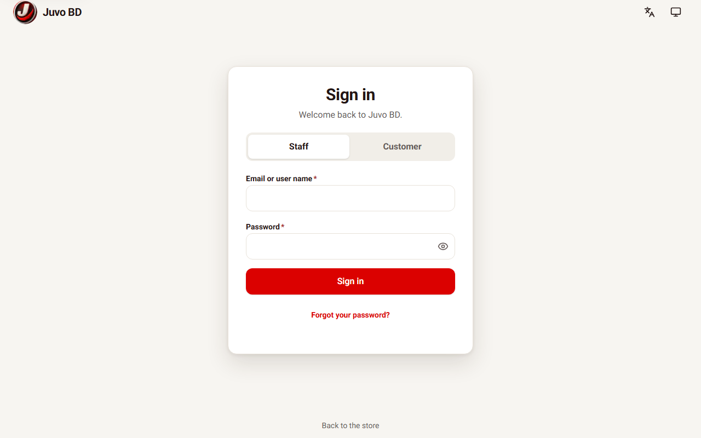

_Figure 1. The sign-in page, Staff tab_

1.  Open the sign-in page and keep the **Staff** tab selected.
2.  Type your **Email or user name** and your **Password**. Use the eye icon to show or hide the password while typing.
3.  Press **Sign in**.
4.  If two-step verification is on for your account, a second step asks for the 6-digit code from your authenticator app. If you lost your phone, choose **Use a recovery code instead** and type one of the recovery codes you saved (each works only once).
5.  After a correct sign-in you arrive at the **Dashboard**.

### 2.3.1 First sign-in and temporary passwords

When an administrator creates your account, the system makes a **temporary password**. You type it at the first sign-in and the system immediately asks you to **choose your own password** before you can do anything else. Only after that do you reach the dashboard. Super Admin accounts must also set up **two-step verification** (section 10.3) because the owner account controls everything.

<table><tbody><tr><td>
<strong>Development administrator</strong>

On a new installation the system creates one Super Admin for development: <strong>admin@juvobd.local</strong> with the password <strong>Juvo@Dev#2026</strong>. You must change this password at the first sign-in. Never use the development password on a real, public system.
</td></tr></tbody></table>

### 2.3.2 Password rules

### 2.3.3 Forgot your password

1.  On the sign-in page press **Forgot your password?**
2.  Type your email and press **Send reset link**. For safety the page always answers the same way, whether or not the email belongs to an account.
3.  Open the email and follow the link (valid for one hour), then choose a new password.
4.  Sign in with the new password. All your older sessions are ended.

### 2.3.4 Lock-out

After **5 wrong passwords or codes** the account is locked for **15 minutes** and the screen says how long to wait. An administrator can see locked accounts on **User management > Users** (a red **Locked** tag).

### 2.3.5 Session length

You stay signed in while you work. The system renews your access every few minutes in the background. If your account, role or branch assignment is changed by an administrator, the change takes effect within seconds without signing you out. If your session really ends (for example, you were signed out from the profile page), you are returned to the sign-in page and brought back to the page you were on afterwards.

## 2.4 Signing in as a customer

Customers sign in on the **Customer** tab with their **mobile number**; no password is needed. The mobile number is the customer's identity in the system; guests can also order without signing in (see chapter 13).

1.  Open **Sign in** and choose the **Customer** tab.
2.  Type the **Mobile number**, for example 01712345678 (the system also understands +8801712345678, and Bengali digits).
3.  Choose where to receive the code: **SMS** or **Email**. If you choose **Email**, type your **Email address**.
4.  Press **Send code**. A 6-digit code is sent. The page shows the number or the masked email it went to, for example 017\*\*\*\*78 or b\*\*\*@example.com.
5.  Type the code and press **Verify**. The first time a mobile number is verified, the system creates the customer's quick profile automatically (and keeps the email you used, if any).

| **Rule**  | **Value**  |
| --- | --- |
| Code length and validity  | 6 digits, valid for 5 minutes. Only the newest code works.  |
| Wrong tries  | 5 wrong tries kill the code; ask for a new one.  |
| Asking again  | You can ask for a new code after 60 seconds (the page counts down).  |
| Limit  | At most 5 codes per hour for one mobile number.  |

<table><tbody><tr><td>
<strong>Test mode: no real SMS or email is sent yet</strong>

A real SMS and email provider is connected only before the system goes live. Until then the messages go to a test sender. So that nobody waits for a message that cannot arrive, the <strong>sign-in page shows the code in a blue test-mode box</strong> while the system runs in development. In a live system this box never appears and the code is delivered only by SMS or email.
</td></tr></tbody></table>

## 2.5 Language, theme and the sign-out

# 3\. How the system is organised

## 3.1 The three faces of the platform

| **Face**  | **Who uses it**  | **What it is**  |
| --- | --- | --- |
| **Storefront**  | Visitors and customers  | The public shop: home page, categories, product pages, cart, checkout. (Being built: chapter 13.)  |
| **Customer account**  | Signed-in customers  | My orders, addresses, wishlist, profile. (Overview page exists today.)  |
| **Admin panel**  | Staff  | Everything described in chapters 4 to 10: catalog, inventory, users, roles, branches and more to come.  |

## 3.2 The access model: Permission, Role, Branch, User

Who may do what is controlled by four simple ideas. Understanding them explains why two staff members see different menus and buttons.

| **Idea**  | **Meaning**  | **Example**  |
| --- | --- | --- |
| **Permission**  | One small thing a person may do. Named module.resource.action.  | catalog.product.edit = may edit products  |
| **Role**  | A named bundle of permissions.  | **Inventory Manager** = product and stock permissions  |
| **Branch**  | A place that holds stock or takes orders: head office, shop, warehouse, online fulfilment centre.  | Head Office (HO), Online Fulfilment (ONL)  |
| **User**  | A staff account. A user gets **roles in branches**.  | Rina is **Inventory Manager** in the Dhaka shop and **Viewer** in the Chittagong shop  |

<table><tbody><tr><td>
<strong>The golden rule</strong>

<strong>A permission only counts in the branch where the person holds the role.</strong> Rina can adjust stock in the Dhaka shop but cannot touch the Chittagong shop's stock. A user marked <strong>Works in all branches</strong> (global scope) can hold a role everywhere. The <strong>Super Admin</strong> role holds every permission, including ones added in the future, and always works in all branches.
</td></tr></tbody></table>

## 3.3 Branches and the active branch

The company can run many branches from one installation. Some information is shared by all branches (the product catalog, customers, roles) and some belongs to one branch (stock, transfers, stock counts, later orders, expenses and cash). In the top bar, the **branch switcher** chooses the **active branch**; lists and numbers then follow that branch. People who work in only one branch do not see the switcher.

| **Shared by all branches**  | **Belongs to one branch**  |
| --- | --- |
| Products, variants, pictures, categories, brands, size charts  | Stock levels and the stock history (movements)  |
| Customers  | Stock transfers (between two branches) and stock counts  |
| Roles and the permission catalogue  | Later: orders, shipments, expenses, cash, support tickets  |
| Audit log (every entry records the branch)  | Reports (can be filtered by branch, or consolidated)  |

Branch isolation is enforced by the system itself, not only by hiding buttons: a person from branch A who asks for something that belongs to branch B receives a “not found” answer, and the attempt is written to the audit log.

## 3.4 Records that are never erased

# 4\. Finding your way around the admin panel

## 4.1 The screen layout

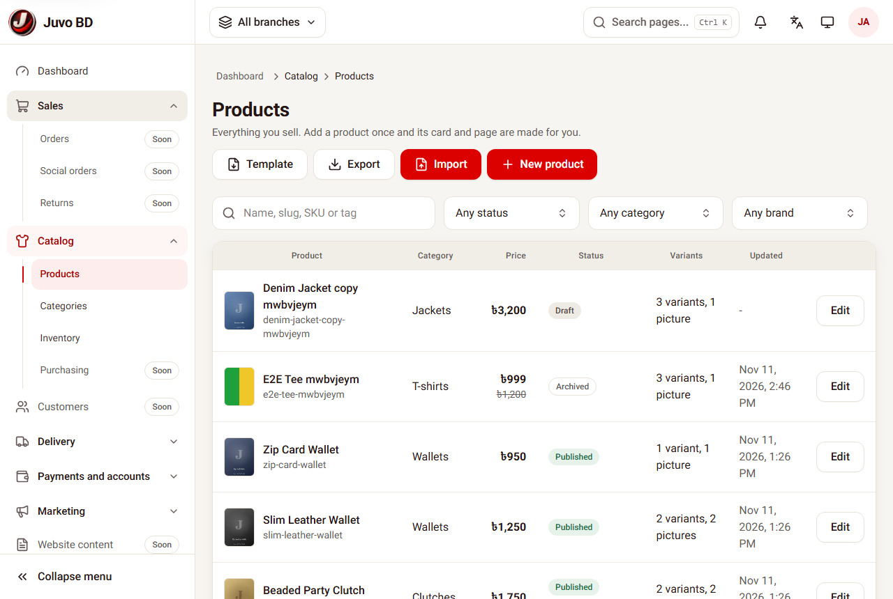

_Figure 2. The admin panel: sidebar menu on the left, top bar, page header and the Products list_

| **Part**  | **What it does**  |
| --- | --- |
| **Sidebar menu** (left)  | The menu tree. Parents (groups) open to show their pages. The page you are on is highlighted and its group is open.  |
| **Branch switcher** (top left of the bar)  | Chooses the active branch, or **All branches** where you are allowed. Hidden when you work in one branch only.  |
| **Search pages** (top bar, shortcut **Ctrl+K**)  | Type a page name, press **Enter**, and you jump there. It only offers pages you may open.  |
| **Bell**  | Notifications (new orders, low stock, delivery problems will appear here as those modules arrive).  |
| **Translate icon / theme icon**  | Language and theme (section 2.5).  |
| **Account menu** (your initials)  | **My profile and security**, language and theme on phones, **Sign out**.  |
| **Breadcrumb**  | Shows where you are, for example Dashboard > Catalog > Products. Each part except the last is a link.  |
| **Page header**  | Page title, a one-line description and the main action buttons of the page (for example **New product**).  |

## 4.2 The menu tree

The menu is a two-level tree. A **parent** (a group such as **Catalog**) has an icon and an arrow; click it to open or close its **children** (the pages). Children are indented under a thin line. The system remembers which groups you left open. A group with a single page is shown as a plain link without a child level. You only see the pages your permissions allow; a group with nothing you may open disappears.

| **Parent**  | **Children (pages)**  | **Available now**  |
| --- | --- | --- |
| **Dashboard**  | (single page)  | Yes  |
| **Sales**  | Orders, Social orders, Returns  | Soon  |
| **Catalog**  | Products, Categories, Inventory, Purchasing  | Products, Categories, Inventory (Purchasing: Soon)  |
| **Customers**  | (single page)  | Soon  |
| **Delivery**  | Delivery zones, Couriers  | Soon  |
| **Payments and accounts**  | Payments, Tax and invoices, Expenses  | Soon  |
| **Marketing**  | Promotions, Campaigns  | Soon  |
| **Website content**  | (single page)  | Soon  |
| **Reports and support**  | Reports, Support  | Soon  |
| **Settings**  | (single page)  | Soon  |
| **User management**  | Users, Roles, Branches, Audit log, Sign-in history  | Yes (all five)  |

Pages marked **Soon** are shown in grey and cannot be opened yet. They show where each future module will live.

## 4.3 The menu on every device

| **Screen**  | **What you see**  |
| --- | --- |
| **Computer (1024 px and wider)**  | Full sidebar with labels. **Collapse menu** (bottom) shrinks it to an icon rail; the choice is remembered.  |
| **Tablet (768 to 1023 px)**  | Icon rail. Pressing a parent icon opens a small list of its pages.  |
| **Phone (below 768 px)**  | A hamburger button opens the menu as a drawer (close it by tapping outside, pressing a page, or swiping). A bottom bar gives one-tap access to **Dashboard, Orders, Products, Customers** and **More**.  |

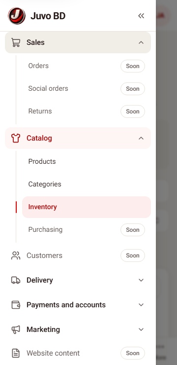

_Figure 3. The menu drawer on a phone_

## 4.4 Lists: search, filters, sorting and paging

Every list in the admin works the same way:

## 4.5 Forms, dialogs, messages

## 4.6 Keyboard and accessibility

# 5\. Dashboard

**Path:** Dashboard (first item in the menu). Every signed-in staff member can open it.

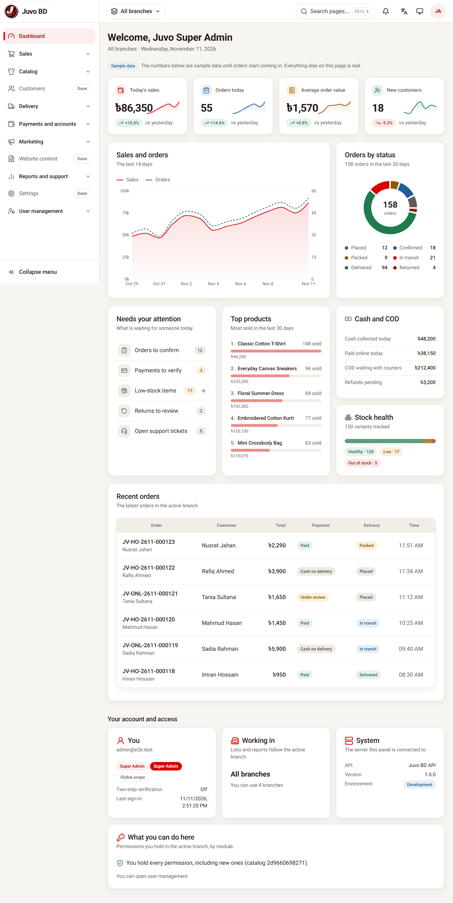

_Figure 4. The dashboard (the figures are sample data)_

<table><tbody><tr><td>
<strong>Sample data</strong>

The first part of the dashboard shows <strong>sample figures</strong> and is marked with a <strong>Sample data</strong> tag, because orders do not exist yet. Orders arrive in a later step; the same cards will then show real numbers. The cards in <strong>Your account and access</strong> at the bottom are real.
</td></tr></tbody></table>

## 5.1 Welcome line

Shows your name, the active branch (or **All branches**) and today's date.

## 5.2 Cards and charts

| **Card**  | **What it shows**  |
| --- | --- |
| **Today's sales, Orders today, Average order value, New customers**  | Four numbers with a small trend line and a green or red chip comparing with yesterday.  |
| **Sales and orders**  | A 14-day chart of sales (red line) and number of orders (blue dotted line). A text summary and a hidden data table are provided for screen readers.  |
| **Orders by status**  | A ring chart with the number of orders Placed, Confirmed, Packed, In transit, Delivered and Returned in the last 30 days.  |
| **Needs your attention**  | Counts of work waiting: orders to confirm, payments to verify, low-stock items, returns to review, open support tickets. Rows that lead to a screen that exists (for example low stock) are links.  |
| **Top products**  | The best sellers of the last 30 days with a small bar.  |
| **Cash and COD**  | Cash collected today, paid online today, cash on delivery waiting with couriers, refunds pending.  |
| **Stock health**  | How many variants are healthy, low or out of stock.  |
| **Recent orders**  | A table of the latest orders: order number, customer, total, payment status, delivery status and time.  |

## 5.3 Your account and access (real data)

| **Card**  | **What it shows**  |
| --- | --- |
| **You**  | Your email, your roles, Super Admin and global-scope tags, whether two-step verification is on and your last sign-in.  |
| **Working in**  | The active branch and how many branches you can use.  |
| **System**  | The server this panel is connected to: name, version and environment (Development or Production).  |
| **What you can do here**  | The permissions you hold in the active branch, grouped by module, or the statement that you hold every permission.  |

# 6\. Products

**Path:** Catalog > Products (/admin/products). **Permission to see:** catalog.product.view. A **product** is one item for sale (for example “Classic Cotton T-Shirt”). Each product has one or more **variants** (colour and size combinations, each with its own SKU and stock), **pictures**, a price and descriptive texts. The system builds the customer-facing product card and page from this data, so nobody has to design a banner per product.

## 6.1 The product list

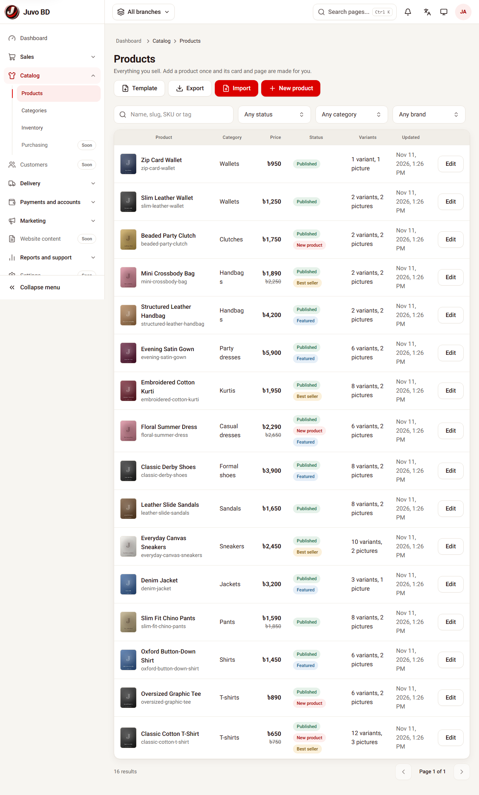

_Figure 5. Catalog > Products_

### Buttons in the page header

| **Button**  | **What it does**  | **Needs permission**  |
| --- | --- | --- |
| **Template**  | A menu: **CSV template** or **Excel template**. Downloads the import file with the right columns and example rows (see 6.10).  | catalog.product.import  |
| **Export**  | A menu: **Export as CSV** or **Export as Excel**. Downloads all products and variants (see 6.10).  | catalog.product.export  |
| **Import**  | Opens the bulk import (see 6.10).  | catalog.product.import  |
| **New product**  | Opens the empty product form (see 6.2).  | catalog.product.create  |

### Search, filters and columns

### Product statuses

| **Status**  | **Meaning**  | **Visible to customers**  |
| --- | --- | --- |
| **Draft**  | Being prepared. New products start here.  | No  |
| **Published**  | Live in the shop. Needs the items in section 6.7.  | Yes  |
| **Archived**  | Taken out of sale and locked: it cannot be edited any more, but orders and stock history are kept.  | No  |

## 6.2 Creating a product

1.  Press **New product**. Fill in at least the **Name (English)**, a **Category** and the **Regular price** (details in 6.3).
2.  Watch the **Storefront preview** on the right: the card updates as you type.
3.  Press **Create product** (bottom bar). The system creates the draft and moves you to the **Variants and stock** tab.
4.  Add the variants (6.4), set the stock (6.5) and upload pictures (6.6).
5.  When the checklist on the right says **Everything needed is in place**, press **Publish** (6.7).

<table><tbody><tr><td>
<strong>Faster alternatives</strong>

To make many products at once use the <strong>bulk import</strong> (6.10). To make a similar product, open an existing one and press <strong>Duplicate</strong>.
</td></tr></tbody></table>

## 6.3 The Details tab

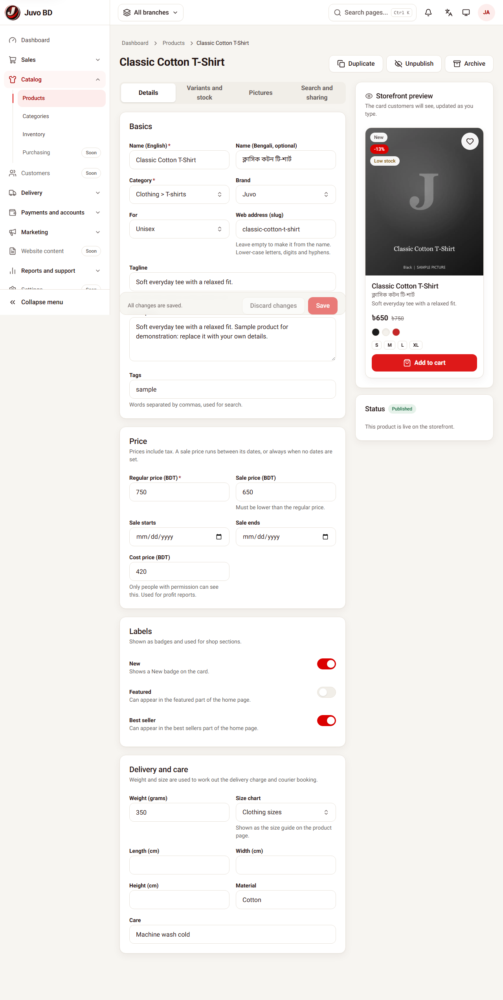

_Figure 6. The product editor, Details tab, with the live storefront card on the right_

### Basics

| **Field**  | **What to enter**  | **Rule**  |
| --- | --- | --- |
| **Name (English)** \*  | The product name.  | Required, up to 200 characters.  |
| **Name (Bengali, optional)**  | The Bengali name, shown under the English one.  | Up to 200 characters.  |
| **Category** \*  | Pick from the category tree, for example **Clothing > T-shirts**.  | Required.  |
| **Brand**  | Pick a brand or **No brand**.  | Brands are managed in 7.2.  |
| **For**  | Unisex, Women, Men or Kids.  |  |
| **Web address (slug)**  | The product's address on the shop, for example classic-cotton-t-shirt. Leave empty to make it from the name.  | Lower-case letters, digits and single hyphens; unique across the shop.  |
| **Tagline**  | One short line shown on the product card.  | Up to 500 characters.  |
| **Description**  | The full text for the product page.  | Up to 8,000 characters.  |
| **Tags**  | Words separated by commas, used for search.  | Up to 500 characters.  |

### Price

| **Field**  | **What to enter**  | **Rule**  |
| --- | --- | --- |
| **Regular price (BDT)** \*  | The normal selling price, tax included.  | Required, 0 or more, at most two decimals.  |
| **Sale price (BDT)**  | A reduced price.  | Must be **lower** than the regular price.  |
| **Sale starts / Sale ends**  | The first and last day of the sale. Without dates the sale price applies all the time.  | The end cannot be before the start. Dates are Bangladesh days: a sale ends at the end of its last day.  |
| **Cost price (BDT)**  | What the item costs you; used for profit reports.  | **Only visible to people with \`catalog.product.view-cost\`.** Others neither see nor change it.  |

The preview shows the discount automatically (for example **\-17%** and the old price crossed out) when a valid sale is running.

### Labels, delivery and care

### The save bar

The bar at the bottom shows **You have unsaved changes** or **All changes are saved**. **Save** stores the form; **Discard changes** returns to the last saved version. If a field is wrong, the page jumps to the Details tab and marks it in red.

## 6.4 The Variants and stock tab: variants

_Figure 7. Variants and stock tab on a phone_

A **variant** is one sellable combination, usually a colour and a size. Customers choose a colour swatch and a size chip; stock is counted per variant.

### Variant fields

| **Field**  | **Meaning**  | **Rule**  |
| --- | --- | --- |
| **SKU** \*  | The variant's stock code, for example JV-TSH-BLA-M.  | Letters, digits, hyphen, underscore or dot, up to 60. **Unique in the whole shop** (not case-sensitive). A removed variant frees its SKU.  |
| **Colour** and **Swatch colour**  | The colour name and a colour square (pick or type #1C0807).  | Swatch is optional.  |
| **Size**  | For example S, M, L, XL, 40, Free size.  |  |
| **Price**  | A price for this variant only.  | Empty = the product price.  |
| **Barcode**, **Weight (grams)**  | Optional.  |  |
| **Active**  | Inactive variants are not sold.  | A published product needs at least one active variant.  |

### Adding variants

1.  Press **Add variant**, fill the dialog and press **Add variant**; or
2.  Press **Generate variants** to make every colour and size pair at once: type a **SKU start** (for example JV-TEE), the **Colours** (Black, White, Red) and the **Sizes** (S, M, L, XL). The dialog says how many variants will be made and shows the first SKUs (for example JV-TEE-BLA-S). Common colour names get their swatch automatically. Pairs that already exist are skipped.
3.  To change a variant press the pencil; to remove it press the bin and confirm. A variant that still has stock cannot be removed (move or write off the stock first).

## 6.5 The Variants and stock tab: stock by branch

Below the variants, **Stock by branch** lists every variant against every branch you may view. For each branch you may adjust, the number is an editable box.

1.  Type the quantity you actually have in the box of that variant and branch. The footer says how many changes are waiting.
2.  Press **Save stock**. The system works out the difference and books it in the stock history: **Opening stock** for the first quantity, **Correction** afterwards.

## 6.6 The Pictures tab

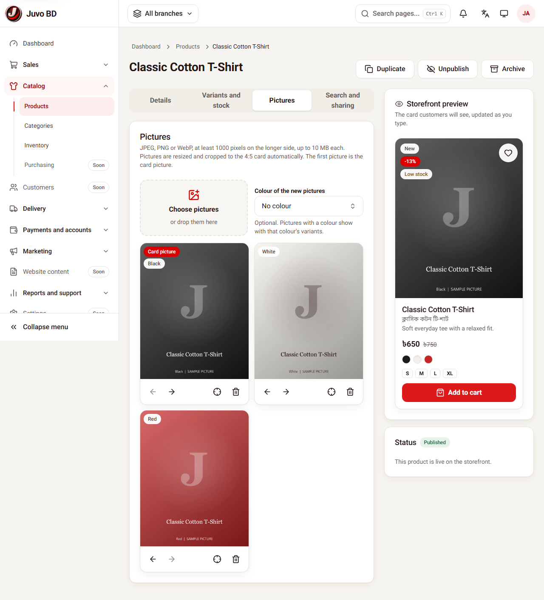

_Figure 8. The Pictures tab_

### Picture rules

| **Rule**  | **Value**  |
| --- | --- |
| File types  | JPEG, PNG or WebP  |
| Size  | At least **1000 pixels** on the longer side; at most **10 MB** per file; at most **12** pictures per product  |
| Checking  | The page checks type, size and pixels before sending and again on the server. A refused file shows the reason next to its name.  |
| What the system makes  | Automatically resized copies (large, card 4:5 and thumbnail), converted to the efficient WebP format, with a blurred placeholder for fast loading  |

### Uploading and ordering

1.  Press **Choose pictures** or drag files onto the box. You can choose several at once.
2.  Optionally set **Colour of the new pictures** first: pictures with a colour belong to that colour's variants.
3.  Wait for each file to show **uploaded**. The pictures appear below; the **first one is the card picture** (tagged **Card picture**).
4.  Change the order by **dragging** a picture or with the arrow buttons (**Move picture N earlier / later**).
5.  Press the cross-hair button to edit a picture (below) or the bin to delete it (the picture and its resized copies are removed).

### Editing a picture: the focal point

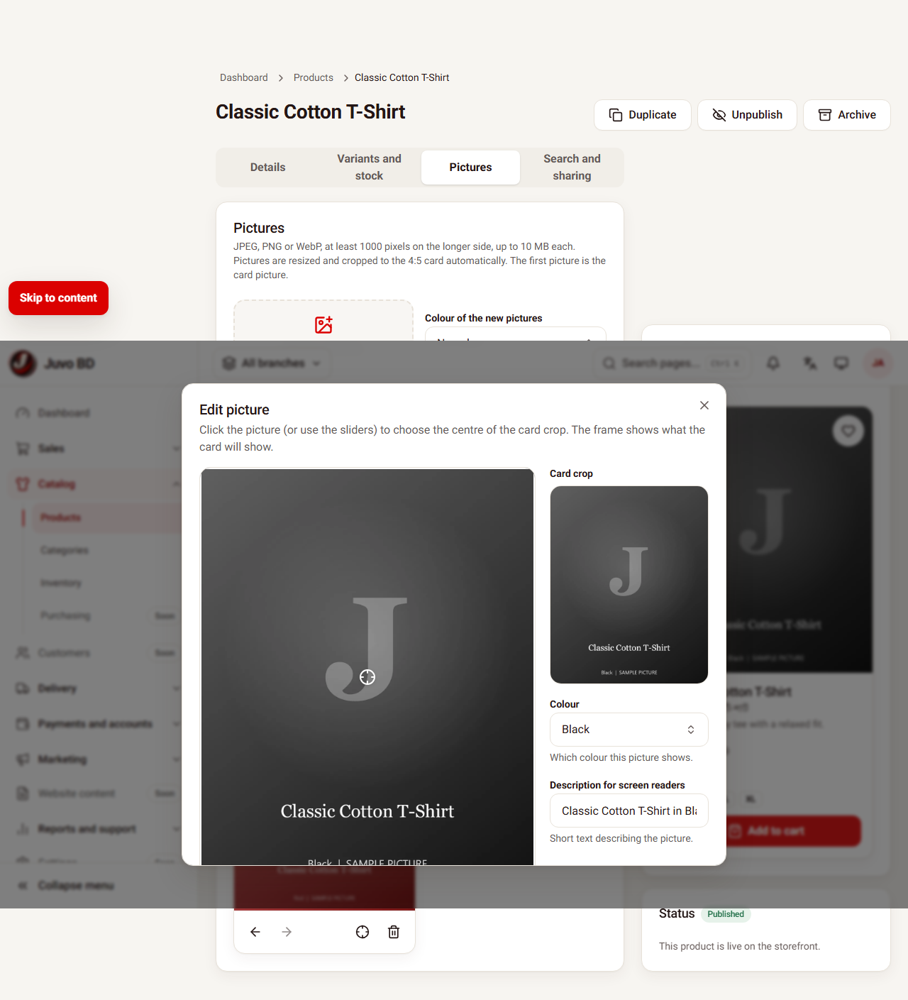

_Figure 9. Edit picture: choose the centre of the card crop_

The customer card is always 4:5 (portrait). If your photo has another shape, the system crops it. Click on the picture (or move the **Left to right** and **Top to bottom** sliders) to choose the **centre of the crop**; the frame shows what the card will show and **Card crop** shows the result. You can also set the picture's **Colour** and a **Description for screen readers** (alternative text).

## 6.7 Publishing, unpublishing, archiving, duplicating, deleting

The buttons at the top of the editor depend on the product's status and your permissions. The card **Status** on the right shows the status and, for a draft, the checklist.

| **Button**  | **When**  | **What happens**  | **Permission**  |
| --- | --- | --- | --- |
| **Publish**  | Draft, checklist complete, no unsaved changes  | The product goes live in the shop.  | catalog.product.publish  |
| **Unpublish**  | Published  | Back to draft; hidden from customers.  | catalog.product.publish  |
| **Archive**  | Draft or Published  | After confirmation the product is archived and locked.  | catalog.product.archive  |
| **Duplicate**  | Always  | Asks for a name and makes a **draft copy** with the variants (new SKUs) and the pictures.  | catalog.product.duplicate  |
| **Delete**  | Draft only  | After confirmation the draft and its variants disappear from the lists (history is kept).  | catalog.product.archive  |

<table><tbody><tr><td>
<strong>The publish checklist (business rule BR-B1 to BR-B3)</strong>

A product can be published only if it has: a <strong>name</strong>, a <strong>category</strong>, a <strong>price</strong>, <strong>at least one picture</strong>, and <strong>at least one active variant</strong>. The checklist on the right lists what is still missing.

The sale price must be lower than the regular price. Every SKU is unique across the system.
</td></tr></tbody></table>

## 6.8 The Search and sharing tab

| **Field**  | **Meaning**  | **Limit**  |
| --- | --- | --- |
| **Page title**  | How the product appears in search results and when shared. Empty = the name.  | 120 characters  |
| **Page description**  | The description text for search results and sharing. Empty = the tagline.  | 320 characters  |
| **Video link (optional)**  | A link to a short video, for example on YouTube.  | Must start with http:// or https://  |

## 6.9 The storefront preview card

The card on the right of the editor is exactly the card customers will see in the shop, built from your unsaved form, your saved pictures, variants and stock. It shows:

## 6.10 Bulk import and export

Use this to enter many products, update prices or stock levels in a spreadsheet, or take a copy of the catalog.

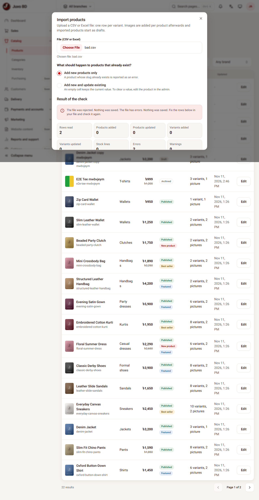

_Figure 10. The import check report_

### The file

| **Column**  | **Meaning**  |
| --- | --- |
| slug, name\_en\*, name\_bn  | Web address, English name (required), Bengali name  |
| category\*  | A category name, slug or path such as Clothing > T-shirts (must exist)  |
| brand  | A brand name; a missing brand is created (shown as a warning)  |
| short\_description, description, material, care, tags  | Texts  |
| target\_group  | Unisex, Women, Men or Kids  |
| weight\_g, length\_cm, width\_cm, height\_cm  | Delivery details  |
| regular\_price\*, sale\_price, sale\_start, sale\_end, cost\_price  | Prices and the sale days (yyyy-mm-dd). Cost is ignored for people without the cost permission.  |
| is\_new, is\_featured, is\_best\_seller  | yes / no  |
| size\_chart, meta\_title, meta\_description  | Size chart name (must exist) and search texts  |
| sku, color\_name, color\_hex, size, price\_override, barcode, variant\_weight\_g  | The variant on this row  |
| opening\_stock, branch\_code  | Starting stock for this variant in a branch (the active branch is used if the code is empty)  |
| status, on\_hand, reserved  | Written by the export for information; ignored on import  |

### Importing: check first, then import

1.  Press **Import**, choose the file and answer “What should happen to products that already exist?”: **Add new products only** (a product whose slug exists is reported as an error) or **Add new and update existing** (**a blank cell keeps the current value**).
2.  Press **Check the file (nothing is saved)**. The report shows the counts (products and variants to create or update, stock lines, errors, warnings) and a table with **Row**, **Column**, **Severity** and **Message** for each problem.
3.  Fix the file and check again until there are no errors. A file with **any error saves nothing** (all or nothing).
4.  Press **Import now**. The report then confirms what was saved.

<table><tbody><tr><td>
<strong>Opening stock is safe</strong>

Opening stock fills an empty history only. A variant that already has stock movements in that branch keeps its numbers and the row shows a warning. You need the stock permission in that branch to set stock by import.
</td></tr></tbody></table>

### Exporting

**Export** downloads the catalog in the same columns, so you can edit and import it back. The cost column only appears for people allowed to see cost. Text that a spreadsheet could mistake for a formula is protected with a leading apostrophe, and the importer removes it again.

## 6.11 Sample products

A new development installation contains **16 sample products** tagged sample with generated picture placeholders (labelled “SAMPLE PICTURE”) and stock in the Head Office and Online Fulfilment branches. They exist so that every screen has something to show. Delete or archive them, or import your own catalog; the samples are never added again once a real product exists.

# 7\. Categories, brands and size charts

**Path:** Catalog > Categories (/admin/categories). **Permission to see:** catalog.category.view. The page has three tabs: **Categories**, **Brands** and **Size charts**; a tab only appears if you may view its list. The chosen tab is kept in the address, so you can bookmark it.

## 7.1 Categories

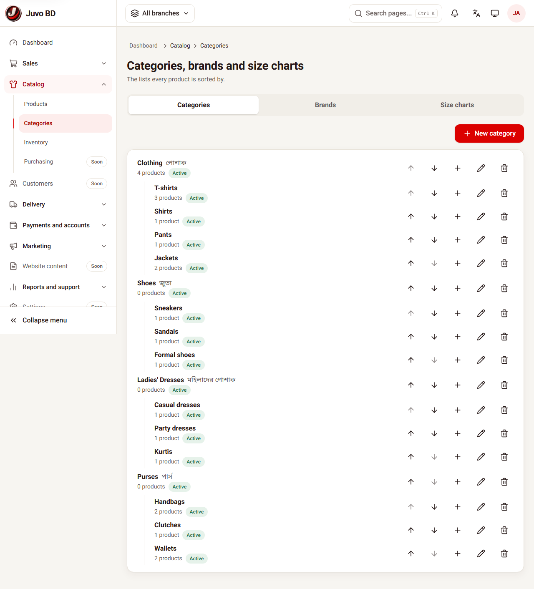

_Figure 11. Categories: the tree_

Categories form a tree: for example **Clothing** contains **T-shirts**, **Shirts**, **Pants** and **Jackets**. Each row shows the name, the number of products and an **Active/Inactive** tag.

| **Action**  | **How**  | **Permission / rule**  |
| --- | --- | --- |
| **Add a category**  | Press **New category** (top level) or **Add sub-category** on a row. Enter **Name (English)**, **Name (Bengali)**, optional **Slug**, **Sort order** and the **Active** switch.  | catalog.category.create  |
| **Edit / move**  | Press the pencil. You can choose another **Parent**; the list never offers the category itself or its descendants (a category cannot move under itself).  | catalog.category.edit  |
| **Reorder**  | Use the **Move up** and **Move down** arrows on a row to move it among its siblings.  | catalog.category.edit  |
| **Delete**  | Press the bin and confirm.  | catalog.category.delete. **Only empty categories** (no products and no sub-categories) can be deleted.  |

<table><tbody><tr><td>
<strong>Default categories</strong>

A new installation contains <strong>Clothing</strong> (T-shirts, Shirts, Pants, Jackets), <strong>Shoes</strong> (Sneakers, Sandals, Formal shoes), <strong>Ladies' Dresses</strong> (Casual dresses, Party dresses, Kurtis) and <strong>Purses</strong> (Handbags, Clutches, Wallets). Edit them as you wish.
</td></tr></tbody></table>

## 7.2 Brands

## 7.3 Size charts

A size chart is a small table (for example Size, Chest in inches, Length in inches) shown to customers as the size guide. The page lists the charts with their category and the table's size.

# 8\. Inventory

**Path:** Catalog > Inventory (/admin/inventory). **Permission to see:** inventory.stock.view. Inventory answers three questions for every variant and every branch: how many are on the shelf (**on hand**), how many are promised to orders (**reserved**) and how many can still be sold (**available = on hand − reserved**). Four tabs at the top: **Stock**, **Movements**, **Transfers**, **Stock counts**; a tab appears only if you may view it.

<table><tbody><tr><td>
<strong>The three rules of stock</strong>

<strong>Stock is kept per variant and per branch.</strong> A person sees and changes only the branches where they hold the permission.

<strong>Stock can never be negative, and reserved units can never be taken away.</strong> The database itself refuses it.

<strong>Every change is written to the stock history (movements) with who, when, why, and the number after the change. It can never be edited or deleted.</strong> The number on the shelf is always explained by the history.
</td></tr></tbody></table>

## 8.1 Stock

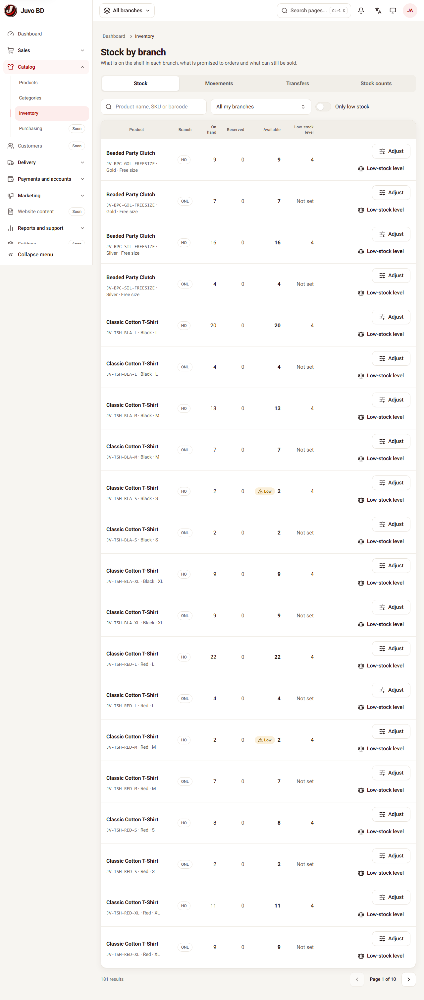

_Figure 12. Inventory > Stock_

| **Column**  | **Meaning**  |
| --- | --- |
| **Product**  | Product name, then SKU, colour and size  |
| **Branch**  | The branch code  |
| **On hand / Reserved / Available**  | The three numbers described above (available is bold)  |
| **Low-stock level**  | The alert threshold for this variant in this branch, or **Not set**. When available stock is at or below it, a **Low** tag appears.  |

Search by product name, SKU or barcode; choose one branch or **All my branches**; switch on **Only low stock** to see what needs re-ordering. Each row has two buttons.

### Adjusting stock

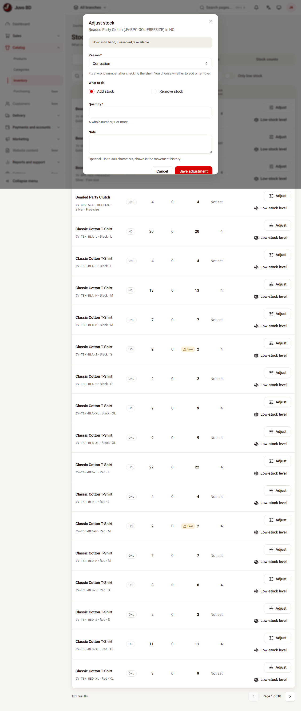

_Figure 13. Adjust stock dialog_

1.  Press **Adjust** on the row (permission inventory.stock.adjust in that branch).
2.  Choose the **Reason** and type the **Quantity**. The dialog shows “On hand will become N” before you save. Add a **Note** if useful.
3.  Press **Save adjustment**. The change appears in the history.

| **Reason**  | **Direction**  | **Use it when**  |
| --- | --- | --- |
| **Opening stock**  | Adds  | Entering the first quantity of a new item.  |
| **Correction**  | Adds or removes  | The system number is wrong (count mistake).  |
| **Damaged**  | Removes  | Goods are damaged and leave the shelf.  |
| **Lost**  | Removes  | Goods are missing or stolen.  |
| **Found**  | Adds  | Goods turned up that were not counted.  |
| **Customer return**  | Adds  | A returned item goes back on the shelf.  |

<table><tbody><tr><td>
<strong>You cannot remove what is reserved</strong>

If you try to remove more than is <strong>available</strong>, the system refuses and says how many can be removed (for example “Only 7 can be removed”). Reserved units belong to open orders.
</td></tr></tbody></table>

### Setting the low-stock level

Press **Low-stock level** (needs inventory.reorder.edit), type the number (0 = no alert) and press **Save level**. The dashboard and the product card use it to show **Low stock**.

## 8.2 Movements: the stock history

**Inventory > Movements** lists every change, newest first: **Date**, **Branch**, **Product / SKU**, **Change** (+ added or − removed), **On hand after**, **Reason**, **Note**, **Reference** (a link to the transfer or count that caused it) and **By** (who). Filter by branch, reason and date range.

| **Reason shown**  | **Created by**  |
| --- | --- |
| Opening stock, Correction, Damaged, Lost, Found, Customer return  | A person adjusting stock (8.1) or the product screen / import  |
| Transfer out, Transfer in, Transfer cancelled  | A stock transfer (8.3)  |
| Stock count  | An approved stock count (8.4)  |

## 8.3 Transfers between branches

A transfer moves stock from one branch (the **source**) to another (the **destination**). A transfer belongs to two branches, so you see it when you may view transfers in either of them.

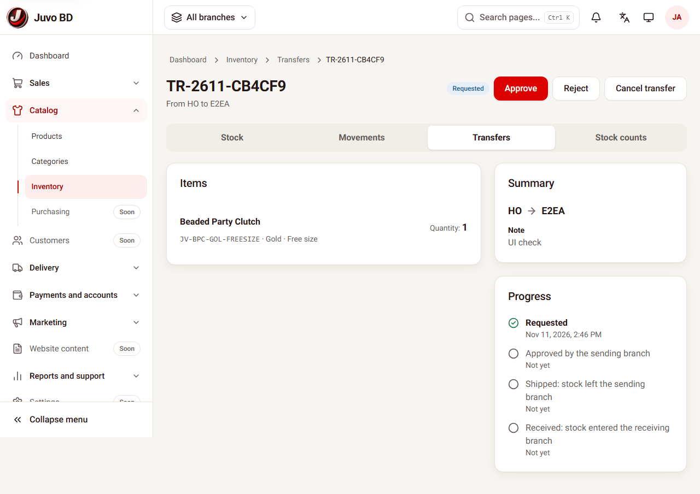

_Figure 14. A transfer with its lines, timeline and actions_

### The workflow

| **Step**  | **Who (where)**  | **Permission**  | **What happens to stock**  |
| --- | --- | --- | --- |
| **Requested**  | Either branch  | inventory.transfer.request  | Nothing yet. The transfer gets a number such as TR-2611-A3F9C2.  |
| **Approved** (or **Rejected** with a reason)  | The source branch  | inventory.transfer.approve  | Nothing yet. The system checks that the stock is there.  |
| **In transit** (Ship)  | The source branch  | inventory.transfer.approve  | Stock **leaves the source** now (movement \*Transfer out\*). The system checks the stock again.  |
| **Received**  | The destination branch  | inventory.transfer.receive  | Stock **enters the destination** (movement \*Transfer in\*).  |
| **Cancelled**  | Either branch before shipping; only the source once in transit  | inventory.transfer.cancel  | If already in transit, the goods are **put back into the source** (\*Transfer cancelled\*).  |

1.  Open **Inventory > Transfers** and press **New transfer**. Choose **From** and **To** branches, add the products and quantities (the picker shows what is available in the sending branch) and an optional note. Press the request button.
2.  The transfer page shows a **timeline** and only the buttons you may use now (**Approve**, **Reject**, **Ship**, **Receive**, **Cancel**).
3.  Ship and cancel ask for a confirmation; reject and cancel ask for a reason.

A step cannot be skipped or repeated: for example **Receive** before **Ship** is refused with “the transfer is not in a state that allows this step”. Receipts are complete only (the whole quantity).

## 8.4 Stock counts (stocktake)

A stock count checks the real stock against the system's numbers and books the differences.

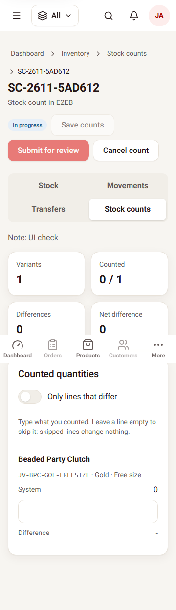

_Figure 15. A stock count on a phone: counted quantities and differences_

1.  Open **Inventory > Stock counts** and press **Start a count**. Choose the **branch** (the one you work in), an optional note and optionally specific variants (otherwise all stocked variants of the branch). Only **one open count per branch** is allowed.
2.  The system **takes a snapshot** of the expected quantity of every line.
3.  On the count page type the **counted quantity** of each variant (leave a line empty to skip it). The **Difference** (counted − expected) updates immediately and a summary counts the differences.
4.  Press **Save**, then **Submit** for review (at least one counted line is needed).
5.  A person with inventory.count.approve presses **Approve**: the differences of counted lines become stock movements (reason \*Stock count\*). Uncounted lines change nothing. Or **Reopen** (send back for more counting). **Cancel** drops the count; nothing is booked.

<table><tbody><tr><td>
<strong>Sales during the count are safe</strong>

The difference is applied to the <strong>current</strong> on-hand quantity (counted minus the snapshot), so items sold while you were counting are not overwritten. If a correction would drop below the units reserved for orders, approval is refused with an explanation.
</td></tr></tbody></table>

## 8.5 Where inventory touches other screens

| **Screen**  | **Connection**  |
| --- | --- |
| Products > Variants and stock  | The same stock numbers; setting a quantity there books a movement.  |
| Products > preview card  | **Low stock** and **Sold out** badges and crossed-out sizes come from available stock.  |
| Dashboard > Needs your attention and Stock health  | Low-stock counts (sample figures today; real once orders arrive).  |
| Products > Import  | **Opening stock** columns create \*Opening stock\* movements.  |
| Orders  | An order reserves stock when placed, takes it off the shelf at packing and releases it on cancellation or when an unpaid online order times out. A return puts good items back on the shelf.  |

# 9\. User management

**Group:** User management (last group of the menu). It has five pages: **Users**, **Roles**, **Branches**, **Audit log** and **Sign-in history**. This is where the owner decides who works in which branch and what each person may do. Typical order for a new company: **Branches** first, then **Roles**, then **Users** (section 11.4, journey A).

| **Page**  | **Path**  | **Permission to open**  | **Purpose**  |
| --- | --- | --- | --- |
| Users  | /admin/ums/users  | ums.user.view  | Staff accounts, their roles and branches  |
| Roles  | /admin/ums/roles  | ums.role.view  | Bundles of permissions  |
| Branches  | /admin/ums/branches  | ums.branch.view  | Shops, warehouses, online fulfilment  |
| Audit log  | /admin/ums/audit  | ums.audit.view  | Who changed what and when  |
| Sign-in history  | /admin/ums/sign-ins  | ums.sign-in.view  | Every sign-in attempt  |

## 9.1 Users

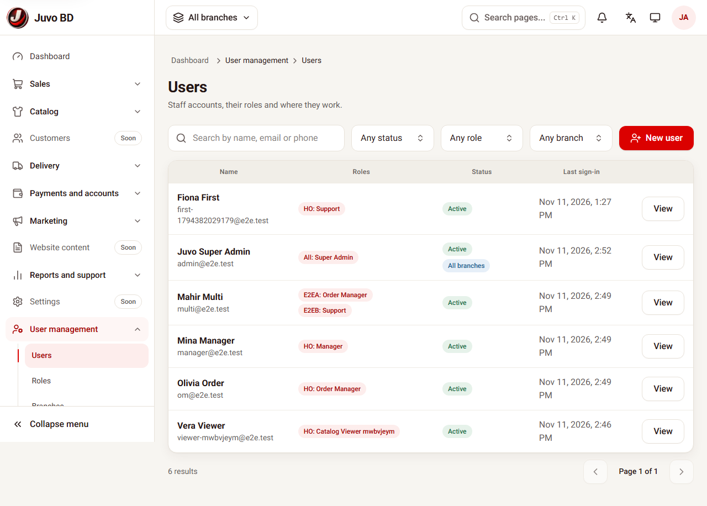

_Figure 16. User management > Users_

### The list

### Creating a user (\*\*New user\*\*, permission \`ums.user.create\`)

| **Field**  | **What to enter**  |
| --- | --- |
| **Full name** \*, **Email** \*  | The person's name and the email they will sign in with.  |
| **User name**  | Optional. The email is used when empty.  |
| **Mobile number**  | Optional contact number.  |
| **Password**  | Optional. Leave empty and the system makes a strong **temporary password**.  |
| **Works in all branches**  | Global scope. Global users can hold a role everywhere. Others work only in the branches given below.  |
| **Branches and roles**  | Add one or more pairs: a branch (or **Everywhere** for global users) and a role. They can also be added later.  |

1.  Press **New user**, fill the dialog and press **Create user**.
2.  A screen shows **“{name} is ready”** and the **temporary password once**. Copy it and give it to the person. They will be asked to change it at their first sign-in.

<table><tbody><tr><td>
<strong>The temporary password is shown only once</strong>

It is never stored in a readable form. If it is lost, use <strong>Set a new temporary password</strong> (below).
</td></tr></tbody></table>

### A user's page

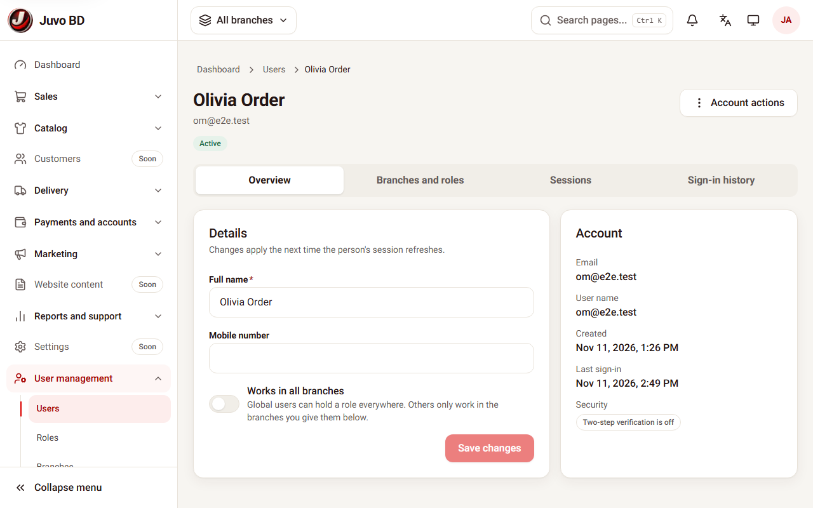

_Figure 17. A user's page: Overview tab_

A user's page has four tabs: **Overview**, **Branches and roles**, **Sessions** and **Sign-in history**, and an **Account actions** menu.

| **Tab**  | **What it contains**  |
| --- | --- |
| **Overview**  | **Details** (full name, mobile; **Save changes**), **Account** (email, user name, when created, last sign-in) and **Security** (two-step verification on or off, whether a password change is required).  |
| **Branches and roles**  | The list of roles per branch with **Give a role in a branch** (add) and **Remove** (confirmed; takes effect within seconds without signing the person out). Below, **What this person can do** lists all permissions branch by branch (choose a branch, search permissions).  |
| **Sessions**  | Active devices: **Device**, **IP address**, **Started**, **Expires** and **Sign out** per device.  |
| **Sign-in history**  | Recent sign-in attempts of this person (success or failure, IP, device).  |

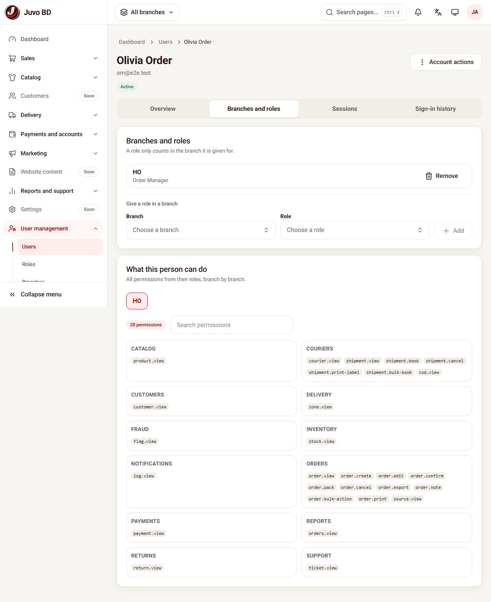

_Figure 18. Branches and roles, with the effective permissions_

### Account actions

| **Action**  | **Effect**  | **Permission**  |
| --- | --- | --- |
| **Deactivate account** / **Activate account**  | The person is signed out at once and cannot sign in; history is kept. Activate reverses it.  | ums.user.deactivate / ums.user.activate  |
| **Set a new temporary password**  | Signs the person out everywhere; the new temporary password is shown once.  | ums.user.reset-password  |
| **Sign out everywhere**  | Ends every session of the person now.  | ums.user.force-logout  |
| **Reset two-step verification**  | Use when the person lost their authenticator app; they set it up again after signing in.  | ums.user.manage-two-factor  |

<table><tbody><tr><td>
<strong>Safety rules the system enforces</strong>

<strong>No privilege escalation</strong>: you can only give roles whose permissions you hold yourself, and only a Super Admin can give or manage Super Admin.

<strong>The last active Super Admin</strong> cannot be deactivated or unassigned. You cannot deactivate yourself.

A branch administrator manages only people who work entirely in branches where they hold the permission.
</td></tr></tbody></table>

## 9.2 Roles and permissions

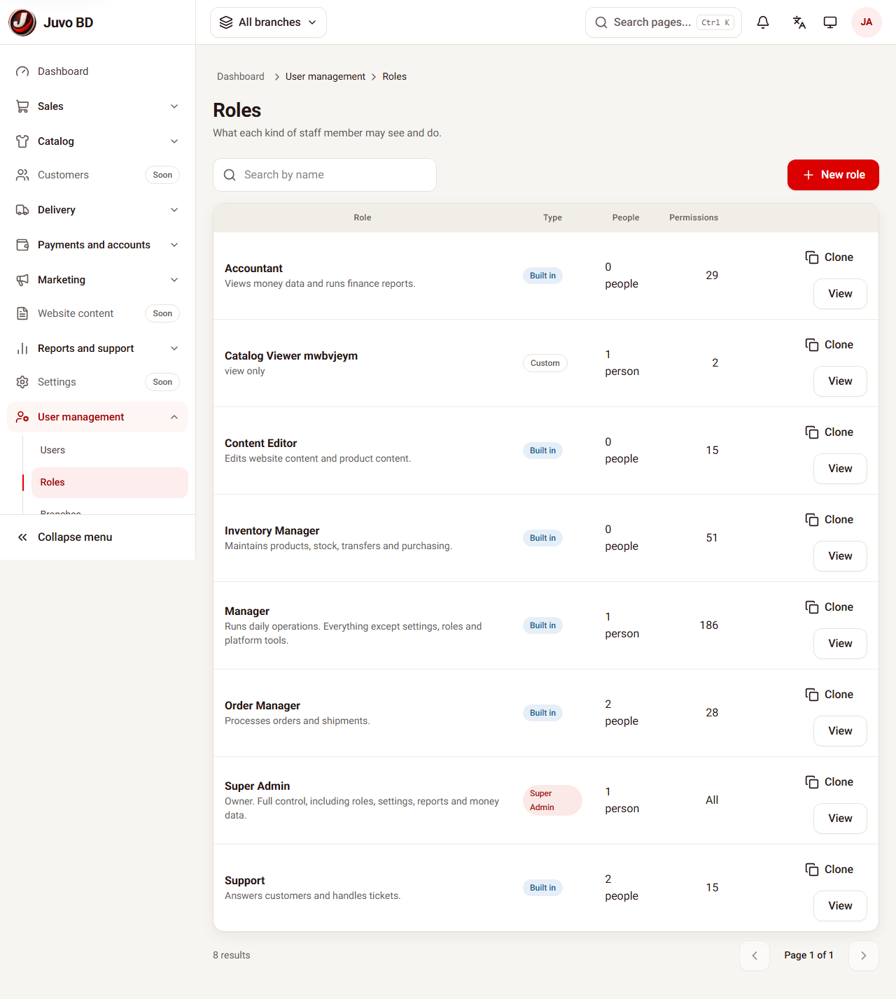

_Figure 19. User management > Roles_

A role is a named set of permissions. The list shows **Role**, **Type** (**Super Admin**, **Built in** or **Custom**), **People** (how many hold it), **Permissions** (how many) and the buttons **View**, **Clone** and **Delete**.

| **Role type**  | **Rules**  |
| --- | --- |
| **Super Admin**  | Always holds every permission, including future ones. Cannot be changed or deleted.  |
| **Built in** (Manager, Order Manager, Inventory Manager, Content Editor, Support, Accountant)  | Cannot be deleted or renamed, but their permissions may be adjusted. Defaults are in section 12.2.  |
| **Custom**  | Roles you create. Can be edited, cloned and deleted (not while people still hold them).  |

### Creating or editing a role

_Figure 20. The permission matrix_

1.  Press **New role** (ums.role.create), or open a role and use its page (ums.role.edit, ums.role.assign-permissions).
2.  Type the **Name** and a **Description**.
3.  In the **permission matrix**, permissions are grouped by **module** (Orders, Catalog, Inventory, Users and so on). Open a module with its arrow (**Expand all / Collapse all** for everything), tick single permissions, or tick the box of a whole module or resource (**Select every permission in ...**). Use **Search permissions** to find one. The counter shows “N of M selected”.
4.  Press **Create role** or **Save changes**. Changes reach people holding the role within seconds.

<table><tbody><tr><td>
<strong>You can only give what you hold</strong>

Permissions you do not hold yourself appear greyed out and cannot be ticked: nobody can create a role more powerful than themselves.
</td></tr></tbody></table>

**Clone** makes a copy with the same permissions under a new name (a quick way to make a small variation). **Delete** needs confirmation and is refused while people hold the role.

## 9.3 Branches

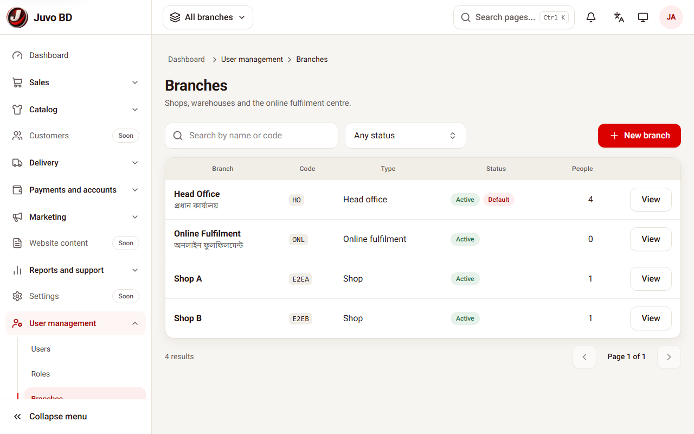

_Figure 21. User management > Branches_

The list shows **Branch**, **Code**, **Type**, **Status** and **People**. Types: **Head office**, **Shop**, **Warehouse**, **Online fulfilment**. A new installation has **Head Office (HO)**, the default, and **Online Fulfilment (ONL)**, so a single-branch business works with no extra set-up.

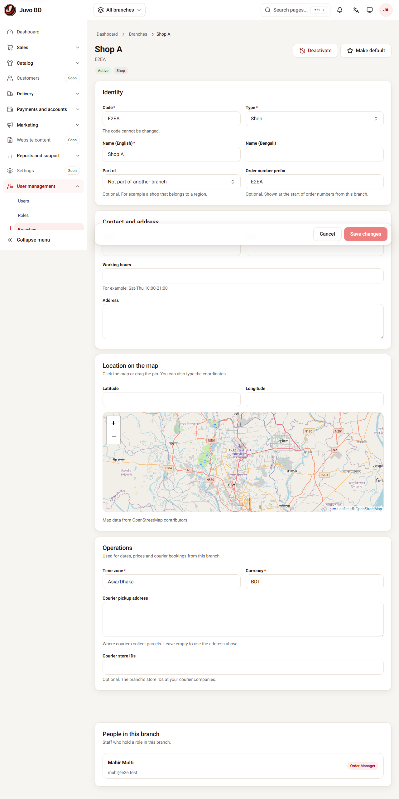

_Figure 22. A branch: identity, address, map and operations_

| **Section**  | **Fields**  |
| --- | --- |
| **Identity**  | **Code** (2 to 20 letters, digits or hyphen, unique, for example DHK-01; it cannot be changed later), **Type**, **Name (English)**, **Name (Bengali)**, **Part of** (parent branch).  |
| **Contact and address**  | **Phone**, **Email**, **Address**.  |
| **Location on the map**  | Click the map to drop a pin (**Latitude**, **Longitude**); used later for choosing the nearest branch for an order.  |
| **Operations**  | **Working hours**, **Time zone**, **Currency**, **Order number prefix** (up to 10 characters, used in order and invoice numbers such as JV-DHK01-2611-000123), **Courier pickup address**, **Courier store IDs**.  |

## 9.4 Audit log

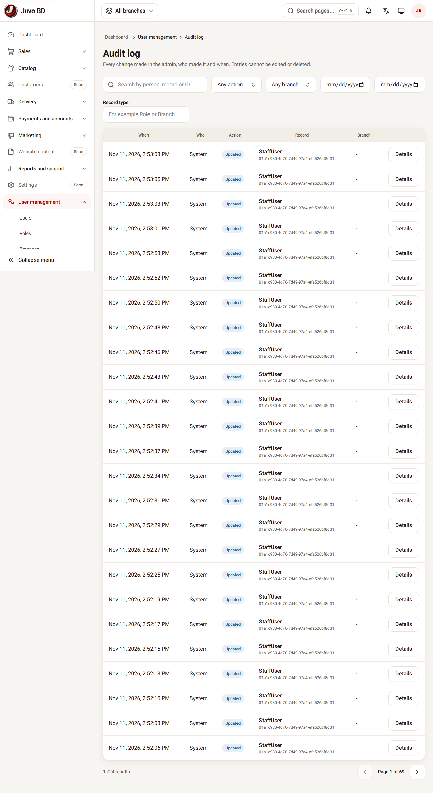

_Figure 23. User management > Audit log_

Every change made in the admin is written here, with who made it, when, in which branch and the old and new values. **Entries cannot be edited or deleted.**

## 9.5 Sign-in history

Lists every sign-in attempt of **staff and customers**, successful or not: **When**, **Account**, **Result** (**Signed in** or **Failed**), **IP address** and **Device**. Search by email or mobile; filter staff or customers. Use it to spot guessing attempts or to confirm when someone last signed in.

# 10\. My profile and security

**Path:** account menu (your initials, top right) > **My profile and security** (/admin/profile). Every staff member can open it.

_Figure 24. My profile and security_

| **Section**  | **What you can do**  |
| --- | --- |
| **Profile**  | See your email, user name, phone, where you work (**All branches** or the assigned branches) and your roles.  |
| **Password**  | Change your password (current password, then the new one twice). It signs you out of your other devices.  |
| **Two-step verification**  | Add a second step to protect your account (section 10.3).  |
| **Active sessions**  | The devices where you are signed in, with **Sign out** for each.  |
| **Sign-in history**  | Your recent sign-in attempts.  |

## 10.1 Changing your password

1.  Open **My profile and security** and go to **Password**.
2.  Type the current password and the new password (rules in 2.3.2), then confirm.
3.  Press the change button. You are signed out of other devices.

## 10.2 Forgotten password

See 2.3.3. An administrator can also give you a new temporary password (9.1).

## 10.3 Setting up two-step verification

Two-step verification adds a 6-digit code from an authenticator app (Google Authenticator, Microsoft Authenticator or similar) to your password. It is **required for Super Admin** and optional for others.

1.  In **Two-step verification** press **Set up two-step verification**.
2.  Open your authenticator app and **scan the QR code**. If you cannot scan, type the shown key into the app.
3.  Type the 6-digit code the app shows and confirm.
4.  **Recovery codes** appear once: ten codes, each usable one time if you lose your phone. Press **Copy codes** and store them safely, then press **I saved them**.
5.  You sign in again with your new code.

# 11\. How everything is connected

This chapter shows how the modules, pages and permissions depend on each other, so that you can predict what happens when you change something.

## 11.1 The chains

| **Chain**  | **How it is linked**  |
| --- | --- |
| **Access chain**  | **Permission** → grouped into a **Role** → a **User** receives the role **in a Branch** (or everywhere for global users) → the menu, the buttons and every list are built from this.  |
| **Catalog chain**  | **Category**, **Brand** and **Size chart** → used by a **Product** → which has **Variants** (colour and size, each with a SKU) and **Pictures** → the **Storefront preview card** and, later, the shop pages.  |
| **Stock chain**  | A **Variant** → has a **Stock level in each Branch** (on hand, reserved, available, low-stock level) → every change is a **Movement** (the history) caused by an **Adjustment**, a **Transfer**, a **Stock count**, the **Import** or, later, an **Order**.  |
| **Branch chain**  | A **Branch** → has **Users with roles** → owns **stock**, transfers, counts and (later) orders, cash and tickets → the **branch switcher** filters pages to it.  |
| **Trace chain**  | Every change → **Audit log** (who, what, when, branch); every sign-in → **Sign-in history**; every stock change → **Movements**.  |

## 11.2 Page, permission and data matrix

| **Page**  | **Needs (to open)**  | **Reads**  | **Changes**  | **Related pages**  |
| --- | --- | --- | --- | --- |
| Dashboard  | (any staff)  | Your access; sample figures  | Nothing  | Inventory (low stock link)  |
| Products  | catalog.product.view  | Products, variants, pictures, categories, brands, size charts, stock  | Products, variants, pictures; stock (via the grid)  | Categories, Inventory, Branches  |
| Categories (tabs)  | catalog.category.view  | Categories, brands, size charts, product counts  | Categories, brands, size charts  | Products  |
| Inventory > Stock  | inventory.stock.view  | Stock levels, products, branches  | Stock levels and movements  | Products, Movements  |
| Inventory > Movements  | inventory.stock.view  | The history  | Nothing (cannot be changed)  | Transfers, Counts  |
| Inventory > Transfers  | inventory.transfer.view  | Transfers, stock  | Stock in two branches, transfer status  | Stock, Branches  |
| Inventory > Stock counts  | inventory.count.view  | Counts, stock  | Stock (when approved)  | Stock, Movements  |
| Users  | ums.user.view  | Users, roles, branches, sessions  | Users, role assignments  | Roles, Branches, Audit  |
| Roles  | ums.role.view  | Roles, permission catalogue  | Roles and their permissions  | Users  |
| Branches  | ums.branch.view  | Branches, people  | Branches  | Users, Inventory  |
| Audit log  | ums.audit.view  | All recorded changes  | Nothing (cannot be changed)  | Every page  |
| Sign-in history  | ums.sign-in.view  | Sign-in attempts  | Nothing  | Users  |
| My profile and security  | (any staff)  | Your account  | Your password, two-step, sessions  | Users (admin reset)  |

## 11.3 If you do this, this also happens

| **You do this**  | **What also happens**  |
| --- | --- |
| Give a role to a user in a branch  | Within seconds the user's menu, buttons and lists change. Nothing else changes, and they are not signed out. An **Updated** entry is written to the audit log.  |
| Remove a role from a user  | The matching pages and buttons disappear for them in that branch within seconds.  |
| Change the permissions of a role  | Everyone holding the role is affected within seconds.  |
| Deactivate a user  | Signed out at once, cannot sign in; their history stays; you can activate them again.  |
| Deactivate a branch  | Its users lose access to it at once; stock history and records remain.  |
| Publish a product  | It becomes visible to customers; the checklist rules are checked first. Unpublish hides it again.  |
| Archive a product  | It is locked: no more edits, no sale; orders and stock history stay.  |
| Change a product's price or sale  | The preview card and the discount badge update immediately; the new price appears wherever the product is shown.  |
| Remove a variant  | Refused while it still has stock; otherwise its SKU becomes free again.  |
| Adjust stock  | One line in the stock history; the dashboard stock health and the product card badges follow.  |
| Ship a transfer  | Stock leaves the source branch now. Receive puts it into the destination. Cancel while in transit puts it back.  |
| Approve a stock count  | The differences become stock movements; the shelf numbers change; the history shows reason “Stock count”.  |
| Import a file with errors  | Nothing at all is saved.  |
| Import with opening stock  | Creates “Opening stock” movements only where a variant has no history in that branch.  |
| Switch the active branch  | Stock, transfers and counts on screen follow the new branch.  |

## 11.4 Typical journeys, end to end

### Journey A: set up a new shop and its team

1.  **User management > Branches > New branch**: create the shop (code, type Shop, names, address, map pin, order prefix).
2.  **User management > Roles**: pick an existing role (for example **Inventory Manager**) or create a custom one; check the permissions.
3.  **User management > Users > New user**: create each person; under **Branches and roles** choose the new shop and the role. Hand over the temporary password.
4.  The new user signs in, changes the password and sees only the menus the role allows, only for their shop.
5.  **Inventory > Transfers**: request stock from Head Office to the new shop; approve, ship and receive (8.3). Or set opening stock on the product screens.

### Journey B: launch a new product

1.  **Categories**: make sure the category, brand and size chart exist (chapter 7).
2.  **Products > New product**: name, category, price (and sale), labels; **Create product**.
3.  **Variants and stock**: **Generate variants** (colours × sizes); set the **stock** per branch.
4.  **Pictures**: upload several pictures, put the best first, set the focal point, give colours.
5.  Check the **Storefront preview**; when the checklist is complete press **Publish**.

### Journey C: bring many products in from a spreadsheet

1.  Download **Template**, fill one row per variant.
2.  **Import > Check the file**; fix the rows named in the report until there are no errors.
3.  **Import now**; open the new draft products and upload their pictures.
4.  Publish them one by one when ready.

### Journey D: monthly stock count of a shop

1.  **Inventory > Stock counts > Start a count** for the shop.
2.  Staff type the counted quantities on a phone.
3.  **Submit**; the manager reviews the differences and **Approve**s.
4.  The **Movements** page shows the corrections with reason “Stock count”.

### Journey E: a team member leaves

1.  **Users > open the person > Account actions > Deactivate account** (they are signed out at once).
2.  Their history stays in the audit log and sign-in history.
3.  If they were a manager, check **Roles** and move their duties to someone else.

# 12\. Permissions reference

Permissions are named module.resource.action. The tables list the permissions of the screens that exist today. The system defines about 230 permissions for every planned module; roles can already include the later ones.

## 12.1 Permissions of the available screens

### Catalog

| **Permission**  | **Allows**  |
| --- | --- |
| catalog.product.view  | Open Products and product pages (without cost price)  |
| catalog.product.create / edit  | Create products / edit products and variants  |
| catalog.product.publish  | Publish and unpublish  |
| catalog.product.archive  | Archive, and delete drafts  |
| catalog.product.duplicate  | Duplicate a product  |
| catalog.product.import / export  | Bulk import / export files  |
| catalog.product.view-cost  | See and change the cost price  |
| catalog.category.view / create / edit / delete  | Categories: see / add / edit and reorder / delete empty ones  |
| catalog.brand.view / create / edit / delete  | Brands  |
| catalog.size-chart.view / edit  | Size charts  |
| catalog.media.upload / delete  | Upload and edit pictures / delete pictures  |

### Inventory

| **Permission**  | **Allows**  |
| --- | --- |
| inventory.stock.view  | Stock list, movements, the stock grid on products  |
| inventory.stock.adjust  | Adjust stock (in the branch where held)  |
| inventory.reorder.view / edit  | See / set low-stock levels  |
| inventory.transfer.view  | See transfers touching a branch you hold it in  |
| inventory.transfer.request / approve / receive / cancel  | Request (either side) / approve, reject and ship (source) / receive (destination) / cancel  |
| inventory.count.view / create / approve  | See counts / start, enter, submit and cancel / approve and reopen  |

### User management

| **Permission**  | **Allows**  |
| --- | --- |
| ums.user.view / create / edit  | See users / create users / edit details  |
| ums.user.activate / deactivate  | Activate / deactivate accounts  |
| ums.user.reset-password / force-logout / manage-two-factor  | Set a temporary password / sign out everywhere / reset two-step verification  |
| ums.session.view / revoke  | See and end a person's sessions  |
| ums.role.view / create / edit / delete / clone  | Roles  |
| ums.role.assign-permissions  | Change the permissions of a role  |
| ums.permission.view  | See the permission catalogue  |
| ums.branch.view / create / edit / deactivate / set-default  | Branches  |
| ums.branch.assign-user  | Give a person a role in a branch  |
| ums.branch.switch-all  | Choose **All branches** in the switcher (still limited to your own branches)  |
| ums.audit.view, ums.sign-in.view  | Audit log, sign-in history  |

## 12.2 What the built-in roles hold for these screens

| **Role**  | **Catalog**  | **Inventory**  | **User management**  |
| --- | --- | --- | --- |
| **Super Admin**  | Everything  | Everything  | Everything  |
| **Manager**  | Everything **except the cost price**  | Everything  | See users, branches, audit log  |
| **Order Manager**  | See products  | See stock  | None  |
| **Inventory Manager**  | Everything except the cost price  | Everything  | None  |
| **Content Editor**  | See and edit products, see categories, upload pictures, size charts  | None  | None  |
| **Support**  | None  | None  | None  |
| **Accountant**  | See products and **cost price**  | None  | None  |

These are starting points from the original requirements. The owner can adjust any built-in role except Super Admin.

# 13\. The storefront and the customer account

The shop is **built and in use** (Step 7). It is what customers see at the web address of the shop; the admin panel described in chapters 5 to 10 runs next to it. Everything below works on a phone, a tablet and a computer, in English and in Bengali (use the language button in the header).

## 13.1 Home page

The home page (/) opens with the brand message and two buttons (**Shop now**, **See the sale**), then **Shop by category**, then the shelves **New arrivals**, **Best sellers**, **On sale** and **Featured**, and at the bottom the promises of the shop (cash on delivery, delivery across Bangladesh, 7-day returns). The shelves fill themselves from the products that are **Published** in the catalog: nothing is typed twice.

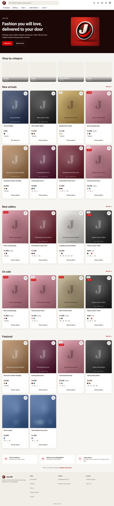

_Figure 25. The shop home page on a computer_

## 13.2 Header, search and menu

## 13.3 Shop, category and search pages

## 13.4 Product page

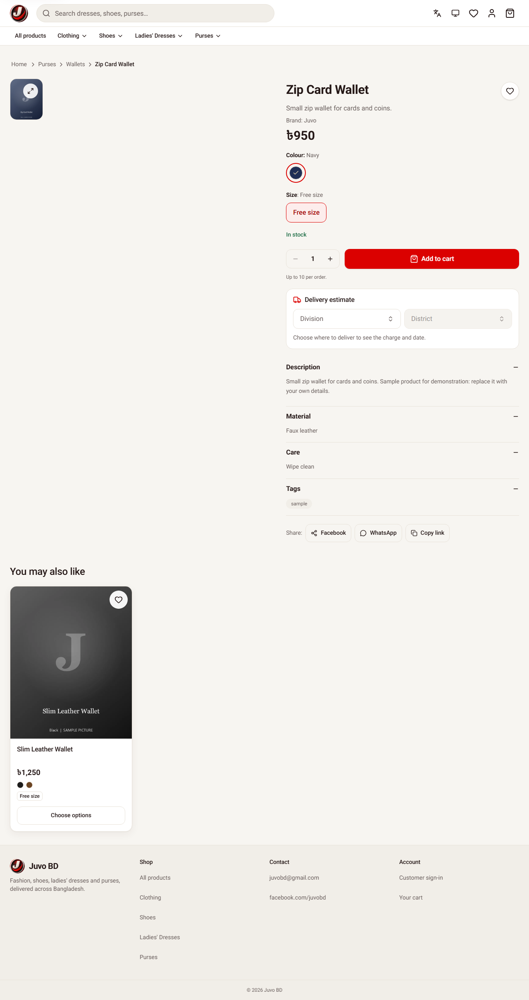

_Figure 26. A product page: gallery, colour and size, quantity, delivery estimate, details and sharing_

## 13.5 Cart

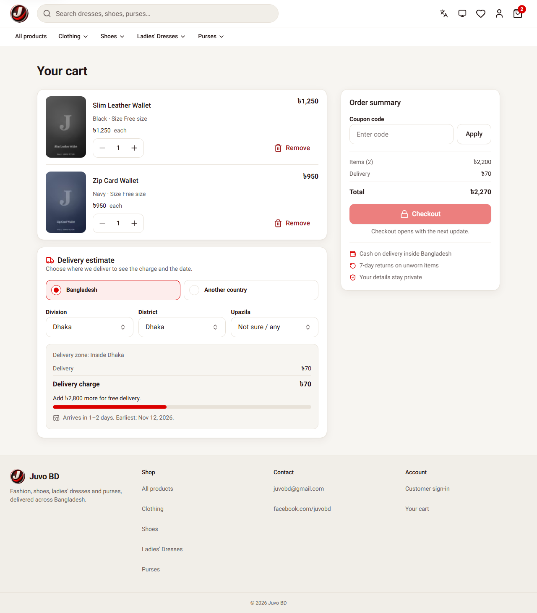

_Figure 27. The cart with the delivery estimate and the order summary_

<table><tbody><tr><td>
<strong>Checkout is released with the orders screens</strong>

The back end already creates orders, reserves stock, applies the cash-on-delivery rules and offers tracking (see 13.7), but the <strong>Checkout</strong> button, the confirmation page and the order screens are still being finished, so the cart shows that checkout opens with the next update.
</td></tr></tbody></table>

## 13.6 Customer account

Customers sign in at /login (**Customer** tab) with their mobile number and a one-time code by SMS or email (section 2.4). **My account** (/account) shows the overview and these pages:

| **Page**  | **What it does**  |
| --- | --- |
| **Profile** (/account/profile)  | Name and email, mobile number and profile level. **Consent**: separate switches for marketing SMS and email, each remembering the time it was given. Transactional messages (order updates) are always allowed. A wrong email is refused with an explanation.  |
| **Addresses** (/account/addresses)  | Add, edit, delete and make default. Bangladesh addresses use **Division, District, Upazila**, then street address and a **landmark** (required, because riders look for landmarks). An optional **map pin** can be dropped by tapping the map, dragged, or set with **Use my location**. The first address becomes the default; a default address cannot be deleted before another one is chosen.  |
| **Wishlist** (/account/wishlist)  | Saved products with **Move to cart** (choose the colour and size) and **Remove**. Moving a product to the cart takes it off the wishlist.  |

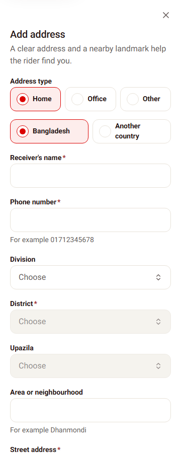

_Figure 28. Saved addresses on a phone_

## 13.7 What the back end already does for orders and returns

These parts are built and tested in the back end and are reachable through the API documentation; their screens arrive step by step (chapter 14):

| **Area**  | **What exists**  |
| --- | --- |
| Orders  | An order has three tracks (order, payment, delivery) with only the allowed changes and a permanent history. Order numbers look like JV-DHK01-2611-000123. Stock is reserved when the order is placed, taken off the shelf at packing, and released on cancellation or when an unpaid online order times out after 30 minutes. Two buyers can never take the last unit.  |
| Checkout rules  | Guest order with only a mobile number; totals are recalculated by the server; cash on delivery above BDT 10,000 needs the delivery charge paid in advance; a one-time code can be required before a cash-on-delivery order; a duplicate order is detected.  |
| Tracking  | A customer or guest can follow an order with the order number and mobile number.  |
| Staff order processing  | List with filters, confirm, pack, cancel, reassign the fulfilling branch, notes, bulk actions, packing slip data, and **manual orders** from social media (source: Facebook, WhatsApp, phone, walk-in).  |
| Fraud basics  | Risk flags (for example many orders from one device or a blacklisted number), a review queue with the decisions Approve, Request advance, Call and Reject, and a blacklist.  |
| Returns  | Return within 7 days of delivery (or exchange): request, approve or reject, pickup, receive, inspect, refund or exchange. Refund amounts are worked out by the system; the delivery charge is refunded only when the shop is at fault; good items return to stock.  |

<table><tbody><tr><td>
<strong>Delivery rates are placeholders</strong>

The delivery zones and rates created by the system are placeholders. The owner must replace them with the real tariff before going live (Delivery zones, when the screen is released).
</td></tr></tbody></table>

# 14\. Roadmap: what is coming and where it will appear

| **Step**  | **Modules**  | **Where in the menu**  | **Status**  |
| --- | --- | --- | --- |
| 7  | Storefront, cart, customer identity and address book, delivery zones and charges  | Storefront; **Delivery > Delivery zones**; **Customers**  | Shop, cart and customer account **released**; admin screens for delivery zones, coupons and customers come in step 12  |
| 8  | Checkout, orders and the order status flow, stock reservation, manual (social media) orders, fraud basics, customer order screens  | **Sales > Orders, Social orders**  | Back end **done**; screens in progress  |
| Returns  | Return and exchange requests, refunds  | **Sales > Returns**  | Back end **done**; screens in progress  |
| 9  | Online payments, refunds, VAT and invoices (PDF), notifications by SMS and email with templates  | **Payments and accounts**; notifications  | In progress  |
| 10  | Couriers and live delivery tracking  | **Delivery > Couriers**  | Planned  |
| 11  | Purchasing, expenses and accounting, support tickets, reports; promotions, pre-orders, loyalty, marketing, resellers, point of sale  | **Catalog > Purchasing**, **Payments and accounts > Expenses**, **Reports and support**, **Marketing**  | Planned  |
| 12  | Live dashboard figures, website content (CMS), settings, platform tools (job dashboard, backup, privacy tools, API keys)  | **Dashboard**, **Website content**, **Settings**  | Planned  |
| 13–14  | Hardening and quality checks; real courier, payment, SMS and map providers; go-live  | Whole system  | Planned  |

Each step follows the same pattern: the back end and the screens are built together, tested in a real browser on computer, tablet and phone sizes, and this manual is extended.

# 15\. Business rules in one place

| **Area**  | **Rule**  |
| --- | --- |
| Access  | A permission counts only in the branch where the role is held (global users: everywhere). Super Admin holds all permissions, including future ones.  |
| Passwords  | At least 10 characters with upper case, lower case, digit and symbol, 4 different characters. 5 wrong attempts lock the account for 15 minutes.  |
| Customer code  | 6 digits, valid 5 minutes, 5 wrong tries, new code after 60 seconds, 5 codes per hour per number.  |
| Catalog  | Publish needs name, category, price, one picture and one active variant. Sale price < regular price. SKUs are unique. Slugs are unique. Archived products cannot be changed.  |
| Pictures  | JPEG, PNG or WebP; at least 1000 px on the long side; at most 10 MB; at most 12 per product; shown on a 4:5 card with an adjustable focal point.  |
| Cost price  | Visible and editable only with catalog.product.view-cost.  |
| Stock  | Available = on hand − reserved. Never below zero; reserved units cannot be removed. Every change is in the stock history, which cannot be edited.  |
| Transfers  | Requested → Approved → In transit → Received. Stock leaves at shipping and arrives at receiving. Whole quantity only.  |
| Stock counts  | One open count per branch. Approval applies counted minus snapshot to the current stock. Uncounted lines change nothing.  |
| Import  | One row per variant; all or nothing; check first; opening stock only where no history exists.  |
| Records  | Products, customers, staff and branches are archived or deactivated, never erased. The audit log and stock history are permanent.  |
| Money and time  | Taka (BDT), prices include tax; times are Bangladesh time; mobile numbers are stored as +880....  |

# 16\. Troubleshooting and messages

## 16.1 Common situations

| **Problem**  | **What to do**  |
| --- | --- |
| I do not receive the sign-in code  | Until a real SMS and email provider is connected (before going live) no message is sent: the sign-in page shows the code in a blue **Test mode** box. In a live system check the number or email, wait the 60 seconds, then ask again; you may choose email instead of SMS.  |
| “Your session ended. Please sign in again”  | Sign in again; you return to the page you were on. This happens after a long pause, after a password change, or when an administrator signs you out.  |
| I cannot see a menu item or a button  | Your role does not include that permission in the active branch. Check the branch switcher, then ask an administrator (Users > your page > Branches and roles > **What this person can do**).  |
| A page says “not found” for something that exists  | It may belong to a branch you do not work in. The system does not reveal other branches' data.  |
| The account is locked  | Wait 15 minutes, or ask an administrator to check the account.  |
| I lost my authenticator app  | Use a recovery code, or ask an administrator to **Reset two-step verification**.  |
| Publish is greyed out  | The checklist is incomplete or you have unsaved changes. Save, and complete the listed items.  |
| An import says there are errors  | Read the **Row** and **Column** of each error in the report, fix the file and check again. Nothing was saved.  |
| The system will not start  | Run .\\scripts\\start-all.ps1; it names the missing tool (the .NET SDK, Node.js or SQL Server tools). Logs are in .run\\api.log and .run\\web.log.  |

## 16.2 Messages you may see

| **Message (shortened)**  | **Meaning**  |
| --- | --- |
| The email, user name, password or code is not correct  | Wrong credentials or code. The same message appears for unknown users, on purpose.  |
| Too many failed attempts. This account is locked for a few minutes  | 5 wrong attempts; wait 15 minutes.  |
| This web address (slug) is already used  | Another product uses that slug; choose another.  |
| This SKU is already used by another variant  | SKUs are unique across the shop.  |
| The product cannot be published or changed this way yet  | The publish checklist is incomplete.  |
| An archived product cannot be changed  | Archived products are locked.  |
| This variant still has stock. Move or write it off first  | Remove stock before removing the variant.  |
| This category still has products or sub-categories  | Move or remove them before deleting the category.  |
| Products still use this brand  | A used brand cannot be deleted.  |
| Not enough available stock for this change  | You tried to remove stock that is reserved or missing.  |
| The transfer / stock count is not in a state that allows this step  | Steps follow a fixed order; refresh the page to see the current state.  |
| You do not have permission to do this / You do not have access to this branch  | Your role lacks the permission, or you chose a branch you do not work in.  |
| Someone else changed this record. Reload and try again  | Two people edited the same record; reload the page and repeat your change.  |

# Appendix A. Task index: “I want to ...”

| **I want to ...**  | **Go to**  | **Section**  |
| --- | --- | --- |
| Sign in / reset my password  | Sign-in page  | 2.3  |
| Add a new product  | Catalog > Products > New product  | 6.2  |
| Add many products from Excel  | Catalog > Products > Import  | 6.10  |
| Make colour and size variants quickly  | Product > Variants and stock > Generate variants  | 6.4  |
| Upload pictures and choose the crop  | Product > Pictures  | 6.6  |
| Put a product on sale  | Product > Details > Price  | 6.3  |
| Publish or hide a product  | Product page header  | 6.7  |
| Add a category, brand or size chart  | Catalog > Categories  | 7  |
| Check stock in a shop  | Catalog > Inventory > Stock  | 8.1  |
| Record damaged or lost goods  | Inventory > Stock > Adjust  | 8.1  |
| Get an alert when stock is low  | Inventory > Stock > Low-stock level  | 8.1  |
| See why a stock number changed  | Inventory > Movements  | 8.2  |
| Move stock to another branch  | Inventory > Transfers > New transfer  | 8.3  |
| Count the shelves  | Inventory > Stock counts  | 8.4  |
| Add a staff member  | User management > Users > New user  | 9.1  |
| Change what a person can do  | Users > person > Branches and roles; or Roles  | 9.1, 9.2  |
| Add a shop or warehouse  | User management > Branches  | 9.3  |
| Find out who changed something  | User management > Audit log  | 9.4  |
| Turn on two-step verification  | My profile and security  | 10.3  |
| Switch language or dark mode  | Top bar icons  | 2.5  |

# Appendix B. Glossary

| **Term**  | **Meaning**  |
| --- | --- |
| **Active branch**  | The branch chosen in the switcher; lists and numbers follow it.  |
| **Archived**  | A product taken out of sale and locked.  |
| **Audit log**  | The permanent record of changes: who, what, when, branch.  |
| **Available**  | On hand minus reserved: what can still be sold.  |
| **Branch**  | A shop, warehouse, head office or online fulfilment centre.  |
| **BDT / taka**  | Bangladeshi currency; prices include tax.  |
| **Category**  | A group of products in a tree (Clothing > T-shirts).  |
| **Focal point**  | The centre of the 4:5 card crop of a picture.  |
| **Global scope**  | A user who can hold roles in every branch.  |
| **Movement**  | One line of the stock history.  |
| **On hand**  | Units physically in the branch.  |
| **Permission**  | One thing a person may do, for example catalog.product.edit.  |
| **Reserved**  | Units promised to open orders.  |
| **Role**  | A named set of permissions.  |
| **Sandbox / test mode**  | Messages and payments go to a test sender, not to real providers.  |
| **SKU**  | Stock keeping unit: the unique code of one variant.  |
| **Slug**  | The web-address form of a name (classic-cotton-t-shirt).  |
| **Stock count**  | A check of real stock against the system's numbers.  |
| **Super Admin**  | The owner role with every permission.  |
| **Two-step verification**  | A code from an authenticator app in addition to the password.  |
| **Variant**  | One colour and size combination of a product.  |

# Appendix C. Quick checklist for the owner's first day

1.  Start the system and sign in as Super Admin; **change the password** and set up **two-step verification**.
2.  Open **User management > Branches** and edit **Head Office**; add your shops and warehouses.
3.  Review the built-in **Roles**; adjust them or create your own.
4.  Create your **staff** and give each person a role in their branch(es).
5.  Review **Categories**, brands and size charts; remove or archive the **sample products** and import your own catalog.
6.  Set stock for each branch (opening stock, transfers or an import).
7.  Upload pictures, check the preview cards and **publish** your first products.
8.  Look at the **Audit log** to see everything you just did recorded.
