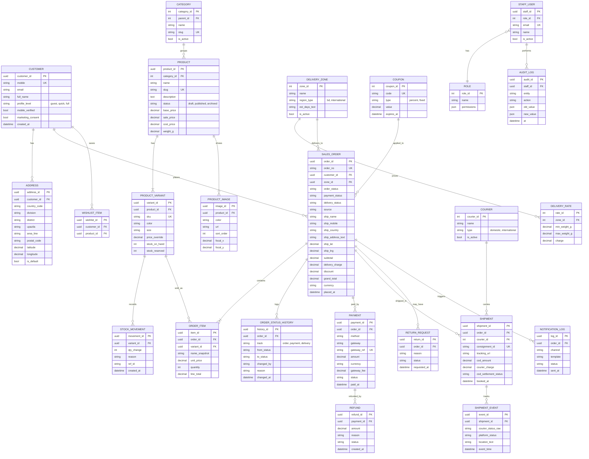

> Generated copy of `Juvo BD — E-Commerce Platform BRD & SRS.docx` (source of truth), converted on 2026-11-02 by scripts/docx_to_md.py. Do not edit by hand; re-run the script.

# Juvo BD — E-Commerce Platform: BRD & SRS

Nov 2, 2026 · @Mahmudur Rahman

## Index

### Document sections

| Section | Content |
| --- | --- |
| 1 | Document control, purpose, scope, glossary |
| 2 | Business requirements (BRD) |
| 3 | Brand identity and UI design system |
| 4 | Overall description, architecture, module map |
| 5 | Modules A, B, C: Showcase, Catalog, Cart |
| 6 | Modules D, E, F: Checkout, Customer identity, Customer panel |
| 7 | Modules G, H, I: Delivery and map, Courier, Payments |
| 8 | Modules J, K, L: Real-time status, Notifications, Cancel/Return/Refund |
| 9 | Modules M, N, O, P: Admin dashboard, Admin panel, Roles, Reports |
| 10 | Modules Q, R: Brand About and social, SEO and marketing |
| 11 | Workflows and pre/post conditions |
| 12 | Data design (ERD) |
| 13 | Non-functional requirements and interfaces |
| 14 | Use cases, acceptance, roadmap, risks, open questions |

**Added sections:**

| Section | Content |
| --- | --- |
| 15 | Additional modules S to AF: social order desk, fraud, tax/invoice, advanced inventory, purchase, expenses, support, promotions, pre-order, loyalty, marketing, reseller, POS, platform services |
| 16 | Build guide: final phase plan, project structure, work packages, definition of done, traceability, first-week checklist |

Note: the phase table in 14.3 is superseded by 16.1.

### Module overview: features and steps

| ID | Module | Short details | Main features | Main steps |
| --- | --- | --- | --- | --- |
| A | Storefront and product showcase | Customer-facing premium shop | Home with hero slider, category pages, auto-designed product cards, filters, search, product page with gallery/zoom, size guide, reviews, language switch | 1. Open home or category 2. Filter or search 3. Open product 4. Pick colour and size 5. Add to cart |
| B | Product catalog and media rules | Admin adds a product once; the system designs the showcase | Product form, variants and SKUs, pricing and sale dates, multi-image upload with auto resize/crop, live preview, bulk import, categories, audit log | 1. Create product 2. Add variants and stock 3. Upload images 4. Preview card and page 5. Publish |
| C | Cart and wishlist | Collect items before ordering | Cart drawer and page, quantity limits by stock, guest cart merge, wishlist, coupons, abandoned-cart reminder | 1. Add item 2. Review cart 3. Apply coupon 4. Go to checkout |
| D | Checkout and order placement | Cart to confirmed order | Guest checkout, mobile validation, optional OTP, live totals, stock re-check, manual order by staff, order number | 1. Mobile and contact 2. Address on map 3. Delivery method 4. Payment method 5. Review and confirm |
| E | Customer identity | Guest, quick profile, full profile | Mobile as unique key, OTP sign-in, quick profile from mobile + optional email, auto-attach guest orders, consent, account deletion | 1. Order as guest or sign in 2. Verify OTP 3. Create quick profile 4. Add details later |
| F | Customer panel | Customer self-service area | Dashboard, my orders, live tracking, invoices, address book, wishlist, reorder, reviews, profile settings | 1. Sign in 2. See orders 3. Track or cancel 4. Manage addresses and profile |
| G | Delivery zones and map address | Exact address and correct delivery charge, Bangladesh and international | Country selector, Division/District/Upazila fields, map pin and autocomplete, current location, zones and rate rules, estimated days, international forms | 1. Choose country 2. Search or drop pin 3. Confirm fields 4. System picks zone and charge |
| H | Courier integration | Book and track parcels transparently | Courier adapters, one-click and bulk booking, labels, webhook status sync, status mapping, retry, failed-delivery flow, COD reconciliation, performance report | 1. Order packed 2. Book courier 3. Store tracking ID 4. Receive status updates 5. Settle COD |
| I | Payments | Safe payment and status control | COD, mobile wallets, local and international gateways, server-side verification, webhooks, partial advance, manual verification, refunds, invoices, ledger | 1. Choose method 2. Pay on gateway 3. Server verifies 4. Order confirmed 5. Reconcile |
| J | Real-time status | Same live truth for admin and customer | Order, payment and delivery tracks, live timeline, public tracking by order no. + mobile, live stock, status history, transparency view, delay alerts | 1. Event occurs 2. Server updates status 3. Screens update live 4. History saved |
| K | Notifications | Messages to customers and staff | SMS, email, in-app, optional WhatsApp, event list, editable EN/BN templates, log and retry | 1. Event fires 2. Template filled 3. Sent 4. Logged or retried |
| L | Cancel, return and refund | After-sale handling | Cancel rules, return request with photos, return workflow, exchange, restock or damage record, refund rules | 1. Request 2. Admin review 3. Pickup 4. Inspect 5. Refund or exchange |
| M | Admin dashboard | Business at a glance | Live today cards, action queue, sales chart, top products, cash view, stock health, date filter | 1. Open dashboard 2. See alerts 3. Click through to the list |
| N | Admin panel | Run the whole business | Orders, products, inventory, customers, delivery, couriers, payments, returns, promotions, CMS, notifications, settings, audit log; bulk actions, export | 1. Pick menu 2. Search and filter 3. Open record 4. Act 5. Change is audited |
| O | Users, roles and permissions | Staff access control | Staff accounts, role permission matrix, hidden cost/profit data, two-step login for owner, deactivate staff | 1. Create staff 2. Assign role 3. Permissions apply immediately |
| P | Reports | Decisions and accounts | Sales, orders, inventory, finance, courier, customer reports, Excel/PDF export, daily summary email | 1. Choose report 2. Set range 3. View 4. Export |
| Q | Brand About and social media | Trust and brand story | Editable About page, brand details, social links (Facebook and others), contact page, policies, FAQ, trust badges | 1. Owner supplies content 2. Edit in CMS 3. Publish |
| R | SEO and marketing | Be found and shared well | Clean URLs, sitemap, share previews, product structured data, analytics hooks, catalog feed, newsletter | 1. Fill SEO fields 2. Connect analytics 3. Publish and monitor |

**Additional modules (details in section 15; phase plan in section 16.1):**

| ID | Module | Short details | Main features | Main steps | Phase |
| --- | --- | --- | --- | --- | --- |
| S | Social order desk | Facebook, Messenger, WhatsApp and phone orders | Quick manual order form, source tag and filter, order links, payment link by SMS | 1. Find or create customer by mobile 2. Add items 3. Set address and payment 4. Save order | 2 |
| T | Fraud control and blacklist | Stop fake and risky COD | Risk flags, customer delivery history, blacklist, rules (OTP/advance/reject), review queue | 1. Order flagged 2. Staff reviews 3. Approve, ask advance or reject | 2 |
| U | Tax, VAT and invoicing | Legal invoices | Tax rules, inclusive/exclusive prices, sequential invoice numbers, credit notes, tax report | 1. Set tax 2. Order paid/shipped 3. Invoice issued 4. Credit note on refund | 2 |
| V | Advanced inventory | Accurate stock | Barcode/QR, stock count, locations, reorder levels, dead stock | 1. Scan 2. Count 3. Review differences 4. Approve adjustment | 3 |
| W | Purchase and supplier | Buying stock | Suppliers, purchase orders, goods receipt, cost update, supplier balance | 1. Create PO 2. Receive goods 3. Stock and cost update | 3 |
| X | Expenses and basic accounting | Profit and cash | Expense entry, auto fees, cash book, profit and loss, export | 1. Record expense 2. Auto entries 3. View profit and loss | 3 |
| Y | Customer support | Complaints and questions | Tickets linked to orders, statuses, canned replies, customer updates | 1. Ticket opened 2. Assigned 3. Resolved and closed | 3 |
| Z | Promotions engine | Sales campaigns | Flash sale, bundles, buy X get Y, festival campaigns, stacking rules | 1. Create campaign 2. Schedule 3. Auto-apply 4. Review results | 4 |
| AA | Pre-order and backorder | Sell before stock arrives | Zero-stock ordering with ship date, pre-order label, separate queue | 1. Mark pre-order 2. Customer orders 3. Stock received 4. Release | 4 |
| AB | Loyalty, referral, store credit | Repeat buying | Points, referral codes, gift cards, ledger | 1. Earn 2. Redeem at checkout | 4 |
| AC | Marketing automation | Consent-based campaigns | Segments, SMS/email campaigns, abandoned cart, back-in-stock, win-back | 1. Build segment 2. Send or automate 3. Measure | 4 |
| AD | Reseller and affiliate | Sell through partners | Reseller price list, affiliate codes, commission statements | 1. Create partner 2. Orders attributed 3. Pay commission | 4 |
| AE | POS and multi-branch | Physical shop sales | POS screen, shared stock, cash register report | 1. Scan 2. Pay 3. Receipt | 5 |
| AF | Platform services | Keep the system safe and maintainable | Feature switches, job dashboard, backup/restore, monitoring, public API, privacy tools, PWA | 1. Configure 2. Monitor 3. Retry failures 4. Restore when needed | 1 to 4 |

## 1. Document Control and Introduction

This document tells a development team exactly what to build for Juvo BD: a full online business platform for selling clothing, shoes, ladies' dresses, purses and similar fashion items across Bangladesh and internationally. It combines the Business Requirements Document (BRD) and the Software Requirements Specification (SRS).

| Item | Detail |
| --- | --- |
| Product name | Juvo BD Commerce Platform |
| Business | Juvo BD (Facebook: facebook.com/juvobd, email: juvobd@gmail.com) |
| Document type | BRD + SRS (IEEE 830 style, adapted) |
| Version | 1.0 (draft for owner review) |
| Currency | BDT (Bangladeshi Taka) default; multi-currency for international orders |
| Languages | English at launch; Bengali (বাংলা) as a switchable second language |
| Audience | Business owner, designers, developers, QA |

### 1.1 Purpose

Define every business need, module, screen, rule and data item of the platform so a team can design, build and test it without guessing.

### 1.2 Scope

The platform has three faces, all in one system:

1. **Customer storefront and customer panel** (website, mobile-first): browse, cart, order, track, manage profile.
2. **Admin panel and dashboard** (web): run the whole business: products, stock, orders, delivery, couriers, payments, customers, content, reports.
3. **Integrations**: payment gateways, courier companies, maps, SMS/email/WhatsApp notifications, social media.

Out of scope for version 1 is listed in section 2.5.

### 1.3 How to read and use this document

- Sections 2 to 4: the business picture, brand look and overall system.
- Sections 5 to 10: **one section per module**. Every module has the same layout: Purpose, Users, Preconditions, Functional requirements (FR IDs), Business rules, Postconditions, Screens.
- Sections 11 to 13: workflow, data design, non-functional rules.
- Section 14: use cases, acceptance checklist, delivery phases, risks, open questions.
- Priority tags: **M** = Must have (launch), **S** = Should have, **C** = Could have (later).
- Requirement IDs: FR-xxx (functional), NFR-xxx (non-functional), BR-xxx (business rule).

### 1.4 Glossary

| Term | Meaning |
| --- | --- |
| SKU | Stock Keeping Unit: a unique code for one sellable variant (e.g. Dress-Red-M) |
| Variant | A product option combination: size, colour |
| COD | Cash on Delivery |
| Guest checkout | Ordering without creating a password-protected account |
| Quick profile | A light profile created from mobile number (and optional email) only |
| Courier | Delivery company that carries parcels to the customer |
| AWB / Consignment ID | Tracking number issued by the courier |
| Zone | A delivery area with its own delivery charge and time |
| OTP | One-time password sent by SMS or email |
| Webhook | An automatic message a courier or payment provider sends to our system when something changes |
| RBAC | Role-based access control |

## 2. Business Requirements (BRD)

### 2.1 Business background and vision

Juvo BD sells fashion (clothing, shoes, ladies' dresses, purses and more) today through a Facebook page. Orders, stock, payments and delivery are handled by hand. **Vision:** one premium, trustworthy online store where customers discover products beautifully, order in a minute, and see every step of delivery, while the owner runs the whole business from one dashboard.

### 2.2 Business problems to solve

| # | Problem today | What the platform must do |
| --- | --- | --- |
| P1 | Products shown only as social posts; no structured catalog | A premium product showcase where uploading a product automatically produces a beautiful card and page |
| P2 | Orders taken by message; mistakes and lost orders | Cart, checkout and confirmed orders with unique order numbers |
| P3 | Customers cannot see order status | Real-time status visible to customer and admin |
| P4 | Manual courier booking and payment follow-up | Courier and payment integration, with transparent tracking and reconciliation |
| P5 | Hard to serve outside Dhaka or abroad | Nationwide Bangladesh and international delivery with map-based address selection |
| P6 | Stock unknown, overselling | Live inventory per variant with low-stock alerts |
| P7 | Customers hesitate to register | Order with only a mobile number, or create a quick profile, or a full profile |
| P8 | Inconsistent brand look | One design system based on the Juvo logo colours |

### 2.3 Business objectives and success measures

| Objective | Measure (target to be agreed with the owner) |
| --- | --- |
| Take all orders through the platform | Share of orders placed on the platform vs. Facebook inbox |
| Fast ordering | Guest checkout completed in under 2 minutes on mobile |
| Fewer delivery disputes | Every order has live tracking and a status history |
| Fewer stock errors | Zero orders accepted for out-of-stock variants |
| Faster payment settlement | Courier COD remittances matched to orders in the system |
| Repeat purchases | Returning-customer rate, wishlist and profile usage |

### 2.4 Stakeholders

| Stakeholder | Interest |
| --- | --- |
| Owner / Super Admin | Full control, reports, money and stock accuracy |
| Staff (order manager, inventory, content, support) | Daily operations with limited permissions |
| Customer (guest, quick profile, registered) | Easy buying, trust, tracking |
| Courier companies | Clear parcel data, COD amounts, status callbacks |
| Payment providers | Correct amounts, secure redirects, callbacks |
| Developers / designers | Clear, testable requirements |

### 2.5 Scope boundaries

**In scope (version 1):** everything in sections 5 to 10.

**Out of scope (later versions):** native Android/iOS apps (the website is a mobile-first installable web app instead), multi-vendor marketplace (other sellers), loyalty points, live chat video, AI recommendations, accounting/ERP integration, wholesale pricing.

### 2.6 High-level business rules

- **BR-001:** One order may contain many products; each product line refers to one variant (size and colour) with its own price and stock.
- **BR-002:** Stock is reserved when an order is confirmed and released if the order is cancelled or payment fails.
- **BR-003:** An order always has an immutable status history (who, when, from, to).
- **BR-004:** Delivery charge depends on destination zone, parcel weight and courier; the customer sees the full total before confirming.
- **BR-005:** Prices are stored in BDT; international display currency is a conversion for information, with the charged currency shown clearly at checkout.
- **BR-006:** Guest, quick-profile and registered customers can all order; the mobile number is the main customer identity.

## 3. Brand Identity and UI Design System

The whole software takes its colours from the **Juvo logo**. I have not seen the logo file, so the colour values below are a **starter palette to be replaced**. Rule: designers extract the logo's primary and secondary colours (hex), put them into the tokens below, and every screen inherits them.

### 3.1 Colour tokens (derive from the logo)

| Token | Role | Rule | Starter value (replace) |
| --- | --- | --- | --- |
| --brand-primary | Buttons, links, active states, key accents | Exact main logo colour | #7A2E4D |
| --brand-primary-dark | Hover, pressed | Primary darkened about 12% | #5E233B |
| --brand-primary-soft | Tags, selected rows, subtle fills | Primary at 8-12% tint | #F5EAF0 |
| --brand-secondary | Highlights, badges, premium accents | Second logo colour, or a warm gold if the logo has one | #C9A24B |
| --surface | Page background | Warm off-white | #FBF8F5 |
| --surface-card | Cards, forms, modals | White | #FFFFFF |
| --text-strong | Headings | Near-black, slightly warm | #1E1A1C |
| --text-muted | Secondary text | 60% of strong | #6B6468 |
| --border | Lines, input borders | Light warm grey | #E7E0DB |
| --success / --warning / --danger / --info | Status colours | Keep distinct from the brand colour | #2E7D5B / #C98A1B / #C0392B / #2F6DA3 |

Accessibility: text on any background must reach contrast ratio 4.5:1 (WCAG AA). Check the final logo-based colours against this before approval.

### 3.2 Typography

- Headings: an elegant serif or high-contrast display font (e.g. Playfair Display or similar) for a premium feel; body and forms: a clean sans-serif (e.g. Inter or similar). Final fonts to be confirmed by the designer.
- Bengali text: a font with full Bengali glyph support (e.g. Hind Siliguri or Noto Sans Bengali). Verify licence and rendering on low-end phones.
- Scale: 12, 14, 16 (body), 20, 24, 32, 44 px. Line height 1.5 for body.

### 3.3 Component rules (simple but premium)

| Component | Look and behaviour |
| --- | --- |
| Spacing and radius | 8 px grid. Cards 16 px radius, inputs and buttons 10-12 px radius |
| Shadows | Soft, layered, low opacity (e.g. 0 1px 2px plus 0 8px 24px at 6-10% black). Cards lift slightly on hover |
| Buttons | Primary = solid brand colour; secondary = outline; ghost for low emphasis. Min height 44 px (touch friendly). Loading state with spinner; disabled state clearly muted |
| Form fields | Label above field, 48 px tall, 1 px --border, focus ring in --brand-primary at 25% glow. Inline validation message under the field in --danger. Required marked with * |
| Dropdowns / select | Same height and border as inputs; custom panel with search for long lists (district, upazila, country); keyboard accessible |
| Checkbox, radio, toggle | Brand colour when on; 24 px hit area minimum |
| Cards (product) | See 3.4 |
| Image frames | Fixed aspect ratio (4:5 portrait for fashion), object-fit: cover, soft radius, subtle inner border, skeleton shimmer while loading, blurred placeholder (LQIP) |
| Modals and drawers | Cart is a right-side drawer; filters are a bottom sheet on mobile |
| Toasts | Short success/error messages, top right (desktop) / bottom (mobile) |
| Badges | New, Sale (-x%), Low stock, Sold out, Free delivery |
| Icons | One consistent line-icon set |
| Motion | 150-250 ms ease-out transitions; respect "reduce motion" setting |
| Dark mode | Optional (Could have); admin panel first |

### 3.4 Premium product card (auto-designed)

The owner must **never design a banner per product**. The system builds the showcase from the data entered at upload:

- Large framed main image (hover or swipe shows the second image).
- Name, short tagline (optional), price with old price struck through and automatic discount badge.
- Colour swatches and available sizes shown as small chips; sold-out sizes crossed out.
- Rating stars (if reviews enabled), wishlist heart, quick add-to-cart.
- Automatic badges: New (added in last N days), Low stock (stock below threshold), Sale, Sold out.
- Consistent layout regardless of image size: the system crops to the frame and offers focal-point selection in admin.

### 3.5 Responsive rules

Mobile first. Breakpoints: 360, 768, 1024, 1280 px. Product grid: 2 columns on phones, 3 on tablets, 4 on desktops. Admin panel: usable on tablet; tables collapse to cards on phones.

## 4. Overall Description, Architecture and Module Map

### 4.1 User classes

| User | Signs in? | What they can do |
| --- | --- | --- |
| Visitor | No | Browse, search, view products, read About, use social links |
| Guest buyer | No | Order using only mobile number and delivery details; track by order number + mobile |
| Quick-profile customer | Mobile OTP | Same as guest, plus saved addresses, order history, wishlist (profile made from mobile number and optional email) |
| Registered customer | Mobile/email + OTP or password | Full profile, multiple addresses, reviews, returns, saved payment preferences |
| Admin staff | Yes (RBAC) | Operate parts of the admin panel by permission |
| Super Admin (owner) | Yes + 2-step verification | Everything, including roles, settings, reports and money data |

### 4.2 Operating environment

- Web application, mobile-first, works on current Chrome, Safari, Edge, Firefox and Android/iOS browsers; installable as a PWA (Should).
- Cloud hosting with HTTPS. Servers placed so Bangladesh users get fast responses (CDN with Asia edge).
- Typical customer device: mid-range Android on 3G/4G, so pages must stay light (NFR-003).

### 4.3 Recommended technology (you said no preference; this is a suggestion, change if your team prefers)

| Layer | Recommendation | Why |
| --- | --- | --- |
| Storefront | Next.js (React + TypeScript) | Fast first load, SEO-friendly, server rendering for product pages |
| Admin panel | React + TypeScript SPA (same design system) | Rich tables, forms, dashboards |
| Backend API | ASP.NET Core Web API (C#), modular monolith | Strong typing, mature ecosystem, easy to split later |
| Database | PostgreSQL | Reliable, relational, good for orders and inventory |
| Cache / queue | Redis + a background job runner (e.g. Hangfire or a message queue) | Courier and payment callbacks, notifications, retries |
| Real-time | WebSockets via SignalR | Live order and stock status |
| File storage | S3-compatible object storage + CDN | Product images and videos |
| Search | PostgreSQL full-text at first; a search service later | Keep version 1 simple |
| Maps | Google Maps Platform (best address data) or OpenStreetMap with Leaflet (lower cost) | Decision in section 14.5 |
| Auth | JWT/cookie sessions, OTP service | Guest, quick and full profiles |

I am not certain every product above is the best fit for your team; please verify versions, licences and pricing before final choice.

### 4.4 Logical architecture (layers, top to bottom)

1. **Clients:** Storefront (customer), Customer panel, Admin panel.
2. **API gateway / backend modules:** Catalog, Cart and Checkout, Orders, Customers, Delivery and Zones, Courier Integration, Payments, Inventory, Notifications, CMS and Brand, Reports, Users and Roles, Audit.
3. **Real-time hub:** pushes order, payment, delivery and stock changes to customer and admin screens.
4. **Integration adapters:** one adapter per courier and per payment gateway behind a common interface, so adding a provider never changes core code.
5. **Data:** PostgreSQL, Redis, object storage.
6. **External services:** payment gateways, courier APIs/webhooks, maps/geocoding, SMS/email/WhatsApp providers.

### 4.5 Module map

| ID | Module | Face | Section |
| --- | --- | --- | --- |
| A | Storefront and product showcase | Customer | 5 |
| B | Product catalog and media rules | Admin + system | 5 |
| C | Cart and wishlist | Customer | 5 |
| D | Checkout and order placement | Customer | 6 |
| E | Customer identity (guest, quick, full profile) | Customer | 6 |
| F | Customer panel | Customer | 6 |
| G | Delivery zones and map address | Customer + Admin | 7 |
| H | Courier integration | Admin + system | 7 |
| I | Payments | Customer + Admin | 7 |
| J | Real-time status | Customer + Admin | 8 |
| K | Notifications | System | 8 |
| L | Cancellation, return and refund | Customer + Admin | 8 |
| M | Admin dashboard | Admin | 9 |
| N | Admin panel (catalog, inventory, orders, customers, couriers, payments, CMS, settings) | Admin | 9 |
| O | Users, roles and permissions | Admin | 9 |
| P | Reports | Admin | 9 |
| Q | Brand About page and social media | Customer + Admin | 10 |
| R | SEO and marketing | Admin + system | 10 |

Modules S to AF (social order desk, fraud, tax/invoice, advanced inventory, purchase, expenses, support, promotions, pre-order, loyalty, marketing, reseller, POS, platform services) are defined in section 15.

### 4.6 Assumptions and constraints

- Courier and payment provider APIs, fees and onboarding rules must be confirmed with each provider; I do not have verified, current details of their APIs, so treat every integration in section 7 as "to be verified in the provider's current documentation".
- The Juvo Facebook page was not reviewed while writing this document; brand story, product categories and existing customers are taken from your message only.
- A business trade licence and payment gateway merchant onboarding are needed before live online payments.
- International shipping needs a courier that supports customs documents; duties and taxes handling must be decided (section 14.5).

## 5. Modules A, B, C: Showcase, Catalog, Cart

### Module A: Storefront and Product Showcase

**Purpose:** a premium-looking shop where customers are impressed on arrival and find products fast.

**Users:** visitor, guest, customers. **Preconditions:** at least one published product. **Postconditions:** visitor reaches a product page or cart with correct live price and stock.

| ID | Requirement | Pri |
| --- | --- | --- |
| FR-A01 | Home page with hero slider (admin-managed), featured categories, New Arrivals, Best Sellers, Sale section, brand story strip, social links, newsletter signup | M |
| FR-A02 | Category pages (Clothing, Shoes, Ladies' Dresses, Purses, and any category the admin adds) with sub-categories | M |
| FR-A03 | Product grid shows auto-designed premium cards (section 3.4); infinite scroll or "Load more" | M |
| FR-A04 | Filters: category, price range, size, colour, brand, availability, discount; sort: newest, price low-high, price high-low, popularity | M |
| FR-A05 | Search with suggestions by name, category and SKU; tolerant of small spelling mistakes (Should) | M |
| FR-A06 | Product detail page: image gallery with zoom and swipe, optional video, variant selectors (colour, size), live stock note, price, delivery estimate by entered area, description, material/care, size chart, reviews, related products | M |
| FR-A07 | Size guide popup per category (admin-editable table) | S |
| FR-A08 | "Notify me when available" for sold-out variants (mobile or email) | S |
| FR-A09 | Recently viewed products | C |
| FR-A10 | Share product to Facebook, WhatsApp, copy link; clean URLs and social preview image | M |
| FR-A11 | Language switch English / Bengali; currency display BDT, with optional conversion for international visitors | S |
| FR-A12 | Customer-visible reviews with star rating and photos (only verified buyers can review) | S |

**Screens:** Home, Category list, Search results, Product detail, About (module Q), Contact, Policies (delivery, return, privacy, terms).

### Module B: Product Catalog and Media Rules

**Purpose:** let staff add a product once and have it appear perfectly everywhere, with no per-product design work.

**Users:** admin staff with Catalog permission. **Preconditions:** categories exist; staff is signed in. **Postconditions:** product is saved, stock rows exist per variant, product appears on the storefront if published.

| ID | Requirement | Pri |
| --- | --- | --- |
| FR-B01 | Create/edit product: name (EN + optional BN), slug, category, sub-category, brand, short and long description, material, care, tags, gender/target group, weight and dimensions (for courier), status (Draft, Published, Archived) | M |
| FR-B02 | Variants: colour and size combinations, each with its own SKU, price override, stock quantity, barcode (optional), weight override | M |
| FR-B03 | Pricing: regular price, sale price with start/end date, cost price (admin-only, for profit report) | M |
| FR-B04 | Image upload: multiple images, drag to reorder, first image is primary; per-colour image sets; bulk upload | M |
| FR-B05 | System auto-processes images: resize to several sizes, convert to modern format (e.g. WebP), compress, crop to the 4:5 frame with adjustable focal point, add placeholder blur | M |
| FR-B06 | Image rules shown to staff: minimum 1000 px on the long side, max 10 MB per file; warn if too small or blurry (blur check is Could) | M |
| FR-B07 | Optional product video (short clip or link) | C |
| FR-B08 | Live "storefront preview" while editing, showing the exact card and page | M |
| FR-B09 | Bulk import/export of products and stock via CSV/Excel with a validation report | S |
| FR-B10 | Duplicate a product to create similar ones quickly | S |
| FR-B11 | Category management: add/edit/reorder, category image, active flag | M |
| FR-B12 | Mark product as New, Featured, Best seller (manual or automatic rules) | M |
| FR-B13 | Product SEO fields: meta title, description, social image | S |
| FR-B14 | Every product change is written to the audit log (who, what, when, old/new) | M |

**Business rules:** BR-B1: a product can be published only if it has a name, category, price, at least one image and at least one variant with stock tracked (stock may be zero). BR-B2: sale price must be lower than regular price. BR-B3: SKU is unique across the system.

### Module C: Cart and Wishlist

**Purpose:** collect items before ordering, for guests and signed-in customers.

**Preconditions:** a variant is in stock. **Postconditions:** cart persists and carries to checkout with prices and stock re-validated.

| ID | Requirement | Pri |
| --- | --- | --- |
| FR-C01 | Add to cart from card (quick add) or product page with required variant selection | M |
| FR-C02 | Cart drawer and full cart page: change quantity, remove, see line totals, subtotal, estimated delivery, coupon field | M |
| FR-C03 | Cart is kept for guests (browser storage + server session) and merged into the account after sign-in | M |
| FR-C04 | Quantity limited to available stock; clear message if stock changed since adding | M |
| FR-C05 | Wishlist (heart): guests keep it on the device; signed-in users keep it on the account; move wishlist item to cart | S |
| FR-C06 | Abandoned cart reminder by SMS/email when mobile or email is known (admin can turn on) | C |
| FR-C07 | Coupon codes: percentage or fixed, minimum order, expiry, usage limit | S |

## 6. Modules D, E, F: Checkout, Customer Identity, Customer Panel

### Module D: Checkout and Order Placement

**Purpose:** turn a cart into a confirmed order in the fewest steps, for any kind of customer.

**Users:** guest, quick-profile, registered customers. **Preconditions:** cart has at least one in-stock item. **Postconditions:** order created with unique number, stock reserved, payment started or COD recorded, confirmation shown and sent, admin notified in real time.

**Checkout steps (single page on mobile, accordion style):**

1. Contact: mobile number (required) and email (optional but encouraged).
2. Delivery address: country, then address by map and fields (module G).
3. Delivery method: courier options with charge and estimated days.
4. Payment method: COD, mobile wallets, cards, bank (module I).
5. Review: items, delivery charge, discount, tax if any, grand total, terms checkbox, "Confirm order".

| ID | Requirement | Pri |
| --- | --- | --- |
| FR-D01 | Checkout works with no account: mobile number plus the basic details (name, address, delivery area) are enough | M |
| FR-D02 | If the mobile number matches an existing customer, offer sign-in by OTP to load saved addresses; ordering without signing in remains possible | M |
| FR-D03 | Mobile number validation: Bangladesh format 01XXXXXXXXX (11 digits) or +880...; international numbers accepted with country code | M |
| FR-D04 | Optional OTP verification of the mobile number before confirming (admin switch: off, COD only, or always). Recommended on for COD to reduce fake orders | S |
| FR-D05 | Show live totals: subtotal, delivery charge, discount, tax/duty (if enabled), grand total, and amount payable now vs. on delivery | M |
| FR-D06 | Re-check stock and price at "Confirm order"; if changed, show what changed and let the customer continue or edit | M |
| FR-D07 | On success show order number, summary, expected delivery date range, tracking link, and a "Create my profile" prompt (module E) | M |
| FR-D08 | Order note field (gift wrap, delivery instruction) | S |
| FR-D09 | Duplicate-order guard: same mobile + same items within a few minutes triggers a warning | S |
| FR-D10 | Order source recorded (website, admin-created, Facebook/phone order entered by staff) | M |
| FR-D11 | Admin can create an order manually on behalf of a customer (for Facebook/phone orders) using the same rules | M |
| FR-D12 | Terms, privacy and return policy acceptance stored with the order | M |

**Business rules:** BR-D1: COD orders above an admin-set amount may require an advance payment. BR-D2: an unpaid online-payment order is held for a limited time (admin setting, e.g. 30 minutes) and then cancelled automatically with stock released. BR-D3: order number format is readable and unique (e.g. JV-2611-000123).

### Module E: Customer Identity (Guest, Quick Profile, Full Profile)

**Purpose:** let customers buy with zero friction, and invite them to create a profile at the moment it feels useful.

**Three levels:**

| Level | Created from | Kept | Can do |
| --- | --- | --- | --- |
| Guest | Mobile number + basic delivery info typed at checkout | The order and a hidden guest record linked to the mobile number | Order, track with order number + mobile |
| Quick profile | Mobile number (verified by OTP) and optional email | Phone, email, saved addresses, order history | One-tap reorder, saved addresses, wishlist, tracking list |
| Full profile | Quick profile + name, birthday (optional), gender (optional), password (optional), profile picture | All of the above | Reviews, returns, communication preferences, multiple addresses |

| ID | Requirement | Pri |
| --- | --- | --- |
| FR-E01 | Create a quick profile in real time from the order confirmation page or the sign-in page using only mobile number and email (email optional) | M |
| FR-E02 | A customer can also create a profile before ordering, from the sign-in page | M |
| FR-E03 | Mobile number is the unique key. Orders placed as guest with the same verified mobile number are automatically attached to the profile after OTP verification | M |
| FR-E04 | Sign-in options: mobile + OTP (default), email + OTP, email/mobile + password (if set), Google sign-in (Could) | M |
| FR-E05 | OTP rules: 6 digits, expires in 5 minutes, limited attempts and resend cooldown, rate-limited per number and device | M |
| FR-E06 | Progressive profile: ask for extra fields one at a time later, never block an order for them | S |
| FR-E07 | Consent checkboxes for marketing SMS/email, stored with timestamp; transactional messages always allowed | M |
| FR-E08 | Customer can delete their account; order records are kept in anonymised form for legal and accounting needs | S |
| FR-E09 | Fraud signals: many orders from one device with different numbers, repeated fake/returned COD, flagged for admin review | C |

**Preconditions:** a valid mobile number. **Postconditions:** a customer record exists, linked to past guest orders where the number is verified.

### Module F: Customer Panel

**Purpose:** one place for a signed-in customer to manage everything about their buying.

| ID | Requirement | Pri |
| --- | --- | --- |
| FR-F01 | Dashboard: active orders with live status, recent orders, wishlist preview, saved addresses | M |
| FR-F02 | My Orders: list with filters (active, delivered, cancelled, returned); order detail with items, amounts, payment status, delivery timeline, courier name, tracking number and link, invoice download (PDF) | M |
| FR-F03 | Live order tracking page with timeline and map-style progress (module J) | M |
| FR-F04 | Cancel an order while allowed (before courier pickup); request a return within the return window (module L) | M |
| FR-F05 | Address book: add, edit, delete, set default; each address with a pinned map location | M |
| FR-F06 | Profile: name, mobile, email, photo, password, language, notification preferences | M |
| FR-F07 | Reorder: add all items of a past order to cart (checks stock and current price) | S |
| FR-F08 | Wishlist and back-in-stock requests | S |
| FR-F09 | Write a review for delivered items | S |
| FR-F10 | Payment history and refund status | M |
| FR-F11 | Help: contact the shop by phone/WhatsApp/message from an order page | S |

**Preconditions:** customer signed in. **Postconditions:** any change is saved and, for orders, mirrored to the admin panel in real time.

## 7. Modules G, H, I: Delivery and Map, Courier Integration, Payments

### Module G: Delivery Zones and Map Address (Bangladesh + International)

**Purpose:** capture an exact, deliverable address anywhere, and price delivery correctly.

**Users:** customers (enter address), admin (configure zones and charges). **Preconditions:** delivery zones and rates configured; map service key active. **Postconditions:** order holds a structured address plus map coordinates, and a calculated delivery charge.

| ID | Requirement | Pri |
| --- | --- | --- |
| FR-G01 | Country selector (all countries; admin can enable/disable countries for shipping) | M |
| FR-G02 | Bangladesh address uses the administrative hierarchy Division, District, Upazila/Thana, Union/Area, then house/road/landmark. Data loaded from a maintained list (8 divisions, 64 districts at the time of writing; verify the current list and upazila data) | M |
| FR-G03 | Map selection: customer searches an address, drops or drags a pin, or taps "Use my current location"; system fills address fields from the pin (reverse geocoding) and stores latitude and longitude | M |
| FR-G04 | Address autocomplete while typing; customer can correct fields manually when the map guess is wrong (common in Bangladesh) | M |
| FR-G05 | Validate that the pin lies inside the selected district/country; warn if not | S |
| FR-G06 | International address form adapts to country (state/province, postal code, phone code) | M |
| FR-G07 | Delivery zones (admin): Inside Dhaka, Dhaka suburbs, Major cities, Rest of Bangladesh, International regions (e.g. South Asia, Middle East, Europe, North America, Rest of world); each with charge rules and estimated days | M |
| FR-G08 | Charge rules: by weight slabs, by order value, flat rate, free-delivery threshold, per-courier override, extra remote-area surcharge | M |
| FR-G09 | Show estimated delivery date range on product page (after area is known), cart and checkout | S |
| FR-G10 | International: collect phone with country code, email (required), and customs details; show whether duties/taxes are prepaid or paid by the receiver (decision in section 14.5) | M |
| FR-G11 | Admin map view of order destinations (pins/heat-map) for planning | C |
| FR-G12 | Saved addresses keep their pin so repeat orders need no map step | M |

**Business rules:** BR-G1: an order cannot be confirmed without a deliverable address in an enabled zone. BR-G2: the delivery charge shown at checkout is the charge billed; changes after confirmation need admin action and a recorded reason. BR-G3: international parcels have a maximum weight and a list of restricted items, both admin-editable.

### Module H: Courier Integration

**Purpose:** book, track and settle deliveries through courier companies, with both admin and customer seeing the same truth.

**Users:** admin (books, monitors), system (webhooks), customer (tracking view). **Preconditions:** courier account credentials stored securely; order is Confirmed and packed. **Postconditions:** order holds courier name, consignment/tracking ID, tracking link and a status history synced from the courier.

**Providers (examples, to be verified):** Bangladesh couriers such as Pathao, Steadfast, RedX, Paperfly, eCourier; international carriers such as DHL, FedEx, UPS or a Bangladesh-based international forwarder. I am not certain which of these currently offer an open merchant API or what each charges; please verify each provider's current API documentation, onboarding and fees before choosing.

| ID | Requirement | Pri |
| --- | --- | --- |
| FR-H01 | Courier adapter interface: create parcel, cancel parcel, get status, get label, get charge estimate, reconcile COD; one adapter per courier; adding a courier requires no change to core order code | M |
| FR-H02 | Courier settings (admin): enable/disable, credentials (encrypted), pickup address/store ID, default courier per zone, charge mapping | M |
| FR-H03 | Book a courier from the order screen in one click (or bulk-book selected orders); parcel data (name, phone, address, weight, COD amount, note) is filled automatically | M |
| FR-H04 | Store the courier's consignment ID, tracking URL, booking time and charge; print shipping label and packing slip | M |
| FR-H05 | Receive courier webhooks and/or poll status; map each courier status to the platform's delivery statuses (table below); keep the raw courier status text too | M |
| FR-H06 | Retry failed API calls automatically with backoff; show "booking failed" to admin with the reason and a retry button | M |
| FR-H07 | Webhook security: verify signature or secret, ignore duplicates (idempotent), log every call | M |
| FR-H08 | Delivery failed / returned-to-sender flow: reason captured, admin decides re-attempt, return, or cancel | M |
| FR-H09 | COD reconciliation: record the amount the courier collected, the courier fee, and the settlement date; mark order's COD as Collected then Settled; show unsettled COD per courier | M |
| FR-H10 | Courier performance report: delivered %, average delivery time, returns %, cost per parcel | S |
| FR-H11 | Customer sees the same status and courier name/tracking ID; courier contact link when provided | M |
| FR-H12 | Admin can switch courier for an unbooked order, or rebook after cancelling at the courier | S |

**Status mapping (platform status is what everyone sees):**

| Platform delivery status | Meaning | Typical courier event |
| --- | --- | --- |
| Booked | Courier accepted the booking | Pickup requested / created |
| Picked up | Courier collected the parcel from Juvo | Picked up |
| In transit | Moving between hubs | At hub / in transit |
| Out for delivery | With the delivery person | Out for delivery |
| Delivered | Customer received it | Delivered |
| Delivery attempt failed | Customer unreachable or refused | Failed / on hold |
| Returning | On the way back to Juvo | Return in progress |
| Returned | Back at Juvo | Returned |

### Module I: Payments

**Purpose:** accept money safely and keep payment status exactly in step with orders.

**Preconditions:** order exists with a payable amount. **Postconditions:** payment record shows status, method, reference, amount, fee and timestamps; the order moves forward only on confirmed payment (or COD).

**Methods (to be verified with providers):** Cash on Delivery; Bangladesh mobile wallets (bKash, Nagad, Rocket) and local gateways/aggregators (e.g. SSLCommerz, aamarPay, ShurjoPay); international cards via a global gateway (e.g. Stripe or PayPal); bank transfer with manual verification. Availability for a Bangladesh merchant, supported currencies and fees must be confirmed with each provider.

| ID | Requirement | Pri |
| --- | --- | --- |
| FR-I01 | Payment adapter interface: initiate, verify, refund, query status; one adapter per gateway | M |
| FR-I02 | Methods shown depend on country, order value and admin switches | M |
| FR-I03 | Online payment flow: redirect or embedded checkout, return to the site, server-side verification with the gateway before marking Paid (never trust the browser return alone) | M |
| FR-I04 | Payment webhooks handled idempotently; late or duplicate callbacks cannot double-pay or double-refund | M |
| FR-I05 | Payment statuses: Pending, Paid, Failed, Cancelled, Partially refunded, Refunded; COD adds Collected-by-courier and Settled | M |
| FR-I06 | Partial payment / advance: pay a delivery-charge advance online and the rest on delivery (admin rule) | S |
| FR-I07 | Manual payment verification (bank transfer, wallet send-money): customer submits transaction ID and optional screenshot; admin approves or rejects | S |
| FR-I08 | Refund from the admin panel back to the original method where the gateway supports it, otherwise recorded as manual refund | M |
| FR-I09 | Invoice and receipt PDF with order, payment and tax details | M |
| FR-I10 | Payment ledger and daily reconciliation view: expected vs. received per gateway and courier | S |
| FR-I11 | No card data is stored on Juvo servers; card entry happens on the gateway's secure page or fields (PCI scope kept minimal) | M |
| FR-I12 | Multi-currency: charge in BDT or the gateway-supported currency, show the exchange rate used, store both amounts | S |

## 8. Modules J, K, L: Real-Time Status, Notifications, Cancel/Return/Refund

### Module J: Real-Time Order, Payment, Delivery and Stock Status

**Purpose:** admin and customer always see the same, current status without refreshing the page, so the whole order is transparent.

**Preconditions:** a connection to the real-time service (falls back to automatic refresh every few seconds if the connection is unavailable). **Postconditions:** every screen showing the order or stock reflects the latest state within a few seconds.

| ID | Requirement | Pri |
| --- | --- | --- |
| FR-J01 | Order timeline (customer and admin) showing each status with date/time: Placed, Confirmed, Packed, Handed to courier, In transit, Out for delivery, Delivered, plus Cancelled/Returned branches | M |
| FR-J02 | Three parallel status tracks per order: Order status, Payment status, Delivery status; all visible on one screen | M |
| FR-J03 | Changes push live to open customer and admin screens (no refresh); admin dashboard counters and order list update live | M |
| FR-J04 | Public tracking page for guests: order number + mobile number (or secure link sent by SMS) | M |
| FR-J05 | Live stock: product page and cart reflect current availability; when the last unit is reserved, other viewers see "Sold out" or "Low stock" quickly | M |
| FR-J06 | Admin sees who changed what and when on every status (status history; BR-003) | M |
| FR-J07 | "Transparency view": admin can open one order and see order, payment, courier booking and courier events side by side, with raw courier messages | M |
| FR-J08 | Estimated delivery date updated from courier data when available | S |
| FR-J09 | Delay alert: orders stuck in one status longer than a set time are highlighted for admin | S |

### Module K: Notifications

| ID | Requirement | Pri |
| --- | --- | --- |
| FR-K01 | Channels: SMS (essential in Bangladesh), email, in-app bell; WhatsApp message (Could, needs approved business templates) | M |
| FR-K02 | Customer events: OTP, order placed, order confirmed, payment received/failed, packed, handed to courier (with tracking link), out for delivery, delivered, delivery failed, cancelled, refund processed, back in stock | M |
| FR-K03 | Admin events: new order, payment received/failed, low stock, courier booking failed, delivery failed, return requested, COD unsettled too long | M |
| FR-K04 | Message templates editable by admin in English and Bengali, with variables like {order_no}, {name}, {tracking_link} | S |
| FR-K05 | Notification log per customer and order (sent, failed, provider response); automatic retry on failure | M |
| FR-K06 | Marketing messages only to customers who consented (FR-E07), with unsubscribe | S |
| FR-K07 | SMS cost control: admin can choose which events send SMS versus email only | S |

### Module L: Cancellation, Return and Refund

**Preconditions:** order exists; the action is allowed by the current status and the policy window. **Postconditions:** order status updated, stock released or returned to shelf, refund created if money was paid.

| ID | Requirement | Pri |
| --- | --- | --- |
| FR-L01 | Customer cancels before the courier pickup; after pickup, only admin can intercept through the courier | M |
| FR-L02 | Admin cancels with a required reason; stock is released automatically; paid amount moves to refund flow | M |
| FR-L03 | Return request by the customer within the return window (admin setting, per category): choose items, reason, photos | M |
| FR-L04 | Return workflow: Requested, Approved/Rejected, Pickup arranged (via courier), Received, Inspected, Refunded or Exchanged | M |
| FR-L05 | Exchange for another size/colour creates a linked new order with no extra charge where stock exists | S |
| FR-L06 | Items returned in good condition can be put back into stock; damaged items are recorded separately | M |
| FR-L07 | Refund amount rules: product value, delivery charge (refundable or not per policy), courier return charge; all editable by admin and shown to the customer | M |
| FR-L08 | Return policy text and eligibility per category (for example non-returnable items) managed in admin | M |

## 9. Modules M, N, O, P: Admin Dashboard, Admin Panel, Roles, Reports

### Module M: Admin Dashboard

**Purpose:** show the owner how the business is doing right now and what needs action today.

**Preconditions:** admin signed in; permission to see dashboard. **Postconditions:** none (read-only view with shortcuts).

| ID | Widget / requirement | Pri |
| --- | --- | --- |
| FR-M01 | Today's cards: new orders, revenue, orders to confirm, orders to pack, in delivery, delivered, cancelled/returned (live) | M |
| FR-M02 | Action queue: orders waiting confirmation, payments to verify, courier bookings failed, delivery failed, return requests, low-stock items | M |
| FR-M03 | Sales chart: day/week/month, compare with the previous period | M |
| FR-M04 | Top products, top categories, top customers | S |
| FR-M05 | Orders by status and by zone/district | S |
| FR-M06 | Cash view: online paid, COD pending with couriers, COD settled, refunds due | M |
| FR-M07 | Stock health: low stock, out of stock, slow movers | S |
| FR-M08 | Date range filter; all cards link to the filtered list behind them | M |

### Module N: Admin Panel (menu and screens)

The admin panel is organised by the following menu. Each item lists its screens and the key functions.

| Menu | Screens and functions | Pri |
| --- | --- | --- |
| Orders | List (search by order no., name, mobile; filter by status, payment, courier, date, zone; bulk actions), order detail (items, customer, address with map, payment, courier, timeline, notes, invoice), create manual order, confirm, pack, book courier, cancel, edit before shipment, print invoice/label/packing slip, internal notes, customer contact buttons (call, SMS, WhatsApp) | M |
| Products | Product list, add/edit product (Module B), variants and stock, categories, brands, size charts, bulk import/export, reviews moderation | M |
| Inventory | Stock by variant, adjust stock with reason (receive, damage, correction), stock movement history, low-stock threshold, purchase/receive entry (Should), stock reservation view | M |
| Customers | List and detail: profile level (guest/quick/full), orders, total spent, addresses, notes, tags, block/unblock, consent flags | M |
| Delivery | Zones, charges, estimated days, enabled countries, restricted items, pickup address | M |
| Couriers | Courier list, credentials, default per zone, booking log, webhook log, status mapping, COD settlement list | M |
| Payments | Gateway settings, payment list, manual verification queue, refunds, ledger and reconciliation | M |
| Returns | Return requests and workflow (Module L) | M |
| Promotions | Coupons, sale scheduling, free-delivery rules, banners/hero slides | S |
| Content (CMS) | Home page sections, hero slider, About page, policy pages, FAQ, contact info, social links, footer, SEO fields | M |
| Notifications | Templates (EN/BN), channel switches, notification log | S |
| Reports | See Module P | M |
| Settings | Business info (name, logo, address, phone, email), currency and exchange rates, tax settings, order number format, stock reservation time, OTP rules, return window, language, theme tokens (brand colours), integrations keys | M |
| Audit log | Searchable record of who changed what (products, prices, stock, orders, settings, roles) | M |

| ID | Cross-cutting admin requirement | Pri |
| --- | --- | --- |
| FR-N01 | Every list has search, filters, sorting, pagination, column chooser and export to Excel/CSV | M |
| FR-N02 | Bulk actions (confirm, book courier, print labels, change status) with a result summary per order | M |
| FR-N03 | Optimistic-lock protection: if two staff edit the same order, the second gets a conflict message | S |
| FR-N04 | Internal notes and tags on orders and customers | S |
| FR-N05 | Sound/visual alert for a new order while the admin panel is open | S |
| FR-N06 | Destructive actions (delete product, cancel shipped order) ask for confirmation and a reason; products used in orders are archived, not erased | M |

### Module O: Users, Roles and Permissions

| ID | Requirement | Pri |
| --- | --- | --- |
| FR-O01 | Staff accounts created by Super Admin; sign-in with email/mobile and password; two-step verification mandatory for Super Admin, optional for others | M |
| FR-O02 | Roles with permission sets per module (view, create, edit, delete, approve, export) | M |
| FR-O03 | Default roles: Super Admin, Manager, Order Manager, Inventory Manager, Content Editor, Support, Accountant (view money data only) | M |
| FR-O04 | Hide cost price, profit and settings from roles without permission | M |
| FR-O05 | Session timeout, forced sign-out, sign-in history, lock after repeated failed attempts | M |
| FR-O06 | Deactivate a staff account instantly without deleting history | M |

| Capability | Super Admin | Manager | Order Mgr | Inventory Mgr | Content Editor | Support | Accountant |
| --- | --- | --- | --- | --- | --- | --- | --- |
| Orders | Full | Full | Full | View | None | View + notes | View |
| Products/Stock | Full | Full | View | Full | Edit content | View | View |
| Customers | Full | Full | View | None | None | View | View |
| Couriers/Delivery | Full | Full | Operate | None | None | View | View |
| Payments/Refunds | Full | Approve | View | None | None | None | Full view |
| CMS/Content | Full | Full | None | None | Full | None | None |
| Reports | Full | Full | Orders only | Stock only | None | None | Finance only |
| Settings/Roles | Full | None | None | None | None | None | None |

### Module P: Reports

| ID | Report | Pri |
| --- | --- | --- |
| FR-P01 | Sales: by day/week/month, product, category, size/colour, channel, zone, payment method | M |
| FR-P02 | Orders: funnel (placed, confirmed, delivered, cancelled, returned) and cancellation/return reasons | M |
| FR-P03 | Inventory: current stock value, low stock, movement, dead stock | M |
| FR-P04 | Finance: revenue, discounts, delivery charges collected vs. paid to couriers, gateway fees, refunds, COD pending/settled, gross profit (needs cost price) | M |
| FR-P05 | Courier: performance and COD settlement | S |
| FR-P06 | Customers: new vs. returning, top spenders, guest-to-profile conversion | S |
| FR-P07 | All reports exportable to Excel/PDF; scheduled email of daily summary to owner | S |

## 10. Modules Q, R: Brand About, Social Media, SEO and Marketing

### Module Q: Brand About Page and Social Media

**Purpose:** tell the Juvo story, build trust, and keep the website connected to the brand's social presence.

**Preconditions:** brand content supplied by the owner. **Postconditions:** the About page and social links are live and editable without a developer.

| ID | Requirement | Pri |
| --- | --- | --- |
| FR-Q01 | About Juvo page with sections editable in admin: brand story, mission and values, what we sell, quality promise, founder/team note (optional), photo gallery, delivery and return promise, customer love (selected reviews) | M |
| FR-Q02 | Brand details block: business name, logo, address or pickup location, phone/WhatsApp, email (juvobd@gmail.com), working hours | M |
| FR-Q03 | Social links in header/footer/About/product pages: Facebook (facebook.com/juvobd), plus Instagram, TikTok, YouTube, WhatsApp as the owner enables them | M |
| FR-Q04 | Embedded Facebook feed or latest posts block on the home page (Could; depends on the provider's current embed terms) | C |
| FR-Q05 | "Order via Messenger/WhatsApp" button as an alternative contact path; such enquiries can be turned into manual orders by staff (FR-D11) | S |
| FR-Q06 | Contact page with form, map location of the shop (if there is a physical point), phone and email; messages arrive in an admin inbox | M |
| FR-Q07 | Trust badges: secure payment, delivery coverage, return policy, support hours | S |
| FR-Q08 | FAQ, Delivery policy, Return policy, Privacy policy, Terms pages editable in admin | M |

**Content the owner must supply:** brand story text, logo files (vector if possible), brand colours, tagline, photos, policy wording, shop/pickup address, social account links. The Facebook page was not read while preparing this document.

### Module R: SEO and Marketing

| ID | Requirement | Pri |
| --- | --- | --- |
| FR-R01 | Clean URLs, page titles and descriptions, automatic XML sitemap, robots rules, canonical tags | M |
| FR-R02 | Open Graph and social share previews for products, so shared links look premium on Facebook and WhatsApp | M |
| FR-R03 | Structured data for products (price, availability, rating) so search engines can show rich results | S |
| FR-R04 | Analytics and ad tracking hooks (e.g. Google Analytics, Meta Pixel) configurable from settings, with a cookie consent banner where required | S |
| FR-R05 | Product catalog feed for Facebook/Instagram shopping (Could; check Meta's current requirements) | C |
| FR-R06 | Newsletter signup and campaign export (consent-based) | C |
| FR-R07 | Page speed targets in NFR-003 are part of SEO acceptance | M |

## 11. Workflows and Pre/Post Conditions

### 11.1 Order status lifecycle (allowed transitions)

Order status is separate from Payment status and Delivery status (FR-J02). Only the transitions below are allowed; anything else is blocked by the system.

| From | Event | To | Who or what triggers | Side effects |
| --- | --- | --- | --- | --- |
| (none) | Customer confirms checkout | Placed | Customer | Order number issued, stock reserved, notifications sent |
| Placed | Payment confirmed or COD accepted (and OTP check passed if required) | Confirmed | System or admin | Admin queue updated |
| Placed | Payment timeout / failed / customer cancels | Cancelled | System or customer | Stock released |
| Confirmed | Items picked and packed | Packed | Admin | Packing slip printed |
| Packed | Courier booked and handed over | Handed to courier | Admin + courier webhook | Tracking ID stored, customer SMS with link |
| Handed to courier | Courier scan shows movement | In transit | Courier webhook | Timeline updated |
| In transit | Out for delivery | Out for delivery | Courier webhook | Customer notified |
| Out for delivery | Delivered | Delivered | Courier webhook | COD marked Collected-by-courier; review request scheduled |
| Out for delivery | Attempt failed | Delivery failed | Courier webhook | Admin alert; re-attempt or return decision |
| Delivery failed | Re-attempt | Out for delivery | Courier / admin | Customer notified |
| Delivery failed | Return to sender | Returned | Courier webhook / admin | Stock review; refund if prepaid |
| Delivered | Return requested and approved | Return in progress | Customer + admin | Return pickup booked |
| Return in progress | Parcel received and inspected | Returned | Admin | Stock updated; refund or exchange |
| Confirmed or Packed | Admin cancels | Cancelled | Admin (reason required) | Stock released; refund if paid |

### 11.2 Payment status flow

- Online: Pending, then Paid (after server verification) or Failed/Cancelled. Paid may later become Partially refunded or Refunded.
- COD: Pending (cash due), then Collected by courier (on Delivered), then Settled (money received from courier).
- Manual transfer: Pending, then Under review, then Paid or Rejected.

### 11.3 End-to-end flow: guest order with courier delivery

1. Visitor adds items to cart and opens checkout.
2. Enters mobile number and basic details; picks the address on the map; system proposes zone and delivery charge.
3. Chooses payment (COD or online); confirms. System validates stock and price, creates the order, reserves stock.
4. Customer sees the confirmation page and gets SMS/email with order number and tracking link; page offers "Create my profile" (module E).
5. Admin dashboard shows the new order live; admin confirms and packs.
6. Admin books the courier (single or bulk); system stores tracking ID and sends it to the customer.
7. Courier webhooks update delivery status; customer and admin timelines change live.
8. Delivered: COD recorded as collected; later settlement is matched and the order's payment becomes Settled.
9. Customer is invited to review; if a return is needed, module L applies.

### 11.4 Online payment flow

1. Order created as Placed with payment Pending.
2. Customer is sent to the gateway page (or embedded form).
3. Gateway returns the customer and also calls the server webhook.
4. Server verifies the transaction directly with the gateway; only then payment becomes Paid and the order Confirmed.
5. On failure or timeout the customer can retry or switch to another method; after the hold time the order is cancelled and stock released (BR-D2).

### 11.5 Pre and post conditions by module (summary)

| Module | Precondition | Postcondition |
| --- | --- | --- |
| A Storefront | Published products exist | Visitor reaches a valid product/cart with live price and stock |
| B Catalog | Staff has Catalog permission; categories exist | Product saved, variants and stock rows created, image sizes generated, audit entry written |
| C Cart | Variant in stock | Cart saved for guest/account, ready for checkout |
| D Checkout | Non-empty cart, valid contact and address, enabled zone | Order created, stock reserved, payment started/COD set, notifications sent |
| E Identity | Valid mobile number | Customer record exists; matching guest orders attached after OTP |
| F Customer panel | Customer signed in | Changes saved; orders mirror to admin in real time |
| G Delivery/Map | Zones and rates configured; map key active | Structured address + coordinates + delivery charge stored |
| H Courier | Credentials valid; order Confirmed and packed | Consignment ID stored; courier statuses mapped to timeline |
| I Payments | Order has payable amount; gateway enabled | Payment record final; order advances only on verified payment or COD |
| J Real-time | Live connection or fallback refresh | Customer and admin see the same state within seconds |
| K Notifications | Template and channel enabled; contact exists | Message sent and logged, retried on failure |
| L Cancel/Return/Refund | Status and policy window allow the action | Stock and money adjusted; status history updated |
| M-N Admin | Staff signed in with permission | Action done and audited |
| O Roles | Super Admin signed in | Permissions applied immediately |
| P Reports | Data exists; permission | Report shown and exportable |
| Q-R Brand/SEO | Owner content supplied | Pages live, editable without developer |

## 12. Data Design

### 12.1 Entity relationship diagram (Mermaid, crow's foot)

The order table is named SALES_ORDER because ORDER is a reserved word in SQL. Paste this into any Mermaid viewer to render it.

Not drawn to keep the diagram readable: cart and cart items (same shape as order items, tied to a session or customer), reviews, CMS pages and sections, settings, OTP codes, webhook log, product video.

### 12.2 Key data rules

| Rule | Detail |
| --- | --- |
| Order snapshots | Order items copy name, price and address text at order time, so later product or address edits never change past orders |
| Available stock | Available = stock_on_hand minus stock_reserved; reservation on Placed, deduction on Packed or Delivered (decide once, apply everywhere), release on cancel/fail |
| Money | Store amounts as exact decimals with a currency code; never floating point |
| Identity | Mobile number stored in international format (+880...) and unique per customer; guest orders keep the number so they can be attached later |
| History | Status changes, stock movements, payments, refunds and courier events are append-only |
| Soft delete | Products, customers and staff are deactivated or archived, not erased |
| Time | Stored in UTC; shown in Asia/Dhaka for Bangladesh users |
| Personal data | Mobile, email and address are personal data: encrypted at rest where feasible, access logged, deletion/anonymisation procedure defined (FR-E08) |

## 13. Non-Functional Requirements and External Interfaces

Numeric targets below are starting proposals; agree them with the owner and the hosting budget.

### 13.1 Non-functional requirements

| ID | Area | Requirement |
| --- | --- | --- |
| NFR-001 | Availability | Storefront available at least 99.5% monthly (proposal); planned maintenance announced |
| NFR-002 | Performance (API) | Normal pages respond within 500 ms at the server for 95% of requests under expected load |
| NFR-003 | Performance (front end) | Product and home pages usable within about 3 seconds on a mid-range phone over 4G; images lazy-loaded and served in modern formats from a CDN; page weight kept small |
| NFR-004 | Capacity | Designed for at least 100 concurrent shoppers and 10,000 products at launch, scalable by adding servers (proposal; revise with business forecast) |
| NFR-005 | Real-time | Status changes reach open screens within about 3 seconds; automatic fallback to polling |
| NFR-006 | Security: transport | HTTPS everywhere, HSTS, secure cookies |
| NFR-007 | Security: application | Protection against the OWASP Top 10 (injection, XSS, CSRF, broken access control, etc.); input validation on client and server; rate limiting on login, OTP and checkout |
| NFR-008 | Security: secrets | Courier and gateway credentials encrypted and never exposed to the browser; secrets kept in a vault or secure configuration |
| NFR-009 | Security: payments | No card data stored; gateway-hosted payment fields; webhook signature checks |
| NFR-010 | Privacy | Personal data minimised, access logged, consent recorded; follow Bangladesh data protection requirements in force at the time. I am not certain of the exact current law; confirm with a legal adviser |
| NFR-011 | Backup and recovery | Automated daily database backups, tested restore, recovery point and time objectives agreed (proposal: 24 h and 4 h) |
| NFR-012 | Audit | All admin changes logged and cannot be edited by staff |
| NFR-013 | Usability | Guest checkout in at most 5 steps; touch targets at least 44 px; clear errors in plain language |
| NFR-014 | Accessibility | WCAG 2.1 AA as the target for contrast, keyboard use and labels |
| NFR-015 | Localisation | English and Bengali; BDT formatting; Bengali digits optional; dates in local format |
| NFR-016 | Compatibility | Latest two versions of major browsers, plus Android 8+ and iOS 15+ browsers (proposal) |
| NFR-017 | Maintainability | Modular code, automated tests for order, stock and payment logic, API documentation, environment separation (development, staging, production) |
| NFR-018 | Observability | Central logs, error tracking, uptime alerts, webhook and integration dashboards |
| NFR-019 | Data integrity | Stock and order creation use transactions so two buyers cannot take the last item |
| NFR-020 | Scalability | Background jobs for notifications, courier calls and reports so checkout stays fast |

### 13.2 External interfaces

| Interface | Purpose | Direction | Notes |
| --- | --- | --- | --- |
| Payment gateways | Take and verify payments, refunds | Out + webhook in | One adapter each (module I) |
| Courier APIs | Book, cancel, track, label, COD reconcile | Out + webhook in | One adapter each (module H) |
| Maps and geocoding | Map picker, autocomplete, reverse geocoding | Out | Needs API key, usage billing, address quality varies in Bangladesh |
| SMS provider | OTP and order messages | Out | Use a provider with Bangladesh delivery and sender ID registration; verify local rules |
| Email provider | Receipts, notices | Out | Authenticated sending domain (SPF/DKIM) |
| WhatsApp Business (optional) | Template messages | Out | Needs approved templates |
| Social platforms | Share, links, optional feed/catalog | Out | Check each platform's current terms |
| Currency rates | International display and charging | In | Daily rate with admin override |
| Analytics and ads | Tracking | Out | Consent-based |

### 13.3 Security and compliance checklist

- Role-based access and two-step verification for the owner account.
- Server-side re-check of every price, stock and discount (never trust the browser).
- Idempotency keys for order creation and payment callbacks.
- Webhook endpoints validate signatures and ignore replays.
- Regular dependency updates and a security test before launch.
- Published privacy policy, terms of sale, delivery and return policy.
- For international orders: restricted-item list, customs documents and duty handling defined before enabling a country.

## 14. Use Cases, Acceptance, Roadmap, Risks, Open Questions

### 14.1 Key use cases

| ID | Use case | Actor | Main flow (short) | Alternative / exception | Covers |
| --- | --- | --- | --- | --- | --- |
| UC-01 | Browse and view a product | Visitor | Open category, filter, open card, choose colour and size | Variant sold out: show "Notify me" | FR-A02 to A06 |
| UC-02 | Place a guest order | Guest | Cart, enter mobile + basic details, map pin, choose courier and payment, confirm | Stock changed: show changes; OTP fails: retry/resend; payment fails: retry or switch method | FR-C, D01 to D07, G |
| UC-03 | Create a quick profile | Guest | On confirmation page enter mobile (and email), verify OTP, past orders attach | Number already has a profile: sign in instead | FR-E01 to E03 |
| UC-04 | Track an order | Customer / guest | Open tracking link or panel, see three status tracks and courier ID | Wrong number: generic error, rate-limited | FR-J01 to J04, H11 |
| UC-05 | Add a product | Staff | Fill form, upload images, add variants and stock, preview, publish | Missing image or variant: cannot publish | FR-B01 to B08 |
| UC-06 | Process and ship an order | Order manager | Confirm, pack, book courier, print label | Booking fails: retry or switch courier | FR-N, H03 to H06 |
| UC-07 | Courier status update | System | Webhook verified, mapped, saved, pushed live, customer notified | Duplicate webhook ignored | FR-H05, H07, J03 |
| UC-08 | Settle COD | Accountant | Import/enter courier settlement, match orders, mark Settled | Mismatch listed for review | FR-H09, I10 |
| UC-09 | Cancel an order | Customer / admin | Cancel before pickup, stock released, refund if paid | After pickup: admin asks courier to stop or return | FR-L01, L02 |
| UC-10 | Return and refund | Customer, admin | Request, approve, pickup, inspect, refund/exchange | Rejected: reason sent | FR-L03 to L07 |
| UC-11 | International order | Customer abroad | Select country, address form adapts, international courier and card payment | Country disabled or item restricted: block with message | FR-G06, G10, I12 |
| UC-12 | Change brand colours | Super Admin | Update tokens in settings, preview, publish | Contrast check fails: warn | Section 3 |

### 14.2 Acceptance checklist (go-live gates)

- A customer can order as guest with only mobile number + basic details, on a phone, in under 2 minutes.
- Quick profile can be created from the confirmation page with mobile + email only, and previous guest orders attach after OTP.
- Uploading a product with images and variants produces a correct card and page with no extra design work, in the logo-based colours.
- Address can be chosen on a map and by Bangladesh administrative fields; an international address works for at least one enabled country.
- Delivery charge at checkout equals the charge on the order and the courier booking.
- Stock never goes below zero; two simultaneous buyers cannot both get the last unit.
- Order, payment and delivery status change live on both customer and admin screens after a courier or payment callback.
- At least one courier and one online payment method work end to end in the test environment, plus COD with reconciliation.
- Duplicate and forged webhooks do not change data.
- Cancel, return and refund paths update stock and money correctly.
- Roles hide restricted data (cost price, settings) from other staff.
- Reports match a manual count on a sample week of test orders.
- Security test passed; backup and restore tested; policies published.

### 14.3 Phased delivery roadmap (proposal)

| Phase | Goal | Modules | Exit gate |
| --- | --- | --- | --- |
| 0. Discovery | Confirm decisions, collect brand assets, pick providers | Section 14.5 answers, logo colours, provider accounts | Signed-off requirements and design direction |
| 1. Foundation | Design system, authentication, catalog and admin base | Section 3, B, O, N (products, categories, settings), CMS base | Staff can add products; storefront shows them |
| 2. Selling | Shopping and ordering | A, C, D, E, F, G (Bangladesh), I (COD + one online method), K (SMS/email) | Real test orders placed and managed end to end |
| 3. Delivery | Courier and live status | H (first courier), J, L, M, reports basics | Booked parcels update live; COD reconciliation works |
| 4. Growth | International and polish | G/H/I international, remaining couriers and gateways, P, Q, R, promotions | Country-by-country go-live checklist |
| 5. Launch and care | Go live, monitor, improve | NFR monitoring, training, backups | Stable operation for an agreed period |

Time and cost estimates are not given here; they depend on team size and chosen providers and should be estimated by the development team after Phase 0.

### 14.4 Main risks

| Risk | Effect | Mitigation |
| --- | --- | --- |
| Courier or gateway API limits, delays in onboarding | Late integration | Start provider onboarding in Phase 0; adapter design; manual fallback (admin enters tracking ID) |
| Poor map/address quality in some areas | Failed deliveries | Pin plus mandatory text landmark; admin address review for flagged orders |
| Fake COD orders | Returns and cost | OTP, advance payment rules, customer risk flag |
| Overselling | Unhappy customers | Transactional stock reservation, live stock |
| International customs and duty complexity | Parcels held or returned | Enable countries one by one; clear duty policy; restricted items list |
| Image quality uploaded by staff | Weak look | Upload rules, size checks, focal-point crop, staff guide |
| Scope growth | Delay | Priority tags (M/S/C) and phase gates |

### 14.5 Open questions for the owner (answer before Phase 1)

1. **Logo and colours:** please share the logo file; the design system will take its exact colours from it (section 3.1).
2. **Categories and sizes:** the full category list and size systems (clothing letters, shoe sizes, free size).
3. **Couriers:** which Bangladesh couriers do you already use or have accounts with? Which international courier or forwarder?
4. **Payments:** which methods do you want at launch (COD, bKash, Nagad, cards, others)? Do you have a trade licence and bank account for merchant onboarding?
5. **COD rules:** advance payment for high-value or first-time COD orders?
6. **International:** which countries first? Who pays customs duty and taxes: you (prepaid) or the receiver?
7. **Stock deduction point:** reserve at order placement and deduct at packing, or at delivery?
8. **Returns:** return window days and which categories are non-returnable?
9. **VAT/tax:** are product prices tax-inclusive? Is VAT invoicing required?
10. **Maps:** Google Maps (better data, usage cost) or OpenStreetMap (lower cost, weaker data)?
11. **Language:** is Bengali needed at launch or later?
12. **Staff:** how many staff and which roles at launch?
13. **Brand content:** brand story, tagline, policies, photos, physical pickup address, other social accounts.
14. **Reviews:** allow customer reviews at launch?

### 14.6 Sources and verification note

This document was written from your message and general industry practice; no external websites (including the Juvo Facebook page) or provider documentation were opened. I do not have verified sources for provider-specific details (courier and payment API features, fees, Bangladesh legal requirements, administrative area counts). Verify each before building.

## 15. Additional Modules S to AF (Business Operations and Platform)

These modules complete the platform for real daily operation. Priority tags follow section 1.3. Preconditions and postconditions are given per module. Phase numbers refer to section 14.3 and section 16.

### Module S: Social Order Desk (Facebook, Messenger, WhatsApp)

**Purpose:** Juvo sells through Facebook today, so inbox orders must flow into the same system. **Phase:** 2. **Preconditions:** staff signed in with Orders permission. **Postconditions:** the order exists as a normal order with source = Facebook/WhatsApp/Phone and the customer record is created or matched by mobile number.

| ID | Requirement | Pri |
| --- | --- | --- |
| FR-S01 | Quick order form for staff: customer mobile (finds existing customer), items by SKU or search, address with map, delivery, payment, source channel | M |
| FR-S02 | Order source tag and filter: Website, Facebook, Messenger, WhatsApp, Phone, Walk-in | M |
| FR-S03 | Paste a customer chat message and use "Pick details" to fill name, phone, address manually into the form (staff-assisted, no automatic reading of private messages) | C |
| FR-S04 | Send the customer a payment link or order-confirmation link by SMS/WhatsApp after a manual order | S |
| FR-S05 | Shareable product link and "Order via WhatsApp/Messenger" buttons that carry product name and variant in the message text | S |
| FR-S06 | Daily count of orders by source for the owner | S |

### Module T: Fraud Control and Blacklist

**Phase:** 2. **Preconditions:** orders and customers exist. **Postconditions:** risky orders are flagged or held before packing.

| ID | Requirement | Pri |
| --- | --- | --- |
| FR-T01 | Risk flags per order: first-time COD, high value, mismatched phone/address, many orders from one device or IP, past returns/refusals, very short address | M |
| FR-T02 | Customer history score: delivered vs. returned/refused count shown on the order screen | M |
| FR-T03 | Blacklist by mobile, email, address text or device; blocked checkouts get a neutral message | M |
| FR-T04 | Rules (admin): hold for manual review, require OTP, require advance payment, or reject | M |
| FR-T05 | Review queue: approve, request advance, call customer (note), reject with reason | M |
| FR-T06 | All decisions logged with staff name and reason | M |

### Module U: Tax, VAT and Invoicing

**Phase:** 2. **Preconditions:** tax settings entered by the owner (rates and whether prices include tax). **Postconditions:** every paid or shipped order has a numbered invoice; changes after invoicing use credit notes.

| ID | Requirement | Pri |
| --- | --- | --- |
| FR-U01 | Tax settings: rate per category or product, tax-inclusive or tax-exclusive prices, business tax registration number (value supplied by owner) | M |
| FR-U02 | Tax shown per line and in total on cart, checkout, invoice | M |
| FR-U03 | Sequential invoice numbers with no gaps; invoice PDF with business details, customer, items, tax, payments | M |
| FR-U04 | Credit note for returns and refunds linked to the original invoice | M |
| FR-U05 | Tax summary report by period for the accountant | S |
| FR-U06 | Bengali/English invoice templates editable in admin | S |

My note: I am not certain of current Bangladesh VAT rules and invoice format requirements. Confirm with an accountant or the tax authority before fixing these rules.

### Module V: Advanced Inventory

**Phase:** 3. **Preconditions:** products and variants exist. **Postconditions:** stock figures equal counted reality and every change has a reason.

| ID | Requirement | Pri |
| --- | --- | --- |
| FR-V01 | Barcode/QR per variant; scan to receive, pack and count (phone camera or scanner) | S |
| FR-V02 | Stock count (stocktake): start a count, enter or scan quantities, review differences, approve adjustments | M |
| FR-V03 | Multiple locations (shop, warehouse, home stock); transfer between locations | C |
| FR-V04 | Reorder level and suggested reorder quantity from sales speed | S |
| FR-V05 | Reserved, available, damaged and returned-pending quantities shown separately | M |
| FR-V06 | Dead-stock and slow-mover list with a markdown suggestion | C |

### Module W: Purchase and Supplier

**Phase:** 3. **Preconditions:** supplier and product records. **Postconditions:** received goods increase stock and update cost price; payables are visible.

| ID | Requirement | Pri |
| --- | --- | --- |
| FR-W01 | Supplier list: name, contact, address, payment terms, notes | M |
| FR-W02 | Purchase order: choose supplier, items, quantity, cost, expected date; statuses Draft, Sent, Partly received, Received, Cancelled | M |
| FR-W03 | Goods receipt: receive full or partial, record damage, auto-increase stock, optional new cost price (average or latest, owner decides) | M |
| FR-W04 | Supplier payments and balance due | S |
| FR-W05 | Purchase history per product and supplier | S |

### Module X: Expenses and Basic Accounting

**Phase:** 3. **Preconditions:** none beyond sign-in. **Postconditions:** owner sees profit and cash position without separate software.

| ID | Requirement | Pri |
| --- | --- | --- |
| FR-X01 | Expense entry: date, category (rent, salary, packaging, ads, courier, gateway fee, other), amount, payment method, attachment (receipt photo) | M |
| FR-X02 | Automatic entries from the system: courier charges, gateway fees, refunds, purchases | M |
| FR-X03 | Daily cash book and bank/wallet balances (manual opening balance, then movements) | S |
| FR-X04 | Profit and loss by period: revenue, cost of goods, delivery, fees, expenses, net profit | M |
| FR-X05 | Export for the external accountant; the platform is not a full accounting system (out of scope: ledgers, payroll) | S |

### Module Y: Customer Support

**Phase:** 3. **Preconditions:** customer or order exists. **Postconditions:** each complaint or question has an owner, a status and a resolution note.

| ID | Requirement | Pri |
| --- | --- | --- |
| FR-Y01 | Support ticket created from the customer panel, contact form, or by staff; linked to order and customer | M |
| FR-Y02 | Ticket statuses: Open, In progress, Waiting for customer, Resolved, Closed; assignee and priority | M |
| FR-Y03 | Canned replies in English and Bengali | S |
| FR-Y04 | Customer sees ticket updates in the panel and by SMS/email | S |
| FR-Y05 | Support report: open tickets, average resolution time, top issue types | C |

### Module Z: Promotions Engine

**Phase:** 4. **Preconditions:** products exist. **Postconditions:** discounts apply automatically and are visible in cart, checkout and invoice.

| ID | Requirement | Pri |
| --- | --- | --- |
| FR-Z01 | Flash sale with start/end time and countdown on cards | S |
| FR-Z02 | Bundle/combo price; buy X get Y; free delivery above an amount | S |
| FR-Z03 | Festival campaigns (Eid, Pohela Boishakh, others): campaign page, banner slot, product set, schedule | S |
| FR-Z04 | Rules for stacking and priority between coupon, sale price and campaign; one clear result shown to the customer | M |
| FR-Z05 | Campaign report: orders, revenue, discount cost | C |

### Module AA: Pre-order and Backorder

**Phase:** 4.

| ID | Requirement | Pri |
| --- | --- | --- |
| FR-AA01 | Per product/variant option: allow orders at zero stock with an expected ship date | S |
| FR-AA02 | Clear label "Pre-order" on card, cart, checkout, invoice; optional advance payment | S |
| FR-AA03 | Pre-order orders wait in a separate queue until stock is received (links to Module W) | S |

### Module AB: Loyalty, Referral and Store Credit

**Phase:** 4.

| ID | Requirement | Pri |
| --- | --- | --- |
| FR-AB01 | Points earned per order, redeemed at checkout; rules in settings | C |
| FR-AB02 | Referral code: both sides get a reward after the first delivered order | C |
| FR-AB03 | Store credit and gift cards; refunds can go to store credit if the customer chooses | C |
| FR-AB04 | Points/credit ledger per customer, visible in the customer panel | C |

### Module AC: Marketing Automation

**Phase:** 4. **Precondition:** customer consent (FR-E07).

| ID | Requirement | Pri |
| --- | --- | --- |
| FR-AC01 | Customer segments (new, repeat, high spenders, inactive, by district) | S |
| FR-AC02 | Campaign send by SMS/email to a segment with schedule and message preview | S |
| FR-AC03 | Automations: abandoned cart, back-in-stock, review request after delivery, win-back after N days | S |
| FR-AC04 | Campaign results: sent, delivered, orders attributed | C |

### Module AD: Reseller and Affiliate

**Phase:** 4.

| ID | Requirement | Pri |
| --- | --- | --- |
| FR-AD01 | Reseller accounts with special price list and minimum order | C |
| FR-AD02 | Affiliate/referrer link or code with commission rule | C |
| FR-AD03 | Commission statement and payout record | C |

### Module AE: Point of Sale and Multi-Branch

**Phase:** 5 (only if Juvo opens a physical shop).

| ID | Requirement | Pri |
| --- | --- | --- |
| FR-AE01 | Simple POS screen: scan or search, cart, discount, payment (cash, wallet, card), receipt | C |
| FR-AE02 | Shared stock between online and shop, with location-wise availability | C |
| FR-AE03 | Shop cash register open/close report | C |

### Module AF: Platform Services

**Phase:** 1 to 5, as noted. These are what make the system maintainable and safe.

| ID | Requirement | Phase | Pri |
| --- | --- | --- | --- |
| FR-AF01 | Settings centre: feature switches (turn modules, payment methods, OTP rules on/off without code change) | 1 | M |
| FR-AF02 | Background job dashboard: failed SMS, courier, payment, webhook jobs with retry | 3 | M |
| FR-AF03 | Backup, restore and data export/import tools; restore tested before launch | 1 | M |
| FR-AF04 | Monitoring: error log, uptime alerts, slow-request alerts, integration health page | 2 | M |
| FR-AF05 | Public REST API with API keys and webhooks for orders, products, stock (documented) | 4 | S |
| FR-AF06 | Data privacy tools: consent log, customer data export and anonymisation | 3 | S |
| FR-AF07 | Installable web app (PWA) with home-screen icon and push notifications | 4 | S |
| FR-AF08 | Multi-language and multi-currency admin settings | 2 | S |
| FR-AF09 | Staff guide and in-app help tips for the admin panel | 4 | S |

### 15.1 Extra data entities for these modules

Add these to the ERD in section 12 when the modules are built.

| Entity | Key fields | Module |
| --- | --- | --- |
| ORDER_RISK_FLAG | order_id, flag_type, score, decision, decided_by | T |
| BLACKLIST_ENTRY | type (mobile/email/device/address), value, reason, created_by | T |
| INVOICE | invoice_no, order_id, tax_total, issued_at, type (invoice/credit_note), parent_invoice_id | U |
| TAX_RULE | category_id, rate, inclusive_flag | U |
| STOCK_LOCATION, STOCK_COUNT, STOCK_COUNT_LINE | location, counted_qty, system_qty, difference | V, AE |
| SUPPLIER, PURCHASE_ORDER, PURCHASE_ORDER_LINE, GOODS_RECEIPT | supplier_id, qty_ordered, qty_received, unit_cost | W |
| EXPENSE, CASH_BOOK_ENTRY | category, amount, date, method, attachment | X |
| SUPPORT_TICKET, TICKET_MESSAGE | order_id, status, assignee, body | Y |
| PROMOTION, PROMOTION_RULE | type, start/end, priority, conditions | Z |
| LOYALTY_LEDGER | customer_id, points_change, reason | AB |
| CAMPAIGN, SEGMENT | channel, schedule, audience_rule | AC |
| API_KEY, WEBHOOK_SUBSCRIPTION, JOB_LOG, FEATURE_FLAG | key_hash, target_url, status, flag_name | AF |

## 16. Build Guide: How to Start Development

This section turns the requirements into a build order. It replaces the phase table in 14.3 by including modules S to AF.

### 16.1 Final phase plan (all modules)

| Phase | Goal | Modules | Exit gate |
| --- | --- | --- | --- |
| 0. Decisions and assets | Lock decisions, collect brand assets and provider accounts | Answers to 14.5, logo, brand content, courier/gateway/SMS/map accounts | Signed-off requirements and design direction |
| 1. Foundation | Platform skeleton, design system, admin base | Section 3 design system, O (roles), N (settings, audit log base), B (catalog), AF01, AF03 | Staff sign in, add products and categories; backup and restore work |
| 2. Selling (MVP) | A customer can order and the shop can process it | A, C, D, E, F, G (Bangladesh), I (COD + one online method), K (SMS/email), S (social order desk), T (fraud basics), U (tax and invoice), AF04, AF08 | Real test orders placed, confirmed and invoiced end to end |
| 3. Delivery and operations | Courier, live status, stock and money control | H, J, L, M, P basics, V, W, X, Y, AF02, AF06 | Parcels booked and tracked live; COD reconciled; stock counted; profit report matches manual check |
| 4. Growth | International, promotions, marketing, API | G/H/I international, Z, AA, AB, AC, AD, Q, R, P full, AF05, AF07, AF09 | Country-by-country go-live checklist passed |
| 5. Extension | Only if needed | AE (POS), further couriers/gateways | Business case approved |

Minimum launchable product (MVP) = Phase 1 + Phase 2 + module H with one courier, J, and L cancel. Everything else can follow.

### 16.2 Recommended project structure

| Area | Suggestion |
| --- | --- |
| Repositories | One backend repo (modular monolith), one storefront repo, one admin repo, one shared design-system package (tokens + components) |
| Backend modules | One folder/project per module name in this document (Catalog, Cart, Checkout, Customers, Orders, Delivery, Couriers, Payments, Inventory, Purchasing, Accounting, Support, Promotions, Notifications, Cms, Reports, Identity, Platform). Each owns its tables and exposes interfaces; no direct cross-module table access |
| Integrations | Folder per provider under Couriers and Payments, each implementing the adapter interface (FR-H01, FR-I01) |
| Environments | Local, Staging (test gateways and test couriers), Production |
| Branching and releases | Short-lived feature branches, pull-request review, automated build and tests, staging deploy on merge, manual approval for production |
| Configuration | All keys and secrets outside code; feature switches from Module AF |

### 16.3 Build order inside Phase 1 and 2 (work packages)

| # | Work package | Depends on | Output you can demo |
| --- | --- | --- | --- |
| 1 | Project setup, CI, environments, database migrations, logging | none | Empty app deploys to staging |
| 2 | Design tokens and base components (buttons, inputs, dropdowns, cards, frames, modals, toasts) from the logo colours | Logo colours | Component gallery page |
| 3 | Identity: staff login, roles and permissions, audit log | 1 | Admin signs in; role limits work |
| 4 | Catalog: categories, products, variants, images pipeline, product preview | 2, 3 | Product appears as a premium card |
| 5 | Storefront: home, category, product page, search, filters | 4 | Public browsing works |
| 6 | Cart and wishlist | 5 | Guest cart persists |
| 7 | Customers: guest, OTP, quick profile, addresses with map and zones | 1, 2 | Customer verifies mobile; address pinned |
| 8 | Delivery zones and charge calculation | 7 | Correct charge per zone/weight |
| 9 | Checkout and order creation, stock reservation, order numbers | 6, 7, 8 | Guest places COD order |
| 10 | Admin orders: list, detail, status transitions, timeline, notes | 9 | Staff confirm and pack orders |
| 11 | Payments: first gateway, verification, webhooks | 9 | Online payment sets order Confirmed |
| 12 | Notifications: SMS and email templates, log | 9 | Customer receives order SMS |
| 13 | Invoices and tax; social order desk; fraud flags | 10 | Invoice PDF; staff create manual order |
| 14 | Customer panel and public tracking | 10 | Customer sees live status |
| 15 | Real-time hub (live orders, stock) | 10, 14 | Status changes without refresh |
| 16 | MVP hardening: security test, load test, backup test, policies pages, About page | all | MVP acceptance (14.2) |

### 16.4 Definition of Ready and Done

| Item | Rule |
| --- | --- |
| Ready (a requirement can start) | Has an FR/NFR ID, priority, pre/post conditions, screen or API sketch, and acceptance test notes |
| Done (a requirement is finished) | Code reviewed; automated tests for money, stock and status rules pass; works on a mid-range phone; matches design tokens; audit/log entries present; admin and customer views consistent; test case written against its FR ID; documentation updated |
| Release | Staging test pass, acceptance checklist items relevant to the phase ticked, backup taken, rollback plan ready |

### 16.5 Traceability: how to use this document

1. Turn every FR row into a backlog item named with its ID (for example FR-D01).
2. Write at least one test case per FR, named with the same ID (positive, negative and edge cases).
3. Keep a status column (Not started, In progress, Done, Deferred) per ID in your tracker.
4. Any new idea gets a new ID, a priority tag and a phase before it is built.
5. Changes to rules in sections 2, 7, 11 and 12 need owner approval and a version note.

### 16.6 First-week checklist

- ☐ Owner answers the questions in 14.5 and shares the logo and brand content
- ☐ Choose map provider, SMS provider, first courier and first payment gateway; start merchant onboarding
- ☐ Pick the technology (4.3) and set up repositories, CI and staging
- ☐ Designer extracts logo colours into tokens and builds the component gallery
- ☐ Team agrees the order status lifecycle (11.1) and stock deduction point (14.5 question 7)
- ☐ Create the backlog from FR IDs with phases from 16.1
- ☐ Prepare test accounts: test gateway, test courier, test SMS
- ☐ Write the product data entry guide (image rules FR-B06) for staff

### 16.7 Document version note

Version 1.0, 2 November 2026. Sections 1 to 14 define the core platform; sections 15 and 16 add operations modules and the build plan. Provider-specific details, tax rules and legal requirements were not verified; confirm them during Phase 0.
