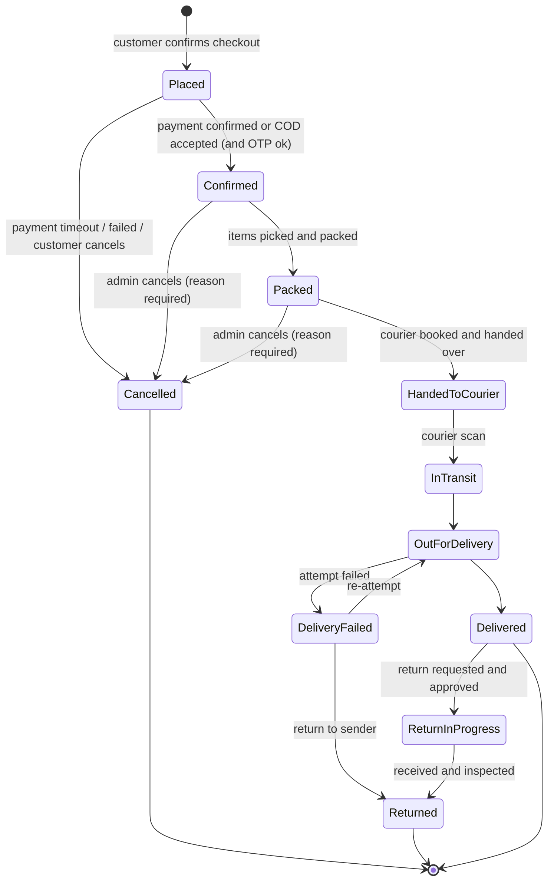
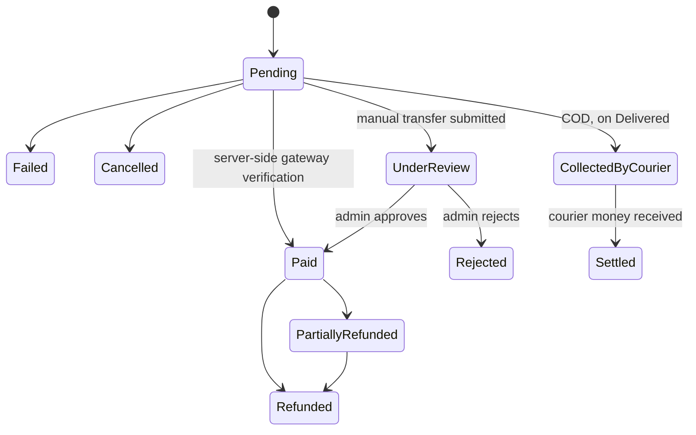

# Juvo BD: understanding of the business and the system

Source of truth for business rules: `Documents/Juvo BD — E-Commerce Platform BRD & SRS.docx` (copy: `docs/source/brd-srs.md`, 16 sections, all 63 tables and the ERD verified).
Technology and structure: `juvo-claude-code-prompt.md`. Decisions: `docs/assumptions.md`. Brand: `docs/brand-tokens.md`.
Section numbers below refer to the SRS unless stated. Multi-branch (4A) is from the master prompt, not the SRS.

## 1. The business in one page

Juvo BD sells fashion (clothing, shoes, ladies' dresses, purses) in Bangladesh and internationally, today only through a Facebook page with manual orders, stock, payment and delivery. The platform gives customers a premium shop (guest checkout with a mobile number, live tracking) and gives the owner one admin panel for catalog, stock, orders, couriers, payments, money and staff. Currency BDT, English plus Bengali.

Problems solved (2.2): P1 no catalog, P2 lost orders, P3 no status visibility, P4 manual courier/payment, P5 hard to serve outside Dhaka/abroad, P6 unknown stock/overselling, P7 customers hesitate to register, P8 inconsistent brand.

Users (4.1): Visitor, Guest buyer, Quick-profile customer (mobile OTP), Registered customer, Admin staff (RBAC), Super Admin (2-step login).

Three faces in one system: storefront + customer panel, admin panel, integrations (payments, couriers, maps, SMS/email/WhatsApp).

## 2. Module matrix (A to AF, plus identity and branches)

Columns: module, main entities, planned API area (`/api/v1/...`), UI screens, permission prefix (`module.resource.action`), planned build step (14-step plan).
"Global" = shared by all branches; "Branch" = carries `BranchId` (4A.2).

| ID | Module | Main entities | API area | UI screens | Permissions | Scope | Step |
| --- | --- | --- | --- | --- | --- | --- | --- |
| A | Storefront and showcase | Product, ProductVariant, ProductImage, Category, Review | `/catalog/products`, `/catalog/categories`, `/search`, `/reviews` | Home, category, search, product detail, size guide, contact, policies | public; `catalog.review.moderate` | Global | 7 |
| B | Catalog and media | Product, Variant, Image, Category, Brand, SizeChart, ProductAudit | `/admin/catalog/*`, `/admin/media` | Product list, add/edit with live preview, categories, brands, size charts, bulk import | `catalog.product.view/create/edit/publish/archive`, `catalog.category.*`, `catalog.media.upload` | Global | 6 |
| C | Cart and wishlist | Cart, CartItem, WishlistItem, Coupon | `/cart`, `/wishlist`, `/coupons/validate` | Cart drawer, cart page, wishlist | public / customer | Global | 7 |
| D | Checkout and order placement | SalesOrder, OrderItem, OrderStatusHistory, IdempotencyKey | `/checkout`, `/orders` | Checkout (single page on mobile), confirmation | `orders.order.create` (staff manual) | Branch (fulfilling) | 8 |
| E | Customer identity | Customer, OtpCode, ConsentLog | `/auth/otp/*`, `/customers/me` | Sign in, OTP, quick profile, create profile | customer self; `customers.customer.*` | Global | 3 + 7 |
| F | Customer panel | Customer, Address, SalesOrder, Invoice | `/me/*` | Dashboard, orders, tracking, invoices, addresses, wishlist, profile | customer self | Global | 7-8 |
| G | Delivery zones and map | DeliveryZone, DeliveryRate, Country, Division, District, Upazila, Address | `/delivery/*`, `/geo/*` | Address picker with map, zone and rate admin | `delivery.zone.*`, `delivery.rate.*` | Global (pickup per branch) | 7 |
| H | Courier integration | Courier, CourierSetting, Shipment, ShipmentEvent, WebhookLog, CodSettlement | `/admin/couriers`, `/shipments`, `/webhooks/couriers/{provider}` | Courier list/settings, booking from order, labels, COD settlement | `couriers.courier.*`, `couriers.shipment.book/cancel`, `couriers.cod.settle` | Branch | 10 |
| I | Payments | Payment, Refund, PaymentLedger, GatewaySetting, WebhookLog | `/payments`, `/admin/payments`, `/webhooks/payments/{provider}` | Pay step, return page, verification queue, refunds, reconciliation | `payments.payment.view`, `payments.payment.verify`, `payments.refund.create/approve` | Branch | 9 |
| J | Real-time status | OrderStatusHistory, SignalR hubs | `/hubs/admin`, `/hubs/customer`, `/track` | Timeline, 3 tracks, public tracking, transparency view | `orders.order.view` | Branch | 8 + 10 |
| K | Notifications | NotificationTemplate, NotificationLog, Outbox | `/admin/notifications/*` | Templates (EN/BN), channel switches, log | `notifications.template.*`, `notifications.log.view` | Branch (sent by) | 9 |
| L | Cancel, return, refund | ReturnRequest, ReturnItem, Refund, StockMovement | `/orders/{id}/cancel`, `/returns` | Cancel, return request with photos, returns queue | `orders.order.cancel`, `returns.return.approve/receive/refund` | Branch | 10 (backend and screens done; refunds by gateway in 9) |
| M | Admin dashboard | read models | `/admin/dashboard/*` | Today cards, action queue, charts, cash view, stock health | `reports.dashboard.view` | Branch + consolidated | 12 |
| N | Admin panel | all admin lists, AuditLog, Setting | `/admin/*` | Menus: orders, products, inventory, customers, delivery, couriers, payments, returns, promotions, CMS, notifications, reports, settings, audit | per feature | mixed | 6-12 |
| O | Users, roles, permissions (UMS) | StaffUser, Role, Permission, RolePermission, UserBranchRole, RefreshToken, SignInHistory, AuditLog | `/auth/*`, `/admin/ums/*` | Users, roles with permission matrix, assign, sessions, audit | `ums.user.*`, `ums.role.*`, `ums.permission.view`, `ums.audit.view` | Global | 3 + 5 |
| 4A | Branches | Branch, UserBranchRole, StockLocation, StockTransfer | `/admin/ums/branches`, `X-Branch-Id` header | Branches, branch-user-role grid, header branch switcher | `ums.branch.view/create/edit/deactivate/assign-user/switch-all`, `orders.order.reassign-branch`, `inventory.transfer.*` | Global | 3 + 5 |
| P | Reports | read models over orders, stock, payments | `/admin/reports/*` | Sales, orders funnel, inventory, finance, courier, customers; export | `reports.sales.view`, `reports.finance.view`, ... `reports.*.export` | Branch + consolidated | 11A |
| Q | Brand About and social | CmsPage, CmsSection, SocialLink, ContactMessage, Faq | `/cms/*`, `/admin/cms/*` | About, contact, policies, FAQ, trust badges, CMS editor, inbox | `cms.page.*`, `cms.contact.view` | Global | 12 |
| R | SEO and marketing | SeoFields, sitemap, newsletter | `/sitemap.xml`, `/feeds/*` | SEO fields, analytics hooks, cookie consent | `cms.seo.edit` | Global | 12 |
| S | Social order desk | SalesOrder (source tag) | `/admin/orders/manual` | Quick order form, source filter, daily count by source | `orders.order.create`, `orders.source.view` | Branch | 8 |
| T | Fraud and blacklist | OrderRiskFlag, BlacklistEntry | `/admin/fraud/*` | Review queue, blacklist, rules | `fraud.flag.view`, `fraud.review.decide`, `fraud.blacklist.*` | Branch | 8 |
| U | Tax, VAT, invoicing | TaxRule, Invoice (invoice/credit note) | `/admin/tax/*`, `/invoices/{id}/pdf` | Tax rules, invoice list/PDF, credit notes, tax report | `tax.rule.*`, `tax.invoice.view`, `tax.report.view` | Branch (numbering) | 9 |
| V | Advanced inventory | StockLocation, StockMovement, StockCount(+Line), StockTransfer | `/admin/inventory/*` | Stock by branch, adjustments, transfers, stocktake, reorder levels | `inventory.stock.view/adjust`, `inventory.count.*`, `inventory.transfer.*` | Branch | 6 |
| W | Purchase and supplier | Supplier, PurchaseOrder(+Line), GoodsReceipt | `/admin/purchasing/*` | Suppliers, POs, goods receipt, balance | `purchasing.supplier.*`, `purchasing.po.*`, `purchasing.receipt.create` | Branch | 11A |
| X | Expenses and accounting | Expense, CashBookEntry | `/admin/accounting/*` | Expenses, cash book, P&L | `accounting.expense.*`, `accounting.pnl.view` | Branch + consolidated | 11A |
| Y | Customer support | SupportTicket, TicketMessage, CannedReply | `/tickets`, `/admin/support/*` | Ticket list/detail, canned replies | `support.ticket.*` | Branch | 11A |
| Z | Promotions engine | Promotion, PromotionRule, Coupon | `/admin/promotions/*` | Campaigns, flash sale, bundles, stacking rules | `promotions.promotion.*` | Global | 11B |
| AA | Pre-order and backorder | Product/Variant flags, ship date | `/admin/preorders/*` | Pre-order label, separate queue | `inventory.preorder.*` | Branch | 11B |
| AB | Loyalty, referral, store credit | LoyaltyLedger, GiftCard, ReferralCode | `/me/loyalty`, `/admin/loyalty/*` | Points, credit ledger, gift cards | `loyalty.*` | Global | 11B |
| AC | Marketing automation | Segment, Campaign, Automation, ConsentLog | `/admin/marketing/*` | Segments, campaigns, automations | `marketing.*` | Global | 11B |
| AD | Reseller and affiliate | Reseller, AffiliateCode, CommissionStatement | `/admin/partners/*` | Partner accounts, commission statements | `partners.*` | Global | 11B |
| AE | POS and multi-branch | PosSession, PosSale, CashRegisterReport | `/admin/pos/*` | POS screen, register open/close report | `pos.sale.create`, `pos.register.*` | Branch | 11B |
| AF | Platform services | FeatureFlag, JobLog, ApiKey, WebhookSubscription, Setting, ConsentLog | `/admin/platform/*`, `/public/v1/*` | Settings centre, job dashboard, backup/restore, integration health, privacy tools, PWA | `settings.system.*`, `platform.job.retry`, `platform.apikey.*`, `privacy.data.*` | Global (+ per-branch override) | 12 |

Cross-cutting backend (Step 2): ProblemDetails + error codes, correlation id, health checks, API versioning, rate limiting, audit interceptor, transactional outbox + background worker, idempotency keys, optimistic concurrency (`rowversion`), `IFileStorage`, `TimeProvider`.

### Roles matrix (SRS 9, Module O) as permission groups

| Capability | Super Admin | Manager | Order Mgr | Inventory Mgr | Content Editor | Support | Accountant |
| --- | --- | --- | --- | --- | --- | --- | --- |
| Orders | Full | Full | Full | View | None | View + notes | View |
| Products/Stock | Full | Full | View | Full | Edit content | View | View |
| Customers | Full | Full | View | None | None | View | View |
| Couriers/Delivery | Full | Full | Operate | None | None | View | View |
| Payments/Refunds | Full | Approve | View | None | None | None | Full view |
| CMS/Content | Full | Full | None | None | Full | None | None |
| Reports | Full | Full | Orders only | Stock only | None | None | Finance only |
| Settings/Roles | Full | None | None | None | None | None | None |

Branch rule (4A.1): effective permission = permission **and** branch scope. A user holds roles per branch (`UserBranchRole`), optionally a global scope. Super Admin always has global scope and every permission, including future ones. Cost price, profit and settings are hidden from roles lacking the permission (FR-O04).

## 3. State machines

### 3.1 Order status (SRS 11.1: only these transitions are allowed; each writes history who/when/from/to/reason and raises a domain event)

Side effects: Placed = order number issued, stock reserved, notifications sent. Cancelled = stock released, refund if paid. Delivered = COD marked Collected-by-courier, review request scheduled. Returned = stock review, refund if prepaid. Orders before packing can be reassigned to another branch (4A.3).

### 3.2 Payment status (11.2, FR-I05)

Rules: never mark Paid from the browser return alone (FR-I03); webhooks are idempotent and signature-checked (FR-I04, FR-H07); advance payment possible for COD (FR-I06, BR-D1); unpaid online orders time out (BR-D2, 30 min default).

### 3.3 Delivery status (7, Module H mapping table)

Booked → Picked up → In transit → Out for delivery → Delivered; branches: Delivery attempt failed (→ re-attempt or Returning → Returned). The raw courier status text is stored next to the mapped platform status (FR-H05).

### 3.4 Other workflows

| Workflow | States |
| --- | --- |
| Return (L, FR-L04) | Requested → Approved/Rejected → Pickup arranged → Received → Inspected → Refunded or Exchanged |
| Purchase order (W, FR-W02) | Draft → Sent → Partly received → Received (or Cancelled) |
| Support ticket (Y, FR-Y02) | Open → In progress → Waiting for customer → Resolved → Closed |
| Inter-branch transfer (4A.3) | Requested → Approved → In transit → Received (stock movement on both sides) |
| Product (B, FR-B01) | Draft → Published → Archived; publish needs name, category, price, 1+ image, 1+ variant (BR-B1) |
| Customer level (E) | Guest → Quick profile (OTP) → Full profile; guest orders attach after OTP (FR-E03) |
| Fraud decision (T) | Flagged → Review → Approve / Request advance / Call (note) / Reject |
| Stocktake (V) | Start count → enter/scan → review differences → approve adjustment |

## 4. Cross-cutting rules that drive the design

- **Stock**: `available = on_hand − reserved` per variant per branch. Reserve at placement inside one transaction with row locking plus `rowversion` check; deduct at packing; release on cancel/fail/timeout (BR-002, NFR-019, assumption Q7). Stock movements are append-only.
- **Immutability**: order status history (BR-003), stock movements, payments, refunds, shipment events and audit log are append-only. Order items snapshot name, price and address.
- **Money**: `decimal(18,2)` + currency code; stored in BDT; international display is a conversion (BR-005); charged currency shown at checkout.
- **Delivery charge**: by zone, weight slabs, order value, free threshold, per-courier override, remote surcharge (BR-004, FR-G08); the shown charge is the billed charge (BR-G2).
- **Identity**: mobile (normalised `+880…`) is the customer key (BR-006); OTP 6 digits, 5 min, rate limited (FR-E05).
- **Numbering**: `JV-<BRANCH>-<YYMM>-<seq>`; invoices and credit notes gap-free per branch.
- **Soft delete**: products, customers, staff and branches are deactivated/archived, never erased (FR-N06).
- **Adapters**: one adapter per courier and per payment gateway behind `ICourierProvider` / `IPaymentGateway`; Sandbox adapters on by default.
- **Time**: UTC stored, Asia/Dhaka displayed.

## 5. Final ERD (database to build; SRS section 12 + section 15.1 + identity, branches and platform tables)

The order table is `SALES_ORDER` (ORDER is reserved in SQL). Every entity marked "Branch" in section 2 carries `branch_id`. Common columns on every table (omitted below): `id`, `created_at`, `updated_at`, `row_version`, soft-delete flag where relevant.

```mermaid
erDiagram
    %% ---- Identity, access and branches ----
    STAFF_USER ||--o{ USER_BRANCH_ROLE : assigned
    BRANCH ||--o{ USER_BRANCH_ROLE : scopes
    ROLE ||--o{ USER_BRANCH_ROLE : grants
    ROLE ||--o{ ROLE_PERMISSION : contains
    PERMISSION ||--o{ ROLE_PERMISSION : in
    STAFF_USER ||--o{ REFRESH_TOKEN : holds
    STAFF_USER ||--o{ SIGN_IN_HISTORY : records
    STAFF_USER ||--o{ AUDIT_LOG : performs
    BRANCH ||--o{ AUDIT_LOG : context
    BRANCH |o--o{ BRANCH : parent_of
    CUSTOMER ||--o{ OTP_CODE : verifies
    CUSTOMER ||--o{ CONSENT_LOG : gives
    CUSTOMER ||--o{ REFRESH_TOKEN : holds

    %% ---- Customers and addresses ----
    CUSTOMER ||--o{ ADDRESS : has
    CUSTOMER ||--o{ SALES_ORDER : places
    CUSTOMER ||--o{ WISHLIST_ITEM : saves
    CUSTOMER ||--o{ CART : owns
    CUSTOMER ||--o{ REVIEW : writes
    CUSTOMER ||--o{ SUPPORT_TICKET : opens
    CUSTOMER ||--o{ LOYALTY_LEDGER : earns
    COUNTRY ||--o{ DIVISION : contains
    DIVISION ||--o{ DISTRICT : contains
    DISTRICT ||--o{ UPAZILA : contains

    %% ---- Catalog ----
    CATEGORY ||--o{ PRODUCT : groups
    CATEGORY |o--o{ CATEGORY : parent_of
    BRAND ||--o{ PRODUCT : makes
    PRODUCT ||--|{ PRODUCT_VARIANT : has
    PRODUCT ||--o{ PRODUCT_IMAGE : shows
    PRODUCT ||--o{ REVIEW : receives
    PRODUCT ||--o{ WISHLIST_ITEM : saved_as
    CATEGORY ||--o{ SIZE_CHART : defines
    CATEGORY ||--o{ TAX_RULE : taxed_by
    CART ||--|{ CART_ITEM : contains
    PRODUCT_VARIANT ||--o{ CART_ITEM : in

    %% ---- Inventory (branch-wise) ----
    BRANCH ||--o{ STOCK_LOCATION : has
    STOCK_LOCATION ||--o{ STOCK_LEVEL : holds
    PRODUCT_VARIANT ||--o{ STOCK_LEVEL : stocked_as
    STOCK_LEVEL ||--o{ STOCK_MOVEMENT : records
    BRANCH ||--o{ STOCK_TRANSFER : from_or_to
    STOCK_TRANSFER ||--|{ STOCK_TRANSFER_LINE : contains
    STOCK_LOCATION ||--o{ STOCK_COUNT : counted_in
    STOCK_COUNT ||--|{ STOCK_COUNT_LINE : has

    %% ---- Orders, payments, delivery ----
    BRANCH ||--o{ SALES_ORDER : fulfils
    SALES_ORDER ||--|{ ORDER_ITEM : contains
    PRODUCT_VARIANT ||--o{ ORDER_ITEM : sold_as
    SALES_ORDER ||--o{ ORDER_STATUS_HISTORY : logs
    SALES_ORDER ||--o{ PAYMENT : paid_by
    PAYMENT ||--o{ REFUND : refunded_by
    SALES_ORDER ||--o{ SHIPMENT : shipped_in
    COURIER ||--o{ SHIPMENT : carries
    BRANCH ||--o{ SHIPMENT : pickup_from
    SHIPMENT ||--o{ SHIPMENT_EVENT : tracks
    SHIPMENT ||--o| COD_SETTLEMENT : settled_by
    DELIVERY_ZONE ||--o{ DELIVERY_RATE : prices
    DELIVERY_ZONE ||--o{ SALES_ORDER : delivers_to
    COUPON ||--o{ SALES_ORDER : applied_to
    SALES_ORDER ||--o{ RETURN_REQUEST : may_have
    RETURN_REQUEST ||--|{ RETURN_ITEM : lists
    SALES_ORDER ||--o{ NOTIFICATION_LOG : triggers
    SALES_ORDER ||--o{ ORDER_RISK_FLAG : flagged
    SALES_ORDER ||--o{ INVOICE : invoiced_by
    INVOICE |o--o{ INVOICE : credit_note_of
    SALES_ORDER ||--o{ SUPPORT_TICKET : about
    SUPPORT_TICKET ||--|{ TICKET_MESSAGE : has

    %% ---- Purchasing, money ----
    SUPPLIER ||--o{ PURCHASE_ORDER : supplies
    BRANCH ||--o{ PURCHASE_ORDER : buys_for
    PURCHASE_ORDER ||--|{ PURCHASE_ORDER_LINE : contains
    PURCHASE_ORDER ||--o{ GOODS_RECEIPT : received_by
    BRANCH ||--o{ EXPENSE : incurs
    BRANCH ||--o{ CASH_BOOK_ENTRY : records

    %% ---- Growth and platform ----
    PROMOTION ||--|{ PROMOTION_RULE : defined_by
    SEGMENT ||--o{ CAMPAIGN : targets
    BRANCH ||--o{ POS_SESSION : runs
    POS_SESSION ||--o{ SALES_ORDER : sells
    API_KEY ||--o{ WEBHOOK_SUBSCRIPTION : owns

    STAFF_USER {
        uuid staff_id PK
        string email UK
        string name
        bool is_active
        bool two_factor_enabled
        bool is_global_scope
        int permission_version
    }
    BRANCH {
        uuid branch_id PK
        string code UK
        string name_en
        string name_bn
        string type "head_office, shop, warehouse, online"
        uuid parent_branch_id FK
        decimal latitude
        decimal longitude
        string order_prefix
        bool is_default
        bool is_active
    }
    USER_BRANCH_ROLE {
        uuid staff_id FK
        uuid branch_id FK
        int role_id FK
    }
    ROLE {
        int role_id PK
        string name UK
        bool is_system
    }
    PERMISSION {
        int permission_id PK
        string code UK "module.resource.action"
        string module
    }
    REFRESH_TOKEN {
        uuid token_id PK
        string token_hash
        uuid family_id
        string device
        string ip
        datetime expires_at
        datetime revoked_at
    }
    CUSTOMER {
        uuid customer_id PK
        string mobile UK
        string email
        string full_name
        string profile_level "guest, quick, full"
        bool mobile_verified
        bool marketing_consent
    }
    PRODUCT {
        uuid product_id PK
        int category_id FK
        string slug UK
        string name_en
        string name_bn
        string status "draft, published, archived"
        decimal base_price
        decimal sale_price
        decimal cost_price
        decimal weight_g
    }
    PRODUCT_VARIANT {
        uuid variant_id PK
        uuid product_id FK
        string sku UK
        string color
        string size
        decimal price_override
    }
    STOCK_LEVEL {
        uuid variant_id FK
        uuid location_id FK
        int on_hand
        int reserved
        int damaged
        int reorder_level
    }
    STOCK_MOVEMENT {
        uuid movement_id PK
        int qty_change
        string reason
        string ref_id
        uuid branch_id FK
    }
    SALES_ORDER {
        uuid order_id PK
        string order_no UK
        uuid branch_id FK
        uuid customer_id FK
        uuid zone_id FK
        string order_status
        string payment_status
        string delivery_status
        string source "website, facebook, messenger, whatsapp, phone, walk_in"
        decimal subtotal
        decimal delivery_charge
        decimal discount
        decimal tax_total
        decimal grand_total
        string currency
        string idempotency_key UK
    }
    ORDER_ITEM {
        uuid item_id PK
        string name_snapshot
        decimal unit_price
        int quantity
        decimal line_total
    }
    PAYMENT {
        uuid payment_id PK
        string method
        string gateway
        string gateway_ref UK
        decimal amount
        decimal gateway_fee
        string status
    }
    SHIPMENT {
        uuid shipment_id PK
        string consignment_id UK
        decimal cod_amount
        decimal courier_charge
        string cod_settlement_status
    }
    INVOICE {
        uuid invoice_id PK
        string invoice_no UK
        string type "invoice, credit_note"
        decimal tax_total
        uuid parent_invoice_id FK
        uuid branch_id FK
    }
    AUDIT_LOG {
        uuid audit_id PK
        uuid staff_id FK
        uuid branch_id FK
        string entity
        string action
        json old_value
        json new_value
    }
```

Additional tables not drawn (no important relationships beyond the above): `SETTING`, `FEATURE_FLAG`, `JOB_LOG`, `OUTBOX_MESSAGE`, `WEBHOOK_LOG`, `NOTIFICATION_TEMPLATE`, `CMS_PAGE`, `CMS_SECTION`, `SOCIAL_LINK`, `CONTACT_MESSAGE`, `FAQ`, `BLACKLIST_ENTRY`, `CANNED_REPLY`, `GIFT_CARD`, `REFERRAL_CODE`, `RESELLER`, `AFFILIATE_CODE`, `COMMISSION_STATEMENT`, `AUTOMATION`, `EXCHANGE_RATE`, `PAYMENT_LEDGER`, `NUMBER_SEQUENCE` (gap-free per branch), `IDEMPOTENCY_KEY`, `POS_SALE`, `CASH_REGISTER_REPORT`.

## 6. Traceability: every requirement and business rule

Rule from the SRS (16.5): every FR is a backlog item named with its ID; every FR gets at least one test named with the same ID; status per ID; new ideas get a new ID, priority and phase.

<!-- TRACEABILITY:START -->

Generated from `docs/source/brd-srs.md` by `scripts/gen_traceability.py` (257 FR/NFR rows, 15 business rules). Status values: **Not started**, **In progress**, **Done**, **Partial**, **Deferred** (with reason). Edit Status, Implemented in and Notes by hand as steps finish. Step = planned step in `Documents/juvo-step-prompts.md`.

### Functional and non-functional requirements

| ID | Requirement | Pri | Step | Status | Implemented in (file / endpoint / page) | Notes |
| --- | --- | --- | --- | --- | --- | --- |
| FR-A01 | Home page with hero slider (admin-managed), featured categories, New Arrivals, Best Sellers, Sale section, brand story strip, social links,… | M | 7 | Not started | | |
| FR-A02 | Category pages (Clothing, Shoes, Ladies' Dresses, Purses, and any category the admin adds) with sub-categories | M | 7 | Done | API `GET /store/categories`, `/store/products?category=` | Backend of Step 7-a; pages in 7-b.  Front end: `src/modules/store`, `cart`, `myaccount` (Step 7-b); e2e store/cart/myaccount specs. |
| FR-A03 | Product grid shows auto-designed premium cards (section 3.4); infinite scroll or "Load more" | M | 7 | Done | API `GET /store/products` (paged cards with price, badges, swatches, sizes) | Backend only; the page is in 7-b.  Front end: `src/modules/store`, `cart`, `myaccount` (Step 7-b); e2e store/cart/myaccount specs. |
| FR-A04 | Filters: category, price range, size, colour, brand, availability, discount; sort: newest, price low-high, price high-low, popularity | M | 7 | Done | API `GET /store/products` filters category, price, size, colour, brand, inStock, onSale; sort newest, price-asc, price-desc, popular; `/products/facets` | Backend of Step 7-a; filter panel in 7-b.  Front end: `src/modules/store`, `cart`, `myaccount` (Step 7-b); e2e store/cart/myaccount specs. |
| FR-A05 | Search with suggestions by name, category and SKU; tolerant of small spelling mistakes (Should) | M | 7 | Done | API `GET /store/products?q=` (tolerates small spelling mistakes), `/store/search/suggest` | Name, tagline, tags, brand, category; SKU search not exposed publicly. UI in 7-b.  Front end: `src/modules/store`, `cart`, `myaccount` (Step 7-b); e2e store/cart/myaccount specs. |
| FR-A06 | Product detail page: image gallery with zoom and swipe, optional video, variant selectors (colour, size), live stock note, price, delivery… | M | 7 | Done | API `GET /store/products/{slug}` (variants with capped availability, pictures, size chart, related) | Backend only; the page is in 7-b.  Front end: `src/modules/store`, `cart`, `myaccount` (Step 7-b); e2e store/cart/myaccount specs. |
| FR-A07 | Size guide popup per category (admin-editable table) | S | 7 | Not started | | |
| FR-A08 | "Notify me when available" for sold-out variants (mobile or email) | S | 7 | Not started | | |
| FR-A09 | Recently viewed products | C | 7 | Done | `src/modules/store/recently-viewed.tsx` | Browser storage only (Step 7-b). |

| FR-A10 | Share product to Facebook, WhatsApp, copy link; clean URLs and social preview image | M | 7 | Not started | | |
| FR-A11 | Language switch English / Bengali; currency display BDT, with optional conversion for international visitors | S | 7 | Partial | |  Step 7-b front end added (language switch, map pin with Use my location, cart page, account dashboard); address search and BDT conversion not built. |
| FR-A12 | Customer-visible reviews with star rating and photos (only verified buyers can review) | S | 7 | Not started | | |
| FR-B01 | Create/edit product: name (EN + optional BN), slug, category, sub-category, brand, short and long description, material, care, tags, gender… | M | 6 | Done | `/admin/products/new`, `/admin/products/{id}` (ProductEditor, ProductDetailsForm); API `/api/v1/catalog/products` | Steps 6-a and 6-e. |
| FR-B02 | Variants: colour and size combinations, each with its own SKU, price override, stock quantity, barcode (optional), weight override | M | 6 | Done | Variants tab (ProductVariants: add, edit, remove, colour x size generator); stock quantity per branch in the stock grid | Step 6-e. |
| FR-B03 | Pricing: regular price, sale price with start/end date, cost price (admin-only, for profit report) | M | 6 | Done | Price card of the product form; cost price only with `catalog.product.view-cost` | Step 6-e. |
| FR-B04 | Image upload: multiple images, drag to reorder, first image is primary; per-colour image sets; bulk upload | M | 6 | Done | Pictures tab (ProductImages): several files at once, per-colour set, drag or button reorder, delete; API `/images` | Steps 6-b and 6-e. |
| FR-B05 | System auto-processes images: resize to several sizes, convert to modern format (e.g. WebP), compress, crop to the 4:5 frame with adjustabl… | M | 6 | Done | Picture editor (focal point by click or sliders, live 4:5 crop frame); API pipeline `SkiaImageProcessor` | Steps 6-b and 6-e. |
| FR-B06 | Image rules shown to staff: minimum 1000 px on the long side, max 10 MB per file; warn if too small or blurry (blur check is Could) | M | 6 | Done | Rules shown on the Pictures tab; type, size and 1000 px checks in the browser before sending, and again in the API | Blur check (Could) not built. |
| FR-B07 | Optional product video (short clip or link) | C | 6 | Partial | Video link field on the Search and sharing tab | A link only; no video upload. |
| FR-B08 | Live "storefront preview" while editing, showing the exact card and page | M | 6 | Partial | Live storefront card beside the editor (ProductCard) built from the unsaved form, the saved pictures, variants and stock | The product page preview arrives with the storefront (Step 7). |
| FR-B09 | Bulk import/export of products and stock via CSV/Excel with a validation report | S | 6 | Done | Import and export buttons on `/admin/products` (ImportExportButtons); API `/products/import`, `/export`, `/import-template` | Steps 6-d and 6-e. Check-first flow with a row-by-row report. |
| FR-B10 | Duplicate a product to create similar ones quickly | S | 6 | Done | Duplicate button in the product header; API `/duplicate` | Step 6-e. |
| FR-B11 | Category management: add/edit/reorder, category image, active flag | M | 6 | Partial | `/admin/categories` (tree, add, edit, delete, move up/down, active flag); API `/catalog/categories` | Category picture upload is not in the UI yet. |
| FR-B12 | Mark product as New, Featured, Best seller (manual or automatic rules) | M | 6 | Done | Labels card of the product form (New, Featured, Best seller; manual) | Automatic rules not built. |
| FR-B13 | Product SEO fields: meta title, description, social image | S | 6 | Partial | Search and sharing tab (page title, description) | Social share image upload is not in the UI yet. |
| FR-B14 | Every product change is written to the audit log (who, what, when, old/new) | M | 6 | Done | Audit interceptor; viewable in `/admin/ums/audit` | Step 6-a. |
| FR-C01 | Add to cart from card (quick add) or product page with required variant selection | M | 7 | Done | API `POST /store/cart/items` (variant and quantity) | Backend of Step 7-a; buttons in 7-b.  Front end: `src/modules/store`, `cart`, `myaccount` (Step 7-b); e2e store/cart/myaccount specs. |
| FR-C02 | Cart drawer and full cart page: change quantity, remove, see line totals, subtotal, estimated delivery, coupon field | M | 7 | Partial | API `GET/PUT/DELETE /store/cart/*`, coupon, `/store/cart/delivery-quote` | Backend only; drawer and page in 7-b.  Step 7-b front end added (language switch, map pin with Use my location, cart page, account dashboard); address search and BDT conversion not built. |
| FR-C03 | Cart is kept for guests (browser storage + server session) and merged into the account after sign-in | M | 7 | Done | Guest cart by `X-Cart-Token` (hash stored), `POST /store/cart/merge` after sign-in | Backend of Step 7-a; the browser keeps the token in 7-b.  Front end: `src/modules/store`, `cart`, `myaccount` (Step 7-b); e2e store/cart/myaccount specs. |
| FR-C04 | Quantity limited to available stock; clear message if stock changed since adding | M | 7 | Done | CartService re-checks availability on every read (`REDUCED`, `OUT_OF_STOCK`, price-changed marker) | Backend of Step 7-a; messages in 7-b.  Front end: `src/modules/store`, `cart`, `myaccount` (Step 7-b); e2e store/cart/myaccount specs. |
| FR-C05 | Wishlist (heart): guests keep it on the device; signed-in users keep it on the account; move wishlist item to cart | S | 7 | Done | API `/me/wishlist` and `move-to-cart` (signed-in customers) | Guest wishlist on the device is front-end work in 7-b.  Front end: `src/modules/store`, `cart`, `myaccount` (Step 7-b); e2e store/cart/myaccount specs. |
| FR-C06 | Abandoned cart reminder by SMS/email when mobile or email is known (admin can turn on) | C | 7 | Not started | | |
| FR-C07 | Coupon codes: percentage or fixed, minimum order, expiry, usage limit | S | 7 | Done | Coupons: `/promotions/coupons` (staff), `/store/coupons/validate`, `/store/cart/coupon` | Percentage or fixed, minimum order, dates, usage limit. Use count rises in Step 8; admin screen in 7-b. |
| FR-D01 | Checkout works with no account: mobile number plus the basic details (name, address, delivery area) are enough | M | 8 | Done | CheckoutService.CheckoutAsync; POST /api/v1/store/checkout; juvo-front/src/modules/orders/checkout-view.tsx; /checkout | Mobile, name and address are enough; the customer is found or created by mobile (BR-006). Backend 8-a; page in 8-b. Front end 8-b: guest with mobile only, or signed in; e2e covers the guest order end to end. |
| FR-D02 | If the mobile number matches an existing customer, offer sign-in by OTP to load saved addresses; ordering without signing in remains possib… | M | 8 | Partial | OrderPlacement (customer found by mobile); OTP sign-in from Step 7 | An existing customer's guest order is attached to them without sign-in; the sign-in offer and saved-address load are front end (8-b). Front end 8-b: the checkout offers sign-in ('Have a profile? Sign in', returns to /checkout); ordering without signing in works. |
| FR-D03 | Mobile number validation: Bangladesh format 01XXXXXXXXX (11 digits) or +880...; international numbers accepted with country code | M | 8 | Done | PhoneNumber.Normalize (Step 3) used by checkout, tracking and the order desk | 01XXXXXXXXX, +880 and international numbers. Front end 8-b: checkout, tracking and the desk accept Bengali digits and +880 forms (unit tested). |
| FR-D04 | Optional OTP verification of the mobile number before confirming (admin switch: off, COD only, or always). Recommended on for COD to reduce… | S | 8 | Done | SettingsService Checkout.OtpMode (Off, CodOnly, Always); CustomerAuthService.ConsumeOtpAsync; juvo-front/src/modules/orders/checkout-view.tsx (code section) | Default CodOnly. A signed-in customer with a verified mobile skips it. Front end 8-b: code field and 'Send code' appear when the quote says otpRequired; the sandbox code is shown on screen in the sandbox. |
| FR-D05 | Show live totals: subtotal, delivery charge, discount, tax/duty (if enabled), grand total, and amount payable now vs. on delivery | M | 8 | Done | POST /api/v1/store/checkout/quote; juvo-front/src/modules/orders/checkout-view.tsx review panel | Subtotal, coupon, delivery, grand total, payNow and payOnDelivery. Prices are tax-inclusive; a duty line stays DAP text from the delivery quote. Front end 8-b: totals, payNow and payOnDelivery come from the quote on every change. |
| FR-D06 | Re-check stock and price at "Confirm order"; if changed, show what changed and let the customer continue or edit | M | 8 | Done | OrderPlacement (expectedTotal gives 409 ORDER.TOTAL_CHANGED; stock re-reserved at placement); juvo-front/src/modules/orders/checkout-view.tsx (expectedTotal, ORDER.TOTAL_CHANGED, stock problems per line) | Edit/continue screen is front end (8-b). Front end 8-b: a changed total is shown (was/now) and needs a second press; sold-out lines are marked; e2e covers both. |
| FR-D07 | On success show order number, summary, expected delivery date range, tracking link, and a "Create my profile" prompt (module E) | M | 8 | Done | CheckoutResultDto (number, tracking token, delivery date range, offerProfile); juvo-front/src/modules/orders/confirmation-view.tsx; /order/confirmed/[number] | Confirmation page and profile prompt in 8-b. Front end 8-b: number, summary, delivery window, one-time tracking link with copy button, create-my-profile prompt for guests. |
| FR-D08 | Order note field (gift wrap, delivery instruction) | S | 8 | Done | CheckoutRequest.Note stored as a customer note; juvo-front/src/modules/orders/checkout-view.tsx (note) | Shown on the packing slip. Front end 8-b: note field on the checkout. |
| FR-D09 | Duplicate-order guard: same mobile + same items within a few minutes triggers a warning | S | 8 | Done | OrderPlacement duplicate guard (ORDER.DUPLICATE_SUSPECTED, confirmDuplicate); juvo-front/src/modules/orders/checkout-view.tsx (duplicate dialog) | Window Checkout.DuplicateWindowMinutes, default 5. Front end 8-b: dialog 'You ordered this a moment ago' with confirmDuplicate; e2e covers it. |
| FR-D10 | Order source recorded (website, admin-created, Facebook/phone order entered by staff) | M | 8 | Done | Order.Source (Web, Facebook, WhatsApp, Phone, WalkIn, Other); juvo-front/src/modules/orders/orders-list.tsx (source filter and chips) | Messenger is recorded as Facebook. Front end 8-b: source badge on every order, filter and summary chips. |
| FR-D11 | Admin can create an order manually on behalf of a customer (for Facebook/phone orders) using the same rules | M | 8 | Done | OrdersService.CreateManualAsync; POST /api/v1/orders/manual; juvo-front/src/modules/orders/order-desk.tsx; /admin/orders/new | Same placement rules: price, stock, coupon, delivery, fraud, duplicate guard. Front end 8-b: the desk uses the same placement rules through POST /orders/manual. |
| FR-D12 | Terms, privacy and return policy acceptance stored with the order | M | 8 | Partial | Order.TermsAcceptedAt (acceptTerms is required) | Policy version is not stored yet (policies arrive with the CMS in Step 12). Front end 8-b: the checkout requires the terms tick (acceptTerms); the policy pages arrive with the CMS. |
| FR-E01 | Create a quick profile in real time from the order confirmation page or the sign-in page using only mobile number and email (email optional) | M | 7 | Partial | CustomerAuthService.VerifyOtpAsync creates the quick profile; `PUT /me` sets name and email | Confirmation-page flow in Step 8. |
| FR-E02 | A customer can also create a profile before ordering, from the sign-in page | M | 7 | Not started | | |
| FR-E03 | Mobile number is the unique key. Orders placed as guest with the same verified mobile number are automatically attached to the profile afte… | M | 7 | Partial | Customers.Mobile unique index, PhoneNumber.Normalize | Attaching guest orders after OTP in Step 8. |
| FR-E04 | Sign-in options: mobile + OTP (default), email + OTP, email/mobile + password (if set), Google sign-in (Could) | M | 7 | Partial | POST /api/v1/auth/otp/request and /verify by mobile (SMS) or email | Password and Google sign-in later. |
| FR-E05 | OTP rules: 6 digits, expires in 5 minutes, limited attempts and resend cooldown, rate-limited per number and device | M | 7 | Done | CustomerAuthService, OtpCode, rate limit policy otp | 6 digits, 5 min, 5 attempts, 60 s cooldown, hourly cap; tested. |
| FR-E06 | Progressive profile: ask for extra fields one at a time later, never block an order for them | S | 7 | Not started | | |
| FR-E07 | Consent checkboxes for marketing SMS/email, stored with timestamp; transactional messages always allowed | M | 7 | Done | API `GET/PUT /me/consent` (timestamped log) | Checkbox UI in 7-b.  Front end: `src/modules/store`, `cart`, `myaccount` (Step 7-b); e2e store/cart/myaccount specs. |
| FR-E08 | Customer can delete their account; order records are kept in anonymised form for legal and accounting needs | S | 7 | Not started | | |
| FR-E09 | Fraud signals: many orders from one device with different numbers, repeated fake/returned COD, flagged for admin review | C | 7 | Not started | | |
| FR-F01 | Dashboard: active orders with live status, recent orders, wishlist preview, saved addresses | M | 7-8 | Partial | API `GET /me/summary`, `/me/addresses`, `/me/wishlist`; juvo-front/src/modules/orders/../myaccount/account-summary.tsx | Orders part in Step 8; UI in 7-b.  Step 7-b front end added (language switch, map pin with Use my location, cart page, account dashboard); address search and BDT conversion not built. Front end 8-b: the overview shows the order count and links to My orders. |
| FR-F02 | My Orders: list with filters (active, delivered, cancelled, returned); order detail with items, amounts, payment status, delivery timeline,… | M | 8 | Done | CustomerOrdersService; GET /api/v1/me/orders (filters active, delivered, cancelled, returned) and /{id}; juvo-front/src/modules/orders/my-orders.tsx, my-order-detail.tsx; /account/orders, /account/orders/[id] | Items, amounts, three statuses, timeline. Invoice PDF in Step 9, courier name and tracking link in Step 10. Front end 8-b: filters active/delivered/cancelled/returned, cards on phones, items, amounts, payment status, delivery timeline, cancel with confirm, help line. |
| FR-F03 | Live order tracking page with timeline and map-style progress (module J) | M | 10 | Partial | TrackingDto.Shipment, SignalR hub /hubs/orders | Courier events and the live push are in the API; the live page is front-end work. |
| FR-F04 | Cancel an order while allowed (before courier pickup); request a return within the return window (module L) | M | 8 + 10 | Done | POST /api/v1/me/orders/{id}/cancel; GET /api/v1/me/orders/{id}/return-eligibility; POST /api/v1/me/returns | Cancel before courier pickup (Step 8) and the return request with window, quantities and pictures (backend, Step 10 slice) are done, with the customer screens: order cancel dialog `juvo-front/src/modules/orders/my-order-detail.tsx` (which also links "Return or exchange items"), request flow `/account/returns/new?order=<id>`, list `/account/returns`, detail and cancel `/account/returns/[id]` (`juvo-front/src/modules/returns`). Browser-tested against the real API (e2e/returns.spec.ts). |
| FR-F05 | Address book: add, edit, delete, set default; each address with a pinned map location | M | 7-8 | Done | API `/me/addresses` (add, edit, delete, default; optional latitude and longitude) | Map picker UI in 7-b.  Front end: `src/modules/store`, `cart`, `myaccount` (Step 7-b); e2e store/cart/myaccount specs. |
| FR-F06 | Profile: name, mobile, email, photo, password, language, notification preferences | M | 7-8 | Partial | API `GET/PUT /me` (name, email) | Photo, password, language and notification preferences later.  Step 7-b front end added (language switch, map pin with Use my location, cart page, account dashboard); address search and BDT conversion not built. |
| FR-F07 | Reorder: add all items of a past order to cart (checks stock and current price) | S | 7-8 | Not started | | |
| FR-F08 | Wishlist and back-in-stock requests | S | 7-8 | Partial | API `/me/wishlist` | Back-in-stock requests not built. |
| FR-F09 | Write a review for delivered items | S | 7-8 | Not started | | |
| FR-F10 | Payment history and refund status | M | 9 | Partial | PaymentsEndpoints /payments/orders/{id}, /payments, /payments/refunds; /store/payments/{id}/status; PayPanel in My order (payment track section), /admin/payments, order page panel | Staff see every payment and refund of an order. A customer-side list of payments and refunds under /me is not built; the customer sees the payment status on the order and the payment session. Front end (9-b): My order shows the payment track as its own section; staff see every payment, refund and event on /admin/payments and the order page. A customer list of payments and refunds under /me still has no endpoint, so it is not built. |
| FR-F11 | Help: contact the shop by phone/WhatsApp/message from an order page | S | 7-8 | Partial | juvo-front/src/modules/orders/my-order-detail.tsx (help alert) | Front end 8-b: an e-mail line with the order number on the order page; phone/WhatsApp buttons wait for the owner's contact details. |
| FR-G01 | Country selector (all countries; admin can enable/disable countries for shipping) | M | 7 | Partial | API `GET /store/geo/countries`; staff `GET/POST/PUT /delivery/countries` enable and zone | 24 countries seeded (Bangladesh and India enabled); selector UI in 7-b. |
| FR-G02 | Bangladesh address uses the administrative hierarchy Division, District, Upazila/Thana, Union/Area, then house/road/landmark. Data loaded f… | M | 7 | Partial | API `/store/geo/divisions`, `/districts`, `/districts/{id}/upazilas`; data from nuhil/bangladesh-geocode (MIT) | 8 / 64 / 494 loaded; the union/area level is free text (`area`). |
| FR-G03 | Map selection: customer searches an address, drops or drags a pin, or taps "Use my current location"; system fills address fields from the… | M | 7 | Partial | |  Step 7-b front end added (language switch, map pin with Use my location, cart page, account dashboard); address search and BDT conversion not built. |
| FR-G04 | Address autocomplete while typing; customer can correct fields manually when the map guess is wrong (common in Bangladesh) | M | 7 | Not started | | |
| FR-G05 | Validate that the pin lies inside the selected district/country; warn if not | S | 7 | Not started | | |
| FR-G06 | International address form adapts to country (state/province, postal code, phone code) | M | 7 | Partial | Address API: abroad needs country and city, optional state and postal code; country phone codes | Adaptive form in 7-b. |
| FR-G07 | Delivery zones (admin): Inside Dhaka, Dhaka suburbs, Major cities, Rest of Bangladesh, International regions (e.g. South Asia, Middle East,… | M | 7 | Partial | API `/delivery/zones` (create, edit, areas, rates, delete) | Seeded zones and rates are placeholders. Admin screen in 7-b. |
| FR-G08 | Charge rules: by weight slabs, by order value, flat rate, free-delivery threshold, per-courier override, extra remote-area surcharge | M | 7 | Partial | DeliveryPricing: base fee, weight slabs, per-extra-kg fee, free threshold, remote surcharge, max weight | Per-courier override deferred. Admin screen in 7-b. |
| FR-G09 | Show estimated delivery date range on product page (after area is known), cart and checkout | S | 7 | Partial | API `POST /store/delivery/quote` returns earliest and latest delivery dates | Display in 7-b and 8. |
| FR-G10 | International: collect phone with country code, email (required), and customs details; show whether duties/taxes are prepaid or paid by the… | M | 7 | Partial | Quote carries `dutiesPaidByReceiver` for international zones | Customs details and required email in Step 8. |
| FR-G11 | Admin map view of order destinations (pins/heat-map) for planning | C | 7 | Not started | | |
| FR-G12 | Saved addresses keep their pin so repeat orders need no map step | M | 7 | Not started | | |
| FR-H01 | Courier adapter interface: create parcel, cancel parcel, get status, get label, get charge estimate, reconcile COD; one adapter per courier… | M | 10 | Partial | juvo-be Juvo.Application/Couriers/CourierProvider.cs (ICourierProvider: quote, book, cancel, fetch status, parse webhook, label), SandboxCourierProvider | API done with a working sandbox adapter and six NotConfigured slots (Pathao, Steadfast, RedX, Paperfly, eCourier, DHL); real adapters in Step 14. COD reconcile is the settlement service, not an adapter call. docs/couriers-api.md. |
| FR-H02 | Courier settings (admin): enable/disable, credentials (encrypted), pickup address/store ID, default courier per zone, charge mapping | M | 10 | Partial | CourierAdminService, /api/v1/couriers, CourierSeeder | Enable or disable, priority, weight/zone/COD limits, rates, per-courier charge override, non-secret settings; credentials are NOT stored (they live in configuration, Step 14), so "encrypted credentials" is deferred. Pickup address and store ids stay on the branch. Admin screen not built. |
| FR-H03 | Book a courier from the order screen in one click (or bulk-book selected orders); parcel data (name, phone, address, weight, COD amount, no… | M | 10 | Done | ShipmentBooking, POST /shipments/orders/{id}/book, /shipments/bulk-book, /shipments/orders/{id}/suggest | One-click and bulk booking (50), auto-suggest by priority, cost, serviceability, zone, COD and weight, manual override; pickup address = the fulfilling branch. Order screen button is front-end work. |
| FR-H04 | Store the courier's consignment ID, tracking URL, booking time and charge; print shipping label and packing slip | M | 10 | Done | Shipment (consignment, tracking URL, cost), GET /shipments/{id}/label | Stored on the parcel; label data is JSON for the screen to print (no PDF). |
| FR-H05 | Receive courier webhooks and/or poll status; map each courier status to the platform's delivery statuses (table below); keep the raw courie… | M | 10 | Done | CourierWebhookService, CourierStatusSyncWorker, ShipmentSync, ShipmentEvent | Webhook and polling feed one sync path; the raw status is kept next to the mapped one; skipped scans are filled in. Table in docs/couriers-api.md section 5. |
| FR-H06 | Retry failed API calls automatically with backoff; show "booking failed" to admin with the reason and a retry button | M | 10 | Partial | ShipmentBooking | A failed booking answers the adapter error at once and nothing is saved (staff press book again); automatic retry with backoff of a failed API call is not built. |
| FR-H07 | Webhook security: verify signature or secret, ignore duplicates (idempotent), log every call | M | 10 | Done | SandboxCourierProvider.ParseWebhook, WebhookSignature, unique index on shipment and event id | Juvo-Signature HMAC with a 5 minute replay window, duplicates acknowledged and ignored, concurrent replays apply once; every report is a ShipmentEvent. A separate call log table is not kept. |
| FR-H08 | Delivery failed / returned-to-sender flow: reason captured, admin decides re-attempt, return, or cancel | M | 10 | Done | ShipmentSync, OrderWorkflow | Failed delivery keeps reason and attempts; the next step is a retry (OutForDelivery) or return to sender (Returned, stock back on the shelf). Cancelling at that point is the existing order rules. |
| FR-H09 | COD reconciliation: record the amount the courier collected, the courier fee, and the settlement date; mark order's COD as Collected then S… | M | 10 | Done | CodSettlementService, /api/v1/couriers/cod-settlements | Collected amount per parcel, courier fee recorded, batch with expected versus received, short and over, then Settled through the Step 9 payment records and ledger. Fees are recorded but not deducted. |
| FR-H10 | Courier performance report: delivered %, average delivery time, returns %, cost per parcel | S | 10 | Not started | | Courier performance report belongs to the reports step (11A). |
| FR-H11 | Customer sees the same status and courier name/tracking ID; courier contact link when provided | M | 10 | Done | TrackingDto.Shipment, MyOrderDto.Shipment | Courier name, consignment, tracking link and scans on the public and the customer order answers. Courier contact link is not stored. |
| FR-H12 | Admin can switch courier for an unbooked order, or rebook after cancelling at the courier | S | 10 | Done | POST /shipments/{id}/rebook, /cancel | Cancel a booking before pickup and book again with another courier. |
| FR-I01 | Payment adapter interface: initiate, verify, refund, query status; one adapter per gateway | M | 9 | Done | IPaymentGateway (initiate, verify = query status, refund, parse and verify webhook), SandboxPaymentGateway, NotConfiguredGateway, PaymentGatewayRegistry | Six provider slots (bKash, Nagad, SSLCommerz, aamarPay, Stripe, PayPal) are registered and answer PAYMENT.NOT_CONFIGURED until Step 14. |
| FR-I02 | Methods shown depend on country, order value and admin switches | M | 9 | Done | PaymentSettingsService, GET /store/payment-methods, PUT /payments/settings; /pay, checkout method list, /admin/payments settings tab | Country (COD only in Bangladesh), amount (COD limit), admin switches and gateway configuration decide availability, with the reason shown. Front end (9-b): the checkout lists the server's methods and greys out one that is not available with the reason; the settings tab switches methods, sets the cash limit and the transfer instructions. |
| FR-I03 | Online payment flow: redirect or embedded checkout, return to the site, server-side verification with the gateway before marking Paid (neve… | M | 9 | Done | CustomerPaymentsService.Initiate/Confirm, sandbox pay page, PaymentWebhookService; /pay/[number], /pay/sandbox/[session], /pay/return | Hosted redirect flow; Paid only after the gateway confirmed it server to server (browser return only triggers the check). No embedded checkout. Front end (9-b): the pay page starts the payment and opens the branded sandbox page; the return page only uses the address to find the order, asks the server (confirm), polls the status, offers retry and shows the 30 minute hold. An e2e test proves success words in the address change nothing. |
| FR-I04 | Payment webhooks handled idempotently; late or duplicate callbacks cannot double-pay or double-refund | M | 9 | Done | PaymentWebhookService, WebhookSignature, PaymentEvents.ProviderEventId unique index | Signature, 5 minute replay window, duplicate event ids acknowledged without effect, success verified with the gateway, amount checked. A refund-completed webhook is only noted; staff complete Pending refunds. |
| FR-I05 | Payment statuses: Pending, Paid, Failed, Cancelled, Partially refunded, Refunded; COD adds Collected-by-courier and Settled | M | 9 | Done | Payment, PaymentEvents, OrderStateMachine (same table for the order payment track) | Exact states of CLAUDE.md section 7; every pair covered by domain tests; a retry is a new payment, never a reopened one. |
| FR-I06 | Partial payment / advance: pay a delivery-charge advance online and the rest on delivery (admin rule) | S | 9 | Partial | StaffPaymentsService.RecordAdvance, Order.AdvancePaid; Record advance on the staff order page | Staff record the advance as a payment; it replaces the advanceReceived flag (which still works). The customer paying the advance online at checkout is not built. Front end (9-b): staff record the advance on the order page and confirm then works without the tick. The customer paying the advance online is not built (initiate refuses cash on delivery). |
| FR-I07 | Manual payment verification (bank transfer, wallet send-money): customer submits transaction ID and optional screenshot; admin approves or… | S | 9 | Done | CustomerPaymentsService.SubmitManual/UploadProof, StaffPaymentsService.Approve/Reject; ManualTransferForm, /admin/payments review queue and detail | Customer reports a transaction id and optional proof (JPEG, PNG, WebP, PDF up to 5 MB); payment and order go UnderReview; staff approve (Paid) or reject (order cancelled). MANUAL is off until the owner writes the account details. Front end (9-b): the customer sees the account details, sends reference, payer and an optional receipt; staff review from a queue chip, see the proof, approve or reject with confirm dialogs. |
| FR-I08 | Refund from the admin panel back to the original method where the gateway supports it, otherwise recorded as manual refund | M | 9 | Done | RefundService, Refund, POST /payments/{id}/refunds, returns refund wiring; /admin/payments detail refund dialog, refunds tab | Gateway refund (sandbox) or manual refund with reference; money is reserved first, no refund above what was paid, concurrent refunds safe; Pending, Completed, Failed; credit note on completion. Front end (9-b): refund dialog (amount, manual or gateway, reason), complete or fail a Pending refund with confirm dialogs; credit note numbers shown. |
| FR-I09 | Invoice and receipt PDF with order, payment and tax details | M | 9 | Done | InvoiceService, SkiaPdfRenderer, /billing/invoices/{id}/pdf, /me/orders/{id}/invoice/pdf, /store/orders/invoice/pdf; Invoice panel on My order and tracking, /admin/billing invoices and credit notes | Branded A4 PDF in English or Bengali with order, tax and payment status. A receipt is the same document; there is no separate receipt layout. Front end (9-b): English and Bengali PDF download links for customers (signed in or private link) and staff; an expandable view of the invoice data. |
| FR-I10 | Payment ledger and daily reconciliation view: expected vs. received per gateway and courier | S | 9 | Partial | StaffPaymentsService.Ledger, GET /payments/ledger; /admin/payments ledger tab | Money in and out per period and method, cash collected, settled and outstanding, transfers under review, refunds pending. Matching against courier or gateway statements is not built. Front end (9-b): ledger tiles and per-method list with a date range and branch filter; matches the API figures in e2e. Reconciliation against statements is still not built. |
| FR-I11 | No card data is stored on Juvo servers; card entry happens on the gateway's secure page or fields (PCI scope kept minimal) | M | 9 | Done | Hosted gateway pages; no card fields | Nothing in the API takes or stores card data; the sandbox page only has buttons. |
| FR-I12 | Multi-currency: charge in BDT or the gateway-supported currency, show the exchange rate used, store both amounts | S | 9 | Partial | Payment.Currency, Refund.Currency, Order.Currency | Amounts carry their currency (BDT today). Exchange rates and charging in another currency are not built. |
| FR-J01 | Order timeline (customer and admin) showing each status with date/time: Placed, Confirmed, Packed, Handed to courier, In transit, Out for d… | M | 8 | Done | juvo-front/src/modules/orders/common.tsx ProgressLine, TrackHistory | Front end 8-b: progress line and per-track history for customer and admin. |
| FR-J02 | Three parallel status tracks per order: Order status, Payment status, Delivery status; all visible on one screen | M | 8 | Done | juvo-front/src/modules/orders/common.tsx TrackBadges | Front end 8-b: order, payment and delivery status side by side on the tracking page, my order and the admin order. |
| FR-J03 | Changes push live to open customer and admin screens (no refresh); admin dashboard counters and order list update live | M | 10 | Partial | SignalR hub /hubs/orders, RealtimeHandlers, POST /realtime/token | Order, payment, shipment, return and new-order events pushed from the outbox to customer, guest and staff groups; counters and screens are front-end work. docs/couriers-api.md section 10. |
| FR-J04 | Public tracking page for guests: order number + mobile number (or secure link sent by SMS) | M | 8 | Done | juvo-front/src/modules/orders/track-view.tsx; /track | Front end 8-b: number + mobile, or the private link /track?token=; neutral message when nothing matches. |
| FR-J05 | Live stock: product page and cart reflect current availability; when the last unit is reserved, other viewers see "Sold out" or "Low stock"… | M | 10 | Not started | | Live stock events are not part of this slice. |
| FR-J06 | Admin sees who changed what and when on every status (status history; BR-003) | M | 10 | Done | OrderStatusHistory plus ShipmentEvent (both append-only) | Courier-driven moves write the history with the courier as actor and every parcel event keeps source and actor. |
| FR-J07 | "Transparency view": admin can open one order and see order, payment, courier booking and courier events side by side, with raw courier mes… | M | 10 | Partial | GET /shipments/{id}, GET /orders/{id} | The data is there (order, payments, parcel and raw courier events); the combined screen is front-end work. |
| FR-J08 | Estimated delivery date updated from courier data when available | S | 10 | Not started | | |
| FR-J09 | Delay alert: orders stuck in one status longer than a set time are highlighted for admin | S | 10 | Not started | | |
| FR-K01 | Channels: SMS (essential in Bangladesh), email, in-app bell; WhatsApp message (Could, needs approved business templates) | M | 9 | Partial | INotificationSender, SandboxNotificationSender (SMS, email, WhatsApp), NotificationService; /admin/notifications channels tab | Three channels with sandbox senders (WhatsApp off by default). The in-app bell is not built. Front end (9-b): switches for SMS, email and WhatsApp and the default language. |
| FR-K02 | Customer events: OTP, order placed, order confirmed, payment received/failed, packed, handed to courier (with tracking link), out for deliv… | M | 9 | Partial | OrderEventHandlers, ReturnEventHandler, InvoiceOnConfirmedHandler, CustomerAuthService | OTP, order placed, confirmed, packed, handed to courier, out for delivery, delivered, cancelled, payment received, failed, under review, rejected, refunded, return steps and invoice ready. No tracking link until couriers (Step 10). |
| FR-K03 | Admin events: new order, payment received/failed, low stock, courier booking failed, delivery failed, return requested, COD unsettled too l… | M | 9 | Not started | | |
| FR-K04 | Message templates editable by admin in English and Bengali, with variables like {order_no}, {name}, {tracking_link} | S | 9 | Done | NotificationAdminService, NotificationCatalog, /notifications/templates; /admin/notifications templates tab | Templates per code, channel and language (en, bn), placeholders like {{OrderNumber}}, versioned, preview, only declared placeholders allowed. Bengali texts are a first pass (native review in Step 12). Front end (9-b): editor per code, channel and language with placeholder help, live preview, version history and restore. |
| FR-K05 | Notification log per customer and order (sent, failed, provider response); automatic retry on failure | M | 9 | Done | NotificationLog, NotificationDeliverHandler, /notifications/logs; /admin/notifications delivery log tab | One row per message and channel: Pending, Sent, Failed, DeadLetter, Skipped, attempts, last error, provider response; retry with backoff through the outbox, resend from the log. Front end (9-b): log with filters, detail and resend for Failed and DeadLetter rows. |
| FR-K06 | Marketing messages only to customers who consented (FR-E07), with unsubscribe | S | 9 | Partial | NotificationService consent check, NotificationCategory.Marketing | A marketing template is only sent with the latest consent of the channel (otherwise logged as Skipped). Unsubscribe links and campaigns come with Step 11B. |
| FR-K07 | SMS cost control: admin can choose which events send SMS versus email only | S | 9 | Partial | PUT /notifications/channels, per-template isActive; /admin/notifications channels tab | SMS, email and WhatsApp can be switched on or off, and a template can be switched off per channel and language. A per-event cost rule is not built. Front end (9-b): channel switches in the screen. |
| FR-L01 | Customer cancels before the courier pickup; after pickup, only admin can intercept through the courier | M | 10 | Done | OrderWorkflow.CancelAsync, ShipmentCancellation, POST /store/orders/track/cancel, /me/orders/{id}/cancel | Customers (signed in or by tracking proof) and staff cancel while Placed, Confirmed or Packed; a booked parcel is cancelled with the courier; after pickup only the courier route (return to sender) applies, there is no admin "intercept through the courier" call. |
| FR-L02 | Admin cancels with a required reason; stock is released automatically; paid amount moves to refund flow | M | 10 | Not started | | |
| FR-L03 | Return request by the customer within the return window (admin setting, per category): choose items, reason, photos | M | 10 | Partial | CustomerReturnsService; GET /api/v1/me/orders/{id}/return-eligibility, POST /api/v1/me/returns (+ /photos), GET/cancel /me/returns | Backend done (docs/returns-api.md): items, reason, up to 5 pictures, window setting Returns.WindowDays (global; per-category window deferred to Step 12). Screens done (Returns front end): `/account/returns/new` with eligibility, quantities, return or exchange, reasons, photos with client checks, idempotent submit; list and detail with cancel. Partial only because the per-category window and the policy text are Step 12. |
| FR-L04 | Return workflow: Requested, Approved/Rejected, Pickup arranged (via courier), Received, Inspected, Refunded or Exchanged | M | 10 | Partial | ReturnRequest + ReturnStateMachine; ReturnsService; /api/v1/returns approve, reject, schedule-pickup, picked-up, received, inspect, refund, exchange, reject-refund | Full workflow and queue done and tested. Pickup is recorded by staff; booking it through a courier API comes with the couriers slice. Screens done: `/admin/returns` (queue, count chips, filters, bulk approve and reject) and `/admin/returns/[id]` (timeline, items, photos, notes, stage actions gated by `returns.*` per branch), browser-tested end to end to the refund and the exchange. |
| FR-L05 | Exchange for another size/colour creates a linked new order with no extra charge where stock exists | S | 10 | Done | ReturnsService.ExchangeAsync; POST /api/v1/returns/{id}/exchange | Linked zero-value replacement order, stock reserved in the same branch; refused when the replacement is out of stock. Backend only. |
| FR-L06 | Items returned in good condition can be put back into stock; damaged items are recorded separately | M | 10 | Done | ReturnStock; POST /api/v1/returns/{id}/inspect | Good lines go back on the shelf with a CustomerReturn stock movement; damaged lines are recorded as Damaged and not restocked. |
| FR-L07 | Refund amount rules: product value, delivery charge (refundable or not per policy), courier return charge; all editable by admin and shown… | M | 10 | Partial | ReturnMath, ReturnPolicy; settings Returns.CustomerFaultReturnCharge, Returns.RefundDeliveryOnSellerFault | Server-side refund maths and customer view of the amounts done; "editable by admin" is by settings rows (no screen until Step 12). Money movement through a gateway is Step 9. |
| FR-L08 | Return policy text and eligibility per category (for example non-returnable items) managed in admin | M | 10 | Partial | Product.NonReturnable (catalog flag, staff endpoint, eligibility) | Per-product non-returnable flag done; policy text page and per-category eligibility are CMS and settings work (Step 12). |
| FR-M01 | Today's cards: new orders, revenue, orders to confirm, orders to pack, in delivery, delivered, cancelled/returned (live) | M | 12 | Not started | | |
| FR-M02 | Action queue: orders waiting confirmation, payments to verify, courier bookings failed, delivery failed, return requests, low-stock items | M | 12 | Not started | | |
| FR-M03 | Sales chart: day/week/month, compare with the previous period | M | 12 | Not started | | |
| FR-M04 | Top products, top categories, top customers | S | 12 | Not started | | |
| FR-M05 | Orders by status and by zone/district | S | 12 | Not started | | |
| FR-M06 | Cash view: online paid, COD pending with couriers, COD settled, refunds due | M | 12 | Not started | | |
| FR-M07 | Stock health: low stock, out of stock, slow movers | S | 12 | Not started | | |
| FR-M08 | Date range filter; all cards link to the filtered list behind them | M | 12 | Not started | | |
| FR-N01 | Every list has search, filters, sorting, pagination, column chooser and export to Excel/CSV | M | 6-12 | Not started | | |
| FR-N02 | Bulk actions (confirm, book courier, print labels, change status) with a result summary per order | M | 6-12 | Not started | | |
| FR-N03 | Optimistic-lock protection: if two staff edit the same order, the second gets a conflict message | S | 6-12 | Partial | rowversion concurrency token; GlobalExceptionHandler returns 409 GENERAL.CONCURRENCY_CONFLICT | UI conflict message in Steps 5/8. |
| FR-N04 | Internal notes and tags on orders and customers | S | 6-12 | Not started | | |
| FR-N05 | Sound/visual alert for a new order while the admin panel is open | S | 6-12 | Not started | | |
| FR-N06 | Destructive actions (delete product, cancel shipped order) ask for confirmation and a reason; products used in orders are archived, not era… | M | 6-12 | Not started | | |
| FR-O01 | Staff accounts created by Super Admin; sign-in with email/mobile and password; two-step verification mandatory for Super Admin, optional fo… | M | 3 | Done | AuthService (login, 2FA, forced setup), UsersService.CreateAsync; /api/v1/auth/*, /api/v1/ums/users | Backend done in Step 3; screens in Step 5. 2FA mandatory for Super Admin (limited token until set up). |
| FR-O02 | Roles with permission sets per module (view, create, edit, delete, approve, export) | M | 3 | Done | RolesService, PermissionCatalog (234 codes), /api/v1/ums/roles, /api/v1/ums/permissions | Permission matrix UI in Step 5. |
| FR-O03 | Default roles: Super Admin, Manager, Order Manager, Inventory Manager, Content Editor, Support, Accountant (view money data only) | M | 3 | Done | Shared/Security/DefaultRoles.cs, IdentitySeeder | Seven default roles per the roles matrix; tested. |
| FR-O04 | Hide cost price, profit and settings from roles without permission | M | 3 | Partial | Permissions catalog.product.view-cost, reports.finance.*, accounting.pnl.view; Manager/Order Manager lack them | Enforced where cost and profit are read (Steps 6, 11A). |
| FR-O05 | Session timeout, forced sign-out, sign-in history, lock after repeated failed attempts | M | 3 | Done | Lockout, sign-in history (/ums/sign-in-history), forced logout, session list/revoke, token expiry | Idle timeout is the 15-minute access token plus refresh policy. |
| FR-O06 | Deactivate a staff account instantly without deleting history | M | 3 | Done | UsersService.DeactivateAsync (revokes tokens, bumps permission version) | Access ends at once; history kept. |
| FR-P01 | Sales: by day/week/month, product, category, size/colour, channel, zone, payment method | M | 11A | Not started | | |
| FR-P02 | Orders: funnel (placed, confirmed, delivered, cancelled, returned) and cancellation/return reasons | M | 11A | Not started | | |
| FR-P03 | Inventory: current stock value, low stock, movement, dead stock | M | 11A | Not started | | |
| FR-P04 | Finance: revenue, discounts, delivery charges collected vs. paid to couriers, gateway fees, refunds, COD pending/settled, gross profit (nee… | M | 11A | Not started | | |
| FR-P05 | Courier: performance and COD settlement | S | 11A | Not started | | |
| FR-P06 | Customers: new vs. returning, top spenders, guest-to-profile conversion | S | 11A | Not started | | |
| FR-P07 | All reports exportable to Excel/PDF; scheduled email of daily summary to owner | S | 11A | Not started | | |
| FR-Q01 | About Juvo page with sections editable in admin: brand story, mission and values, what we sell, quality promise, founder/team note (optiona… | M | 12 | Not started | | |
| FR-Q02 | Brand details block: business name, logo, address or pickup location, phone/WhatsApp, email (juvobd@gmail.com), working hours | M | 12 | Not started | | |
| FR-Q03 | Social links in header/footer/About/product pages: Facebook (facebook.com/juvobd), plus Instagram, TikTok, YouTube, WhatsApp as the owner e… | M | 12 | Not started | | |
| FR-Q04 | Embedded Facebook feed or latest posts block on the home page (Could; depends on the provider's current embed terms) | C | 12 | Not started | | |
| FR-Q05 | "Order via Messenger/WhatsApp" button as an alternative contact path; such enquiries can be turned into manual orders by staff (FR-D11) | S | 12 | Not started | | |
| FR-Q06 | Contact page with form, map location of the shop (if there is a physical point), phone and email; messages arrive in an admin inbox | M | 12 | Not started | | |
| FR-Q07 | Trust badges: secure payment, delivery coverage, return policy, support hours | S | 12 | Not started | | |
| FR-Q08 | FAQ, Delivery policy, Return policy, Privacy policy, Terms pages editable in admin | M | 12 | Not started | | |
| FR-R01 | Clean URLs, page titles and descriptions, automatic XML sitemap, robots rules, canonical tags | M | 12 | Not started | | |
| FR-R02 | Open Graph and social share previews for products, so shared links look premium on Facebook and WhatsApp | M | 12 | Not started | | |
| FR-R03 | Structured data for products (price, availability, rating) so search engines can show rich results | S | 12 | Not started | | |
| FR-R04 | Analytics and ad tracking hooks (e.g. Google Analytics, Meta Pixel) configurable from settings, with a cookie consent banner where required | S | 12 | Not started | | |
| FR-R05 | Product catalog feed for Facebook/Instagram shopping (Could; check Meta's current requirements) | C | 12 | Not started | | |
| FR-R06 | Newsletter signup and campaign export (consent-based) | C | 12 | Not started | | |
| FR-R07 | Page speed targets in NFR-003 are part of SEO acceptance | M | 12 | Not started | | |
| NFR-001 | Availability: Storefront available at least 99.5% monthly (proposal); planned maintenance announced | - | 13 | Not started | | |
| NFR-002 | Performance (API): Normal pages respond within 500 ms at the server for 95% of requests under expected load | - | 13 | Not started | | |
| NFR-003 | Performance (front end): Product and home pages usable within about 3 seconds on a mid-range phone over 4G; images lazy-loaded and served i… | - | 13 | Not started | | |
| NFR-004 | Capacity: Designed for at least 100 concurrent shoppers and 10,000 products at launch, scalable by adding servers (proposal; revise with bu… | - | 13 | Not started | | |
| NFR-005 | Real-time: Status changes reach open screens within about 3 seconds; automatic fallback to polling | - | 13 | Not started | | |
| NFR-006 | Security: transport: HTTPS everywhere, HSTS, secure cookies | - | 13 | Partial | Juvo.Api/Configuration/WebApplicationExtensions.cs (HSTS, HTTPS redirect), Http/SecurityHeadersMiddleware.cs | Step 2 foundation. Secure auth cookies come with Step 3/4. Cookies httpOnly, SameSite=Lax, Secure in production (Step 4); HSTS and TLS on the host in Step 14. |
| NFR-007 | Security: application: Protection against the OWASP Top 10 (injection, XSS, CSRF, broken access control, etc.); input validation on client… | - | 13 | Partial | Rate limits on auth/otp, lockout, hashed tokens, ProblemDetails, security headers, permission policies | Full OWASP review in Step 13. Step 4: no tokens in JavaScript, token endpoints blocked in the BFF, open-redirect guard, security headers in next.config. |
| NFR-008 | Security: secrets: Courier and gateway credentials encrypted and never exposed to the browser; secrets kept in a vault or secure configurat… | - | 13 | Partial | Signing key and DB secrets via user-secrets/environment; refresh tokens and OTP hashed | Encrypted provider credentials in Steps 10 and 14. |
| NFR-009 | Security: payments: No card data stored; gateway-hosted payment fields; webhook signature checks | - | 13 | Not started | | |
| NFR-010 | Privacy: Personal data minimised, access logged, consent recorded; follow Bangladesh data protection requirements in force at the time. I a… | - | 13 | Not started | | |
| NFR-011 | Backup and recovery: Automated daily database backups, tested restore, recovery point and time objectives agreed (proposal: 24 h and 4 h) | - | 13 | Not started | | |
| NFR-012 | Audit: All admin changes logged and cannot be edited by staff | - | 13 | Partial | AuditSaveChangesInterceptor, AccessDenied entries, GET /api/v1/ums/audit-logs | Audit viewer UI in Step 5. |
| NFR-013 | Usability: Guest checkout in at most 5 steps; touch targets at least 44 px; clear errors in plain language | - | 13 | Partial | juvo-front: 44 px minimum on buttons/links/fields, checked by Playwright at 360/768/1280 px | Guest checkout steps in Step 8. |
| NFR-014 | Accessibility: WCAG 2.1 AA as the target for contrast, keyboard use and labels | - | 13 | Partial | juvo-front e2e/ui-checks.spec.ts: axe WCAG 2.1 A/AA on every built page, keyboard-operable Radix components, visible focus | Re-run for each new screen (every step); full audit in Step 13. |
| NFR-015 | Localisation: English and Bengali; BDT formatting; Bengali digits optional; dates in local format | - | 13 | Partial | juvo-front next-intl en/bn, language switch, Bengali digits accepted in phone numbers | BDT formatting and Bengali review in Steps 7 and 12. |
| NFR-016 | Compatibility: Latest two versions of major browsers, plus Android 8+ and iOS 15+ browsers (proposal) | - | 13 | Partial | juvo-front Playwright projects: desktop, tablet, Android (Pixel 7), iPhone 14 | Real-device and older-version checks in Step 13. |
| NFR-017 | Maintainability: Modular code, automated tests for order, stock and payment logic, API documentation, environment separation (development,… | - | 13 | Partial | Layered solution, tests/*, OpenAPI (Scalar), Testing/Development/Production environments | Docs and full tests in Step 13. |
| NFR-018 | Observability: Central logs, error tracking, uptime alerts, webhook and integration dashboards | - | 13 | Partial | Http/CorrelationIdMiddleware.cs, JSON logging, /health/live and /health/ready | Dashboards and alerts in Steps 12/14. |
| NFR-019 | Data integrity: Stock and order creation use transactions so two buyers cannot take the last item | - | 13 | Partial | rowversion on Entity, UnitOfWork.ExecuteInTransactionAsync, tests/InterceptorTests.cs | Last-unit stock reservation is built in Step 8. |
| NFR-020 | Scalability: Background jobs for notifications, courier calls and reports so checkout stays fast | - | 13 | Partial | Infrastructure/Outbox/OutboxProcessor.cs (transactional outbox + worker, retry, JobLogs) | Notification and courier jobs use it in Steps 9/10. |
| FR-S01 | Quick order form for staff: customer mobile (finds existing customer), items by SKU or search, address with map, delivery, payment, source… | M | 8 | Done | OrdersService.CreateManualAsync; juvo-front/src/modules/orders/order-desk.tsx | Backend done (mobile lookup, SKU lines, address with pin, delivery override, payment, source). The form with map and SKU search is 8-b. Front end 8-b: source, customer by mobile, SKU/name search, discount and delivery override by permission, branch, address, payment, notes; the figures are an estimate until saved (no dry-run endpoint). |
| FR-S02 | Order source tag and filter: Website, Facebook, Messenger, WhatsApp, Phone, Walk-in | M | 8 | Done | OrderSource; GET /api/v1/orders?source=; juvo-front/src/modules/orders/orders-list.tsx | Filter and tag. Front end 8-b: source badge, filter and summary chips on the order list. |
| FR-S03 | Paste a customer chat message and use "Pick details" to fill name, phone, address manually into the form (staff-assisted, no automatic read… | C | 8 | Not started | | |
| FR-S04 | Send the customer a payment link or order-confirmation link by SMS/WhatsApp after a manual order | S | 8 | Partial | OrderPlacedHandler sends the customer an SMS (sandbox log) | A payment link by SMS or WhatsApp needs the payment module (Step 9). |
| FR-S05 | Shareable product link and "Order via WhatsApp/Messenger" buttons that carry product name and variant in the message text | S | 8 | Not started | | |
| FR-S06 | Daily count of orders by source for the owner | S | 8 | Done | GET /api/v1/orders/sources/summary; juvo-front/src/modules/orders/orders-list.tsx (source chips) | Orders and value per source in a period. Front end 8-b: orders and value per source shown as chips above the list. |
| FR-T01 | Risk flags per order: first-time COD, high value, mismatched phone/address, many orders from one device or IP, past returns/refusals, very… | M | 8 | Done | FraudService rules: HIGH_COD_NEW_CUSTOMER, FIRST_TIME_COD, HIGH_VALUE, DEVICE_VELOCITY, PAST_FAILED_COD, SHORT_ADDRESS, MISMATCHED_DETAILS; juvo-front/src/modules/orders/common.tsx RiskChips | Mismatch means the same address text used with other mobile numbers in 30 days. Front end 8-b: flag chips on the order list (badge), order detail and review queue. |
| FR-T02 | Customer history score: delivered vs. returned/refused count shown on the order screen | M | 8 | Done | FraudService.StatsAsync; customerStats on the order detail and GET /api/v1/fraud/customers/{id}/stats; juvo-front/src/modules/orders/fraud-view.tsx StatsPanel | Score 0 to 100 from delivered, returned or failed and cancelled orders. Front end 8-b: customer stats panel in the review queue and on the order detail. |
| FR-T03 | Blacklist by mobile, email, address text or device; blocked checkouts get a neutral message | M | 8 | Done | BlacklistEntry; /api/v1/fraud/blacklist; checks in FraudService.EvaluateAsync; juvo-front/src/modules/orders/fraud-view.tsx (blacklist tab) | Mobile (contact or recipient), email, address text, device. The checkout answer is neutral. Front end 8-b: list, add and remove by mobile, e-mail, address or device; e2e proves a blocked checkout. |
| FR-T04 | Rules (admin): hold for manual review, require OTP, require advance payment, or reject | M | 8 | Partial | Rules with action Flag, Hold, RequireAdvance, Reject (PUT /api/v1/fraud/rules/{code}); juvo-front/src/modules/orders/fraud-view.tsx (rules tab) | Require OTP is the global Checkout.OtpMode, not a per-rule action. Front end 8-b: enable, threshold and action per rule. |
| FR-T05 | Review queue: approve, request advance, call customer (note), reject with reason | M | 8 | Done | GET /api/v1/fraud/reviews; POST /api/v1/fraud/reviews/{orderId}/decide; juvo-front/src/modules/orders/fraud-view.tsx (review queue); /admin/fraud | Approve, RequestAdvance, Call, Reject; a held order cannot be confirmed. Front end 8-b: Approve, Request advance, Call, Reject with a note; e2e covers the decisions. |
| FR-T06 | All decisions logged with staff name and reason | M | 8 | Done | FraudReviewLog (append-only) and a note on the order; juvo-front/src/modules/orders/order-detail.tsx (review decisions) | Staff name, time, state change and note. Front end 8-b: the decision log is shown on the order. |
| FR-U01 | Tax settings: rate per category or product, tax-inclusive or tax-exclusive prices, business tax registration number (value supplied by owne… | M | 9 | Partial | TaxRule, TaxService, TaxMath, BillingSeeder, Business.* settings; /admin/billing tax rules tab | One active tax-inclusive rule (15% VAT sample is inactive and unverified, needs an acknowledgement to activate); seller tax number from settings. Per category or product rates and tax-exclusive prices are not built. Front end (9-b): tax rules list, create, edit, activate (with the unverified acknowledgement) and deactivate. |
| FR-U02 | Tax shown per line and in total on cart, checkout, invoice | M | 9 | Partial | Order.TaxRuleCode/TaxRatePercent/TaxAmount, InvoiceLine.TaxAmount | Tax per line and in total on the invoice; the order stores the tax inside its total. Cart and checkout screens do not show it yet. |
| FR-U03 | Sequential invoice numbers with no gaps; invoice PDF with business details, customer, items, tax, payments | M | 9 | Done | InvoiceService.NextNumberAsync, Invoice, DocumentSequence; /admin/billing invoices tab, invoice detail | INV-BRANCH-YYMM-000001 per branch and month, counter locked in the same transaction, immutable (append-only), PDF. Front end (9-b): invoice list, detail with lines, tax and credit notes, PDF. |
| FR-U04 | Credit note for returns and refunds linked to the original invoice | M | 9 | Done | InvoiceService.IssueCreditNoteAsync, CreditNote; /admin/billing credit notes tab, credit note detail | CN-BRANCH-YYMM-000001 gap-free, one per completed refund (including refunds of returns), linked to the invoice (issued first when missing), immutable. Front end (9-b): credit note list, detail and PDF. |
| FR-U05 | Tax summary report by period for the accountant | S | 9 | Not started | | |
| FR-U06 | Bengali/English invoice templates editable in admin | S | 9 | Partial | SkiaPdfRenderer (English and Bengali labels) | The PDF has English and Bengali versions; the layout is fixed in code, an admin editor for invoice templates is not built. |
| FR-V01 | Barcode/QR per variant; scan to receive, pack and count (phone camera or scanner) | S | 6 | Not started | | |
| FR-V02 | Stock count (stocktake): start a count, enter or scan quantities, review differences, approve adjustments | M | 6 | Partial | `/admin/inventory/counts` and `/counts/{id}` (start, enter, submit, approve, reopen, cancel) | Manual entry; barcode scanning is not built. |
| FR-V03 | Multiple locations (shop, warehouse, home stock); transfer between locations | C | 6 | Partial | `/admin/inventory/transfers` (request, approve, ship, receive, reject, cancel) and stock by branch | One stock location per branch. |
| FR-V04 | Reorder level and suggested reorder quantity from sales speed | S | 6 | Partial | Low-stock level per variant and branch; low-stock filter on `/admin/inventory` | Suggested reorder quantity from sales speed needs orders (later). |
| FR-V05 | Reserved, available, damaged and returned-pending quantities shown separately | M | 6 | Partial | Reserved, available and on hand shown separately on `/admin/inventory` and the product stock grid | Damage is a ledger reason; returned-pending arrives with returns (Step 10). |
| FR-V06 | Dead-stock and slow-mover list with a markdown suggestion | C | 6 | Not started | | |
| FR-W01 | Supplier list: name, contact, address, payment terms, notes | M | 11A | Not started | | |
| FR-W02 | Purchase order: choose supplier, items, quantity, cost, expected date; statuses Draft, Sent, Partly received, Received, Cancelled | M | 11A | Not started | | |
| FR-W03 | Goods receipt: receive full or partial, record damage, auto-increase stock, optional new cost price (average or latest, owner decides) | M | 11A | Not started | | |
| FR-W04 | Supplier payments and balance due | S | 11A | Not started | | |
| FR-W05 | Purchase history per product and supplier | S | 11A | Not started | | |
| FR-X01 | Expense entry: date, category (rent, salary, packaging, ads, courier, gateway fee, other), amount, payment method, attachment (receipt phot… | M | 11A | Not started | | |
| FR-X02 | Automatic entries from the system: courier charges, gateway fees, refunds, purchases | M | 11A | Not started | | |
| FR-X03 | Daily cash book and bank/wallet balances (manual opening balance, then movements) | S | 11A | Not started | | |
| FR-X04 | Profit and loss by period: revenue, cost of goods, delivery, fees, expenses, net profit | M | 11A | Not started | | |
| FR-X05 | Export for the external accountant; the platform is not a full accounting system (out of scope: ledgers, payroll) | S | 11A | Not started | | |
| FR-Y01 | Support ticket created from the customer panel, contact form, or by staff; linked to order and customer | M | 11A | Not started | | |
| FR-Y02 | Ticket statuses: Open, In progress, Waiting for customer, Resolved, Closed; assignee and priority | M | 11A | Not started | | |
| FR-Y03 | Canned replies in English and Bengali | S | 11A | Not started | | |
| FR-Y04 | Customer sees ticket updates in the panel and by SMS/email | S | 11A | Not started | | |
| FR-Y05 | Support report: open tickets, average resolution time, top issue types | C | 11A | Not started | | |
| FR-Z01 | Flash sale with start/end time and countdown on cards | S | 11B | Not started | | |
| FR-Z02 | Bundle/combo price; buy X get Y; free delivery above an amount | S | 11B | Not started | | |
| FR-Z03 | Festival campaigns (Eid, Pohela Boishakh, others): campaign page, banner slot, product set, schedule | S | 11B | Not started | | |
| FR-Z04 | Rules for stacking and priority between coupon, sale price and campaign; one clear result shown to the customer | M | 11B | Not started | | |
| FR-Z05 | Campaign report: orders, revenue, discount cost | C | 11B | Not started | | |
| FR-AA01 | Per product/variant option: allow orders at zero stock with an expected ship date | S | 11B | Not started | | |
| FR-AA02 | Clear label "Pre-order" on card, cart, checkout, invoice; optional advance payment | S | 11B | Not started | | |
| FR-AA03 | Pre-order orders wait in a separate queue until stock is received (links to Module W) | S | 11B | Not started | | |
| FR-AB01 | Points earned per order, redeemed at checkout; rules in settings | C | 11B | Not started | | |
| FR-AB02 | Referral code: both sides get a reward after the first delivered order | C | 11B | Not started | | |
| FR-AB03 | Store credit and gift cards; refunds can go to store credit if the customer chooses | C | 11B | Not started | | |
| FR-AB04 | Points/credit ledger per customer, visible in the customer panel | C | 11B | Not started | | |
| FR-AC01 | Customer segments (new, repeat, high spenders, inactive, by district) | S | 11B | Not started | | |
| FR-AC02 | Campaign send by SMS/email to a segment with schedule and message preview | S | 11B | Not started | | |
| FR-AC03 | Automations: abandoned cart, back-in-stock, review request after delivery, win-back after N days | S | 11B | Not started | | |
| FR-AC04 | Campaign results: sent, delivered, orders attributed | C | 11B | Not started | | |
| FR-AD01 | Reseller accounts with special price list and minimum order | C | 11B | Not started | | |
| FR-AD02 | Affiliate/referrer link or code with commission rule | C | 11B | Not started | | |
| FR-AD03 | Commission statement and payout record | C | 11B | Not started | | |
| FR-AE01 | Simple POS screen: scan or search, cart, discount, payment (cash, wallet, card), receipt | C | 11B | Not started | | |
| FR-AE02 | Shared stock between online and shop, with location-wise availability | C | 11B | Not started | | |
| FR-AE03 | Shop cash register open/close report | C | 11B | Not started | | |
| FR-AF01 | Settings centre: feature switches (turn modules, payment methods, OTP rules on/off without code change) | M | 12 | Not started | | |
| FR-AF02 | Background job dashboard: failed SMS, courier, payment, webhook jobs with retry | M | 12 | Partial | JobLogs table + OutboxProcessor (retry/backoff, manual Requeue) | Dashboard UI in Step 12. |
| FR-AF03 | Backup, restore and data export/import tools; restore tested before launch | M | 12 | Not started | | |
| FR-AF04 | Monitoring: error log, uptime alerts, slow-request alerts, integration health page | M | 12 | Partial | /health/live, /health/ready, correlation id, structured logs | Integration health page in Step 12. |
| FR-AF05 | Public REST API with API keys and webhooks for orders, products, stock (documented) | S | 12 | Not started | | |
| FR-AF06 | Data privacy tools: consent log, customer data export and anonymisation | S | 12 | Not started | | |
| FR-AF07 | Installable web app (PWA) with home-screen icon and push notifications | S | 12 | Not started | | |
| FR-AF08 | Multi-language and multi-currency admin settings | S | 12 | Not started | | |
| FR-AF09 | Staff guide and in-app help tips for the admin panel | S | 12 | Not started | | |

### Business rules

| ID | Rule | Status | Enforced in | Notes |
| --- | --- | --- | --- | --- |
| BR-001 | One order may contain many products; each product line refers to one variant (size and colour) with its own price and stock. | Done | Order and OrderItem (one line per variant) | Snapshot of name, SKU, colour, size, price, picture. |
| BR-002 | Stock is reserved when an order is confirmed and released if the order is cancelled or payment fails. | Done | OrderStock (reserve at placement, release on cancel, failure, timeout or branch change, deduct at packing) | Project rule: reserve at placement (assumptions.md row 7), not at confirmation. |
| BR-003 | An order always has an immutable status history (who, when, from, to). | Done | OrderStatusHistory is IAppendOnly | Who, when, from, to, reason. |
| BR-004 | Delivery charge depends on destination zone, parcel weight and courier; the customer sees the full total before confirming. | Done | OrderPlacement uses the Step 7 delivery quote | Shown charge equals billed charge; staff override needs a permission. |
| BR-005 | Prices are stored in BDT; international display currency is a conversion for information, with the charged currency shown clearly at checko… | Partial | Orders store BDT | The international display conversion is not built yet. |
| BR-006 | Guest, quick-profile and registered customers can all order; the mobile number is the main customer identity. | Done | Customers.Mobile unique, OTP sign-in, OrderPlacement.FindOrCreateCustomerAsync | Guest, quick and full customers all order; the mobile finds or creates the profile. |
| BR-B1 | a product can be published only if it has a name, category, price, at least one image and at least one variant with stock tracked (stock ma… | Not started | | |
| BR-B2 | sale price must be lower than regular price. | Not started | | |
| BR-B3 | SKU is unique across the system. | Not started | | |
| BR-D1 | COD orders above an admin-set amount may require an advance payment. | Done | OrderPlacement (threshold, advance amount), OrderWorkflow.Confirm, StaffPaymentsService.RecordAdvance | The advance is the standard delivery charge; staff record it as a payment (or use the old advanceReceived flag) before confirming. |
| BR-D2 | an unpaid online-payment order is held for a limited time (admin setting, e.g. 30 minutes) and then cancelled automatically with stock rele… | Done | OrderTimeoutService, OrderTimeoutWorker, payment hold minutes setting | Cancels an unpaid online order after the hold (default 30 minutes) and releases stock; a failed attempt can be retried until the hold ends. |
| BR-D3 | order number format is readable and unique (e.g. JV-2611-000123). | Not started | | |
| BR-G1 | an order cannot be confirmed without a deliverable address in an enabled zone. | Not started | | |
| BR-G2 | the delivery charge shown at checkout is the charge billed; changes after confirmation need admin action and a recorded reason. | Partial | One DeliveryPricing used for the quote (Step 8 will bill the same figure) | Billing and change-with-reason in Step 8. |
| BR-G3 | international parcels have a maximum weight and a list of restricted items, both admin-editable. | Partial | Zone `MaxWeightGrams` refuses heavier parcels (`DELIVERY.OVERWEIGHT`) | Restricted-items list not built. |

<!-- TRACEABILITY:END -->
